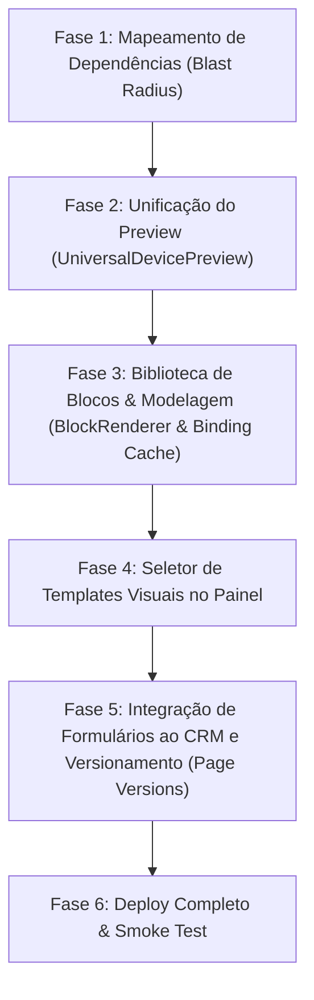

# Auditoria de Builders e Planejamento de Arquitetura — TravelOS v2

## 🕵️ 1. Inventário Detalhado dos Builders Atuais

### 1.1 Construtor de Páginas do Portal Público (Public Portal Builder)
- **Caminho**: [agency.$slug.portal.pages.$page_id.tsx](file:///c:/Users/Eduardo%20Ant%C3%B4nio%20Ramo/Music/travelagencias/src/routes/agency.$slug.portal.pages.$page_id.tsx)
- **Tabela do Banco**: `portal_pages`
- **Comportamento & Preview**:
  - Renderiza um canvas central dentro de um [IframeSandbox.tsx](file:///c:/Users/Eduardo%20Ant%C3%B4nio%20Ramo/Music/travelagencias/src/components/portal/IframeSandbox.tsx) (que cria um portal React em um iframe isolado e injeta as variáveis CSS de design do host).
  - Permite visualizar em Desktop, Tablet ou Mobile.
  - Edição de ordenação via `@dnd-kit/sortable` na barra lateral esquerda.
  - Painel lateral direito dinâmico que renderiza o editor de conteúdo e estilo da seção selecionada ([BlockFormEditors.tsx](file:///c:/Users/Eduardo%20Ant%C3%B4nio%20Ramo/Music/travelagencias/src/components/portal/BlockFormEditors.tsx)).
- **Templates de Página**: 13 templates pré-carregados (de [cms-templates.ts](file:///c:/Users/Eduardo%20Ant%C3%B4nio%20Ramo/Music/travelagencias/src/lib/cms-templates.ts)) divididos em `site` (Landing page de roteiros, Sobre nós, Contato & Suporte, Luxury Boutique Travel, Promo Hub, Portal Corporativo, Aventura LP Premium, Luxury Corporate Hub) e `biolink` (Hopp Clean, Hopp Dark, Hopp Vibrant, Vibrant Dark Glow, Clean Agent Pro).
- **Tipos de Seções (Blocos) Disponíveis**: Mais de 50 tipos diferentes de seções em [NewSectionsRenderer.tsx](file:///c:/Users/Eduardo%20Ant%C3%B4nio%20Ramo/Music/travelagencias/src/components/portal/NewSectionsRenderer.tsx) e [BlockRenderer.tsx](file:///c:/Users/Eduardo%20Ant%C3%B4nio%20Ramo/Music/travelagencias/src/components/portal/BlockRenderer.tsx).

### 1.2 Construtor de App do Cliente (Client App Builder / PWA)
- **Caminho**: [agency.$slug.client-app-builder.tsx](file:///c:/Users/Eduardo%20Ant%C3%B4nio%20Ramo/Music/travelagencias/src/routes/agency.$slug.client-app-builder.tsx)
- **Tabela do Banco**: `client_portal_settings`
- **Comportamento & Preview**:
  - Editor simples que permite ordenar e ocultar/mostrar 4 blocos fixos na Home do passageiro (`hero`, `my_trips`, `store`, `support`) via `DraggableList`.
  - Permite configurar a cor primária e de fundo do tema visual.
  - Preview estático simplificado no lado direito (`DevicePreview` e `DeviceSelector`) sem usar iframe sandbox (HTML/CSS simulado direto).

---

## 🛠️ 2. Diagnóstico de Pontos Críticos e Quebras Silenciosas

1. **Fragmentação de Preview**:
   - O construtor de páginas do portal usa `IframeSandbox` com portal React, o que isola estilos do host e garante renderização limpa.
   - O construtor do app do passageiro usa renderização inline com CSS regular, correndo o risco de vazamento de estilos ou incompatibilidade com o layout real do PWA do cliente.
2. **Duplicação de Código em Formulários e Inputs**:
   - Cada tipo de bloco nos construtores possui suas próprias validações e inputs de texto, upload de mídia, e seletores.
   - Não há reutilização de bibliotecas de formulário integradas de forma consistente (alguns usam Tiptap, outros textarea simples).
3. **Bindings de Dados Frágeis**:
   - O `BoundBlockWrapper` em `BlockRenderer.tsx` faz fetch direto do Supabase (`group_tours`) a cada render de bloco com binding. Não há cache centralizado, o que pode gerar loops de requisições se houver rerenderizações consecutivas na UI.
4. **Ausência de Templates de Sites Completos Selecionáveis**:
   - O usuário precisa selecionar um template ao criar uma nova página, mas não há visualização visual prévia rápida do template ou possibilidade de aplicar templates em páginas existentes de forma intuitiva sem perda de dados históricos.
5. **Drag and Drop Limitado**:
   - O DnD atual de camadas é uma lista vertical simples na barra lateral. Não há DnD direto visual sobre o Canvas de preview (não dá para arrastar um bloco diretamente sobre o preview do iframe para reordená-lo).

---

## 🎨 3. Proposta de Arquitetura da "Grande Biblioteca de Blocos e Templates"

### 3.1 Biblioteca Universal de Componentes de Preview (Canvas e Viewport)
Unificar a visualização em um único `<UniversalDevicePreview>` que:
- Encapsula o `IframeSandbox` para qualquer contexto (seja portal público, biolink ou app do cliente).
- Sincroniza em tempo real as CSS Custom Properties configuradas nos builders com o document element do iframe.

### 3.2 Seções e Blocos Dinâmicos Vinculados a Templates Prontos
Criar uma estrutura de metadados robusta em `src/lib/cms-templates.ts` e exportar `PageTemplate` para o editor. Adicionar um seletor visual na barra lateral ("Templates") que mostra miniaturas ou previews em cards de cada layout disponível.

---

## 🚀 PLANEJAMENTO EM FASES PARA REFACTOR (SEGUNDO REGRAS DO PROJETO)

### Fase 1: Mapeamento de Dependências (Blast Radius)
- Identificar todos os locais de uso de `IframeSandbox`, `BlockRenderer`, e `cms-templates`.
- Criar a migration do banco de dados para a tabela `portal_page_versions` e adicionar as colunas do Meta Pixel / marketing a `agencies`.

### Fase 2: Unificação do Preview
- Criar o componente `<UniversalDevicePreview>` na pasta `src/components/portal/`.
- Substituir o mockup simulado do `client-app-builder.tsx` por esse novo preview isolado em iframe, garantindo que as cores customizadas e layouts sejam fiéis à versão mobile final.

### Fase 3: Biblioteca de Blocos & Modelagem (Binding Cache)
- Refatorar o fetch do `BoundBlockWrapper` em `BlockRenderer.tsx` para usar **React Query** (`useQuery(["bound-tour", tourId])`), eliminando chamadas redundantes e loops de renderização catastróficos.
- Mapear e categorizar claramente os blocos para cada tipo de builder (`site`, `biolink`, `document`, `package`).

### Fase 4: Seletor de Templates Visuais
- Criar um painel visual amigável na aba "Templates" da barra lateral esquerda, mostrando ícones, descrições e títulos dos layouts pré-montados.
- Permitir que o usuário aplique um template a uma página vazia com um único clique.

### Fase 5: Integração CRM & Versionamento
- Ajustar o bloco `contact-form` para criar registros na tabela `leads` e `crm_interactions`.
- Garantir que cada salvamento do editor persista o estado anterior em `portal_page_versions` e limite a 20 registros por página para evitar estouro de armazenamento.

### Fase 6: Deploy & Verificação
- Executar typecheck, build de produção, RLS sweep e deploy de backend/frontend seguindo o protocolo supremo.
