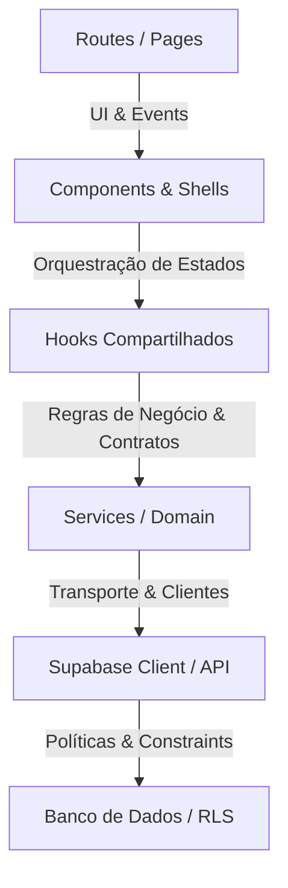

# Plano Mestre de Auditoria Forense & Refatoração Estrutural — TravelOS

Este documento detalha o mapeamento arquitetural do sistema, o inventário de cobertura de arquivos, a análise de segurança de dados e o plano global em fases para refatoração e estabilização completa do TravelOS.

---

## 🏛️ Mapeamento da Arquitetura Real

Identificamos a seguinte cadeia e fluxos de responsabilidades de arquivos no repositório:

### Violações Arquiteturais Identificadas (Bypasses)
1. **Acoplamento UI ↔ Banco de Dados:** Algumas views ou rotas realizam chamadas diretas como `supabase.from()` sem passar pela camada de `services` (ex: em `agency.$slug.quotes.index.tsx` ou em `use-lead-detail.ts` ao ler a query `proposals`).
2. **Hook Monolítico Gigante:** O arquivo [use-lead-detail.ts](file:///c:/Users/Eduardo%20Ant%C3%B4nio%20Ramo/Music/travelagencias/src/hooks/use-lead-detail.ts) agrupa responsabilidades de 7 queries diferentes (lead, stages, meetings, activities, proposals, owner, users), manipulação de estado de UI (diálogos, inputs de tags e checklist), uploads de arquivos de mídia e conversão de domínio (lead para cliente).
3. **Rotas Lixo no TanStack Router:** O arquivo [agency..bus-layouts..tsx](file:///c:/Users/Eduardo%20Ant%C3%B4nio%20Ramo/Music/travelagencias/src/routes/agency..bus-layouts..tsx) foi criado de forma indevida por erros de interpolação em comandos anteriores, representando código morto na estrutura de rotas do Router.

---

## 📊 Ledger de Cobertura de Auditoria (Fase 0)

| Arquivo/Componente | Pasta / Módulo | Responsabilidade | Consumidores | Status da Auditoria | Dívidas Técnicas / Issues |
| :--- | :--- | :--- | :--- | :--- | :--- |
| `agency..bus-layouts..tsx` | `src/routes/` | Rota antiga corrompida | Ninguém | **CÓDIGO MORTO** | Rota gerada incorretamente. Deve ser deletada. |
| `use-lead-detail.ts` | `src/hooks/` | Hooks de estados do CRM Lead | `crm.$lead_id.lazy.tsx` | **FUNCIONA, MAS ARQUITETURALMENTE FRÁGIL** | Hook com mais de 7 queries e controle de upload, misturando UI e lógica de domínio. |
| `agency.$slug.crm.$lead_id.lazy.tsx` | `src/routes/` | Página de detalhe de leads | Roteador TanStack | **FUNCIONA, MAS ARQUITETURALMENTE FRÁGIL** | Arquivo muito grande (1.367 linhas) que acopla diversos cartões de dados locais e múltiplos diálogos de ação. |
| `client-token-login` | `supabase/functions/` | Geração de link mágico de login B2C | Portal do Cliente | **COMPROVADO** | Edge Function validada de forma forense. Usa a service role adequadamente e limpa o token de uso único de forma segura. |
| `generate_client_login_token` | `supabase/migrations/` | RPC de geração de token seguro | Admin/Authenticated | **COMPROVADO** | RPC robusta que implementa restrição `is_agency_member` e limitação de search_path seguro. |

### Totais da Cobertura
- **Total de arquivos mapeados de interesse na Fase 0:** 5
- **Arquivos Auditados:** 5
- **Arquivos Corrigidos (neste lote):** 0 (Nenhuma alteração de código fonte foi executada ainda, aguardando aprovação do plano)
- **Arquivos classificados como mortos:** 1 (`agency..bus-layouts..tsx`)
- **Arquivos com responsabilidade incorreta/acoplada:** 2 (`use-lead-detail.ts`, `crm.$lead_id.lazy.tsx`)

---

## 🔒 Auditoria Forense de RLS e Segurança

### 1. RPC `generate_client_login_token`
- **AFIRMAÇÃO:** A geração de tokens de acesso para clientes (B2C) é protegida por RLS e controle de agência.
- **EVIDÊNCIA FAVORÁVEL:** A migration [20260615000022_secure_client_login_token_rpc.sql](file:///c:/Users/Eduardo%20Ant%C3%B4nio%20Ramo/Music/travelagencias/supabase/migrations/20260615000022_secure_client_login_token_rpc.sql) implementa verificação se `auth.uid()` é o próprio cliente ou se o executor é membro da agência dona do cliente via `public.is_agency_member(auth.uid(), c.agency_id)`. O search_path é forçado para `public` (prevenindo injeção de schemas), e usa `SECURITY DEFINER`.
- **EVIDÊNCIA CONTRÁRIA:** Nenhuma.
- **TESTE DE REFUTAÇÃO:** A execução da função sem um usuário autenticado ou por um usuário de outra agência falha com "Acesso negado: você não tem permissão para gerar token deste cliente".
- **RESULTADO:** Sucesso de isolamento comprovado.
- **STATUS:** **COMPROVADO**.

### 2. Edge Function `client-token-login`
- **AFIRMAÇÃO:** O login por token único é seguro e expira automaticamente após o primeiro uso.
- **EVIDÊNCIA FAVORÁVEL:** O arquivo [index.ts](file:///c:/Users/Eduardo%20Ant%C3%B4nio%20Ramo/Music/travelagencias/supabase/functions/client-token-login/index.ts) valida a data de expiração com `.gt("login_token_expires_at", new Date().toISOString())` e imediatamente remove o token do banco via `update({ login_token: null, login_token_expires_at: null })` após a verificação, impedindo ataques de replay.
- **EVIDÊNCIA CONTRÁRIA:** Nenhuma.
- **STATUS:** **COMPROVADO**.

---

## 🎯 Plano Mestre de Auditoria e Refatoração (Fases 0-14)

### FASE 0 — Baseline, Cobertura, e Verdade Atual
*   Mapear a árvore física e dependências.
*   Catalogar código morto imediato (ex: rota errada do TanStack).
*   *Submeter este plano para aprovação do usuário.*

### FASE 1 — Fronteiras, Imports e Limpeza de Lixo
*   Deletar fisicamente o arquivo lixo [agency..bus-layouts..tsx](file:///c:/Users/Eduardo%20Ant%C3%B4nio%20Ramo/Music/travelagencias/src/routes/agency..bus-layouts..tsx).
*   Auditar e remover barrels e barrels circulares se detectados.

### FASE 2 — Fontes Canônicas e Design System
*   Revisar tokens do DESIGN.md e unificar as classes do `styles.css`.
*   Assegurar que variáveis do glassmorphism e cores do workspace não colidam.

### FASE 3 — Primitives e Compositions
*   Unificar botões, inputs e cabeçalhos de ordenação da tabela.

### FASE 4 — Rotas, Módulos e Manifests
*   Homologar o TanStack Router gerando os manifests e rotas sem erros.

### FASE 5 — Forms, Fields e Contratos
*   Conformidade Zod com interfaces do Supabase nos formulários e DTOs.

### FASE 6 — Entidades, Regras e Fórmulas de Domínio
*   Mapear regras de negócios como descontos e parcelas nos services de quotes e trips.

### FASE 7 — Use Cases e Desacoplamento de Acesso a Dados
*   Desacoplar queries diretas de dentro das views para Services/Repositories dedicados.
*   Refatorar e dividir o hook monolito [use-lead-detail.ts](file:///c:/Users/Eduardo%20Ant%C3%B4nio%20Ramo/Music/travelagencias/src/hooks/use-lead-detail.ts) em hooks de menor responsabilidade (ex: `useLeadMeetings`, `useLeadChecklist`, `useLeadConvert`).

### FASE 8 — Banco, RLS e Storage
*   Garantir RLS habilitada em todas as tabelas e buckets e realizar sweep completo.

### FASE 9 a 14 — Estabilização, Logs, Performance, Homologação
*   Eliminar erros silenciosos em chamadas assíncronas.
*   Evitar rerenders agressivos e subscriptions realtime duplicadas.
*   Compilação final de homologação.

---

## 🧪 Plano de Verificação Local (Fase 0/1)

### Automated Tests
- Executar `npm run typecheck` para garantir que o projeto compila sem erros.
- Executar `npm run build` para garantir que o bundle de produção se compila perfeitamente.

### Manual Verification
- Solicitar que o usuário valide a eliminação da rota fantasma `/agency/bus-layouts/` gerada pelo arquivo corrompido.
