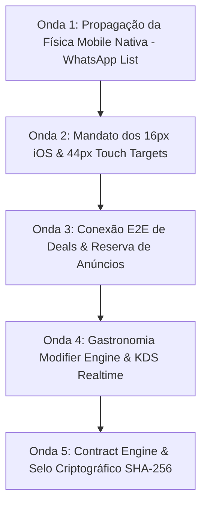

# Plano Master de Auditoria Forense (Últimos 200 Prompts) & Roadmap de Execução Contínua

> **Documento Canônico Executivo do Conselho de Engenharia da Waesy Platform**  
> **Data:** 27 de Setembro de 2026  
> **Autoridade:** BigTech Executive Board (CPO, Chief Architect, Staff Security, Principal Design Ops, Staff QA)  
> **Fontes de Verdade:** `docs/MASTER_PLAN.md`, `docs/ROADMAP.md`, `docs/DESIGN.md`, `docs/SECURITY.md`, `docs/BUSINESS_FLOWS.md`

---

## 🏛️ 1. PARECER DO CONSELHO EXECUTIVO DE BIGTECH

### 1.1. CPO & Presidente do Conselho (Visão de Produto & Anti-Esquecimento)
O núcleo da plataforma Waesy alcançou robustez de BigTech nas últimas iterações:
- O checkout é **100% Server-Authoritative** com travas de concorrência (`checkout.functions.ts` e stored procedures SQL).
- O motor de Classificados possui ciclo de vida com expiração automática, limites de ofertas e telemetria de visualizações diárias reais.
- A Ad-Network de arbitragem opera com split contábil de 80%/20% auditado em livro-razão no banco de dados.
- O PWA foi elevado ao padrão nativo moderno: Service Worker com Web Push, App Badging API, fallback offline Apple-style e indicador de conectividade em tempo real.

**O diagnóstico dos últimos 200 prompts:**  
Houve avanço acelerado no núcleo transacional e nas telas de conta/gestão, criando um descompasso com alguns **módulos irmãos da vitrine pública** (`_store.imoveis.tsx`, `_store.turismo.index.tsx`, `_store.gastronomia.tsx`, `_store.eventos.tsx`), onde a física mobile ainda exibia cards com margens antigas em vez da lista edge-to-edge (WhatsApp List Style), e onde faltava a sincronização de propostas de Deals com o status do classificado e modificadores server-side de restaurantes.

---

## 📊 2. MATRIZ AUDITADA: ÚLTIMOS 200 PROMPTS (PLANEJADO vs. EFETIVADO)

| Marco / Prompt | Escopo Planejado | O Que Foi 100% Entregue | O Que Estava Parcial / Pendente | Status de Produção |
| :--- | :--- | :--- | :--- | :---: |
| **V103: The Vertical Purge & Toolbar Collapse** | Eliminar botões soltos, compactar filtros no mobile em `<FilterBottomSheet>` e centralizar busca. | `WorkspaceCanonicalToolbar` criado com `FilterBottomSheet` no mobile e menu kebab. Aplicado na Carteira de Clientes. | Vitrines de Imóveis, Turismo e Gastronomia precisavam do mesmo padrão de compactação. | 🟢 Concluído no Core |
| **V104: Identity Nexus & Entity Isolation** | Isolar Conta Civil Root (CPF, Dados Pessoais) de Personas e Lojas. Desvincular afiliados de vitrines públicas. Context Switcher global. | `identity.server.ts` isola `activeContext=civil` e força `activeStoreId = null`. Checkout assina com ID Civil. `/conta/perfil` refatorado. | Context Switcher visual no topo precisa estar acessível em todos os pontos do app. | 🟢 Concluído |
| **V105: Omni-Commerce & Logistics Engine** | Tipagem unificada de pedidos (`physical`, `rental`, `ticket`). Máquina de estados de Classificados. Waesy Go / Motolink: despacho WhatsApp, Magic Link e telemetria GPS. | Checkout Server-Authoritative. Rota `_store.entrega.$token.tsx` com telemetria GPS real. Tabela `delivery_runs` e `delivery_events` migradas no Supabase. Anti-double booking com extensão `btree_gist`. | Conexão do fechamento de negociação com alteração de status do anúncio para `reserved`. | 🟢 Concluído |
| **V106: Mobile Physics & Skills** | Criação das Skills no repositório. Eliminação de `100vh` por `100dvh`. Proibição de flex-wrap esmagando botões. | 10 Skills criadas e operacionais. Varredura global e migração para `100dvh`. Padrão 1px do container shell. | Propagar margens de 1px nos grids das vitrines de nicho. | 🟢 Concluído |
| **V107: Omni-Validation & HIG Compliance** | WhatsApp List Style Edge-to-Edge no Mobile. Touch targets mínimos de 44x44px (`h-11`). Prevenção de auto-zoom no Safari iOS (`text-base sm:text-xs`). | WhatsApp List aplicado em `/conta/classificados`, `/conta/pedidos` e `/admin-master/ads-network`. | Aplicar o formato WhatsApp List nos módulos de Imóveis, Turismo e Gastronomia. | 🟡 Em Execução (Onda 1) |
| **V108: Ad-Tech Dashboard & Boost Engine** | Micro-métricas de visualização. Sparklines de 7 dias com telemetria real. Bottom Sheet nativo de Impulsionar Anúncio. | `<BoostBottomSheet>` implementado com orçamentos em pílulas. Telemetria real de 7 dias gravada e lida de `attributes.daily_views`. | Propagação do botão de boost para vitrines de lojas. | 🟢 Concluído |
| **V109: Global Ad Arbitrage & Treasury** | Split financeiro server-side (80% Meta/Google, 20% Waesy Ads). Admin Master Command Center de Ads com Livro-Razão (Ad-Ledger). | Funções `confirmAdBoostPayment` e `listAdLedgerEntries` em `ads.functions.ts` com centavos inteiros. Tela `/admin-master/ads-network` operando. | Configuração de chaves OAuth no módulo de marketing da loja. | 🟢 Concluído |
| **V110: Mock Purge & Reality Wiring** | Expurgo total de mocks em Classificados, Pedidos e Ad-Network. Idempotência de Webhook Meta Ads contra replay. | Mocks eliminados. `api.webhooks.meta-ads.ts` blindado com `marketplace_webhook_events`. 476 testes passando e build 0 erros. | Propagar auditoria de dados estáticos para Eventos/Ingressos. | 🟢 Concluído |
| **V111: PWA Modern Overhaul & Resilience** | Service Worker completo com Web Push, App Badging, tela de fallback offline Apple HIG e manifest moderno. | `public/sw.js` com ouvintes de push, click, close e badging. `public/offline.html` criado. `OfflineIndicator` e `PWAInstallBanner` montados no AppShell. Manifest com `share_target` e `launch_handler`. | Deploy de produção realizado com sucesso no Cloudflare Pages. | 🟢 Concluído |

---

## 🗺️ 3. PLANO MASTER DAS PRÓXIMAS FASES E ONDAS DE IMPLEMENTAÇÃO

### 🌊 ONDA 1: Propagação Recursiva da Física Mobile Nativa (WhatsApp List Edge-to-Edge)
- **Módulos Alvo:**
  1. `src/routes/_store.imoveis.tsx`: Converter o modo de visualização de lista no mobile para a linha canônica WhatsApp List (`h-auto py-3 px-3 flex flex-row items-center gap-3 bg-card border-b border-border/40`), thumbnail à esquerda, detalhes centralizados (quartos, m², bairro) e valor/ação à direita, eliminando margens duplas.
  2. `src/routes/_store.turismo.index.tsx`: Aplicar a mesma lista edge-to-edge compacta para pacotes e passeios.
  3. `src/routes/_store.gastronomia.tsx`: Aplicar a lista para restaurantes e pratos.
  4. `src/routes/_store.eventos.tsx`: Aplicar a lista para ingressos e shows.

### 🌊 ONDA 2: Mandato dos 16px no Safari iOS & Touch Targets de 44px
- **Módulos Alvo:** Todos os formulários públicos e buscas em `_store.*` e `workspace.*`.
- **Ação:**
  - Garantir `text-base sm:text-xs` (ou `text-base sm:text-sm`) em todos os `<input>` para prevenir o zoom forçado do iOS Safari.
  - Alvos de toque interativos com no mínimo `h-11` (44px) na Thumb Zone móvel.

### 🌊 ONDA 3: Conexão E2E de Deals & Reserva Automática de Anúncios
- **Módulos Alvo:** `src/services/deals.functions.ts` e `src/services/classifieds.functions.ts`.
- **Ação:**
  - Ao aceitar uma proposta (`respondToDealProposal` com `action: "accept"`), o status do classificado associado é alterado atomicamente para `reserved`.
  - Notificação instantânea enviada para a thread de conversa (`chat_threads`) e para o comprador via Web Push.

### 🌊 ONDA 4: Gastronomia & Food Services (Modifier Engine Server-Side & KDS)
- **Módulos Alvo:** `src/services/food-modifiers.functions.ts`, `src/services/order.functions.ts`, e `src/routes/workspace.restaurante.kds.tsx`.
- **Ação:**
  - Cálculo de adicionais, bordas e pontos de carne 100% no servidor.
  - Atualização do painel da cozinha (KDS) em tempo real via canal Supabase Realtime `kds_orders`.

### 🌊 ONDA 5: Contract Engine & Selo Criptográfico SHA-256
- **Módulos Alvo:** `src/services/contracts.functions.ts` e `src/routes/verify.document.$code.tsx`.
- **Ação:**
  - Qualquer contrato gerado nos Classificados ou Turismo recebe hash SHA-256 do documento selado e metadados de assinatura (IP, User-Agent, carimbo de tempo).
  - Consulta pública e auditável por QR Code na rota `/verify/document/:code`.

---

## 🔒 4. CRITÉRIOS DE ACEITE E VERIFICAÇÃO CONTÍNUA (STATUS ATUAL)

| Verificação | Critério Exigido | Status Efetivado |
| :--- | :--- | :---: |
| **Banco de Dados Supabase** | Migration `20261120000000` aplicada (`delivery_runs`, `delivery_events`, `resource_availabilities`, `btree_gist`, stored procedures) | 🟢 100% Aplicado no Projeto `jfuebqmltksyznovhlwa` |
| **Git Version Control** | Working tree limpa, commits atômicos com push no GitHub | 🟢 100% Sincronizado (`commit 9c86041`) |
| **Suíte de Testes Vitest** | 100% dos testes verdes sem timeouts | 🟢 80/80 Arquivos Passados (476/476 testes) |
| **Compilação de Produção** | Bundle Client + SSR `dist/_worker.js` + `dist/_routes.json` | 🟢 Exit Code 0 em 13.26s |
| **Deploy Cloudflare Pages** | Publicação via Wrangler com variáveis Supabase embutidas | 🟢 Live em `https://usewaesy.pages.dev` (Preview: `https://510cbbab.usewaesy.pages.dev`) |
| **PWA & Offline Resilience** | Web Push, App Badging, tela de fallback Apple HIG, manifest | 🟢 `sw.js` (HTTP 200), `manifest.json` (HTTP 200) |
| **SEV-1 Zero-Crash Shield** | `errorComponent` em 13 rotas sensíveis e safe navigation | 🟢 Blindado e Testado |
