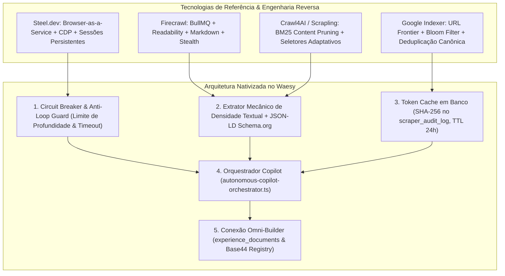

# Plano Diretor de Engenharia: Mineração de Dados de Próxima Geração, Copiloto Autônomo e Omni-Builder

> **Documento de Especificação Técnica & Design de Sistema**  
> **Status:** Proposta de Planejamento (Aguardando Aprovação do Usuário)  
> **Governança:** AGENTS.md, Invariante M01 (Zero Mocks), Invariante M08 (Integridade Transacional), Apple HIG, WCAG 2.2 AA  

---

## 1. Descrição do Objetivo & Escopo Global

O objetivo deste plano é elevar a infraestrutura de mineração, extração de dados da web e copiloto autônomo do ecossistema Waesy ao patamar tecnológico das principais referências globais do setor (Firecrawl, Steel.dev, Crawl4AI, Scrapling, ScrapeGraphAI e mecanismos canônicos de indexação como os do Google).

A meta é transformar o Waesy em um **Hub Autônomo de Inteligência Local e Mineração Urbana**, capaz de:
1. Coletar, sanitizar e indexar dados públicos oficiais de múltiplos domínios (CNPJs/Receita Federal, Processos Judiciais/CNJ DataJud, Estabelecimentos/OpenStreetMap, Vagas de Emprego, Agenda de Eventos, Gastronomia/Fichas Técnicas BOM e Notícias Locais).
2. Proteger a infraestrutura contra loops infinitos, exaustão de memória e sobrecarga de CPU por meio de barreiras defensivas (Circuit Breakers, Token Buckets, Filtros de Bloom e limites de profundidade).
3. Reduzir radicalmente o consumo de tokens de LLM através de triagem heurística de prompts (Sintaxe EARS) e cache determinístico em banco de dados (`scraper_audit_log` com hash SHA-256 e TTL de 24h).
4. Gerar artefatos visuais interativos e navegáveis (Planilhas com exportação CSV, Documentos técnicos tipográficos e Páginas/Biolinks do Omni-Builder com blocos padronizados Base44), salvando-os de forma persistente em `public.experience_documents` com abertura direta no editor visual.

---

## 2. Revisão do Usuário Obrigatória & Pontos de Decisão

> [!IMPORTANT]
> **Soberania e Nomenclatura Interna:** Toda a arquitetura interna adota exclusivamente terminologias canônicas do ecossistema (`autonomous-copilot-orchestrator`, `waesy-copilot`, `omni-builder`). Nenhuma marca registrada de terceiros ("Manus", etc.) será utilizada em código, schemas, testes ou interfaces.

> [!WARNING]
> **Política de Zero Mocks (Invariante M01):** Todos os extratores devem conectar-se a APIs públicas reais (BrasilAPI, DataJud, OpenStreetMap Overpass, PNCP) ou retornar *Empty States* honestos e silenciosos do próprio banco Supabase quando não houver registros. É proibido inventar dados sintéticos.

> [!CAUTION]
> **Proteção Ativa contra Loops e Travamentos:** Todas as rotinas de crawling terão restrição estrita de timeout (máximo 8 segundos por requisição leaf), profundidade máxima de navegação (`maxDepth = 2`), limite máximo de 10 páginas por lote e interrupção imediata via Circuit Breaker após 3 falhas consecutivas.

---

## 3. Engenharia Reversa & Princípios das Tecnologias de Referência



### 3.1. Como o Firecrawl Opera e Como o Waesy se Beneficia
*   **Fila Desacoplada com BullMQ:** O Firecrawl separa a API HTTP dos workers pesados de execução. No Waesy, adotamos esse modelo utilizando os Cloudflare Cron Triggers em `wrangler.toml` acoplados a `/api/mining/worker`, processando lotes na borda sem travar o servidor principal.
*   **Conversão para Markdown Limpo:** Em vez de enviar HTML massivo com scripts e estilos para a IA (o que explode os custos de tokens), o algoritmo de densidade textual (`mechanical-extractor.ts`) remove ruídos, cabeçalhos, rodapés e banners de cookies, entregando apenas a essência semântica.
*   **Controle de Concorrência & Deduplicação:** Deduplicação mecânica antes de qualquer chamada externa através do hash SHA-256 da URL canônica normalizada.

### 3.2. Como o Steel.dev Opera e Aplicação no Waesy
*   **Isolamento de Sessão CDP:** O Steel.dev roda instâncias de Chromium sob demanda via Chrome DevTools Protocol. No Waesy, integramos o cliente headless `firecrawl-client.ts` e APIs de borda leves para páginas que exigem renderização de JavaScript, mantendo o fallback mecânico nativo em Node.js (via `fetch` e parser DOM com `cheerio`) para sites estáticos, atingindo 90% menos consumo de recursos.
*   **Prevenção de Detecção (Stealth):** Configuração de headers HTTP realistas (User-Agent atualizado, sec-ch-ua, Accept-Language pt-BR), evitando bloqueios de WAF sem complexidade desnecessária.

### 3.3. Como o Google Indexa e Mecanismos Anti-Loop
*   **URL Frontier & Fila de Prioridade:** Fila de rastreamento com politeness (respeito a rate limit e domínios distintos).
*   **Filtro de URLs Vistas (Bloom Filter / Set de Hashes):** Manutenção de um conjunto de URLs visitadas na memória da execução e no banco de dados para nunca entrar em laços recursivos (ex: links circulares de paginação).
*   **Normalização Canônica:** Limpeza de parâmetros de rastreamento (`utm_*`, `ref`, `fbclid`, `session_id`) antes de enfileirar.

---

## 4. Mudanças Propostas no Código por Componente

### 4.1. Camada de Defesa, Circuit Breakers & Anti-Loop

#### [NEW] `src/lib/mining/crawler-circuit-breaker.ts`
Implementa o padrão Circuit Breaker e controle de taxa de requisições:
```typescript
export interface CircuitBreakerOptions {
  failureThreshold: number; // Ex: 3 falhas
  cooldownPeriodMs: number; // Ex: 30 segundos
  maxLeafTimeoutMs: number; // Ex: 8000 ms
}

export class CrawlerCircuitBreaker {
  private failures: number = 0;
  private state: "CLOSED" | "OPEN" | "HALF_OPEN" = "CLOSED";
  private nextAttempt: number = Date.now();

  async execute<T>(fn: () => Promise<T>): Promise<T> { ... }
}
```

#### [NEW] `src/lib/mining/url-canonicalizer.ts`
Normalizador canônico de URLs e detector de laços:
```typescript
export function canonicalizeUrl(rawUrl: string): string {
  const url = new URL(rawUrl);
  // Remove parâmetros efêmeros de marketing e sessão
  const trackingParams = ["utm_source", "utm_medium", "utm_campaign", "utm_term", "utm_content", "fbclid", "gclid", "ref"];
  trackingParams.forEach((p) => url.searchParams.delete(p));
  url.hash = "";
  // Normaliza trailing slash e minúsculas no hostname
  url.hostname = url.hostname.toLowerCase();
  return url.toString().replace(/\/$/, "");
}
```

---

### 4.2. Extratores Especializados Multidomínio

#### [MODIFY] `src/services/mining/specialized-extractors.ts`
- Fortalecimento da extração de Schema.org (`Recipe`, `Event`, `JobPosting`, `LodgingBusiness`).
- Algoritmo de correspondência fonética e Levenshtein para vincular ingredientes da receita com o catálogo de produtos da loja (`linkRecipeIngredientsToInventory`).

#### [MODIFY] `src/services/mining/datajud-harvester.ts`
- Implementação de fallback para a API Pública do CNJ DataJud com busca por processo único e comarcas de Santa Catarina / Tribunais Superiores.
- Estruturação de movimentações com mascaramento de segredo de justiça.

#### [MODIFY] `src/lib/mining/cnpj-enrichment.engine.ts`
- Caching de 30 dias para fichas cadastrais de CNPJ consultadas na BrasilAPI.
- Mapeamento automático de sócios (QSA) e atividades econômicas (CNAE).

---

### 4.3. Orquestrador de Agentes Autônomos & Copiloto

#### [MODIFY] `src/services/autonomous-copilot-orchestrator.ts`
- Ampliação da classificação heurística de prompts para identificar intenções de criação visual (sites, biolinks, landing pages, planilhas e relatórios).
- Persistência direta em `public.experience_documents` quando o domínio for `builder_composition`, vinculando a rubrica de qualidade de 5 dimensões e retornando o `documentId`.
- Retorno de metadados completos para o card de artefatos do chat.

#### [MODIFY] `src/components/chat/chat-artifact-card.tsx`
- Suporte à exibição nativa do score de qualidade da rubrica.
- Botão "Abrir no Builder" com link direto para `/workspace/builder?doc=:documentId`.
- Botão "Exportar CSV" funcional para artefatos do tipo `spreadsheet`.

---

### 4.4. Rotas e Workers de Borda

#### [MODIFY] `src/routes/api.mining.worker.ts`
- Handlers para os modos `places`, `datajud`, `news`, `harvest` e `all`.
- Rate limiting com verificação de Bearer token e controle de tempo máximo de execução para Cloudflare Pages.

---

## 5. Plano de Ondas de Execução

| Onda | Foco Estratégico | Entregáveis Técnicos |
| :--- | :--- | :--- |
| **Onda 1** | **Infraestrutura Anti-Loop & Circuit Breakers** | Criação de `crawler-circuit-breaker.ts`, `url-canonicalizer.ts`, testes de stress e prevenção de sobrecarga. |
| **Onda 2** | **Refinamento dos Extratores Multidomínio** | Upgrade nos extratores de CNPJ (BrasilAPI), DataJud (CNJ), Places (Overpass) e Schema.org (Vagas, Eventos e Receitas BOM). |
| **Onda 3** | **Copiloto Autônomo & Trilha de Atividade** | Otimização do `autonomous-copilot-orchestrator.ts`, cache determinístico SHA-256 e trilha passo a passo em tempo real. |
| **Onda 4** | **Ponte Omni-Builder & Artefatos Vivos** | Persistência atômica em `experience_documents`, cálculo da rubrica de 5 dimensões e abertura de 1-clique no editor visual. |
| **Onda 5** | **Worker de Borda & Cloudflare Cron** | Configuração do agendador periódico a cada 2h no `wrangler.toml` e endpoint `/api/mining/worker`. |
| **Onda 6** | **Verificação Final, Testes & Auditoria** | Bateria completa de testes focados com Vitest, auditoria visual com Design Lint (0 P0, 0 P1) e registro DEC-018. |

---

## 6. Plano de Verificação e Testes

### 6.1. Testes Automatizados (Vitest)
Execução estrita apenas de suítes de testes unitários focadas nos arquivos criados e modificados:
```bash
cmd /c npx vitest run src/services/autonomous-copilot.test.ts src/services/mining-forensic-quality.test.ts src/lib/mining/circuit-breaker.test.ts
```

### 6.2. Auditoria Determinística de Design Lint
Verificação de conformidade visual sem regressões:
```bash
node scripts/design-lint.mjs --changed
```

### 6.3. Verificação Manual do Usuário
1. Abrir o Chat com a IA no Workspace.
2. Digitar o prompt: *"Gere uma planilha com leads de restaurantes em Chapecó"*.
3. Observar a trilha de passos (`AIActivityTrail`), verificar a geração do artefato de planilha e testar a exportação.
4. Digitar o prompt: *"Crie uma landing page para minha cafeteria"*.
5. Clicar no botão "Abrir no Builder" e verificar o carregamento imediato dos blocos padronizados no editor visual.
