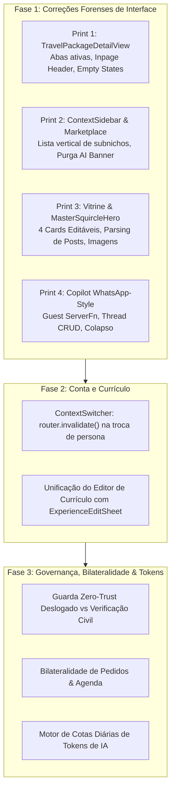

# Plano Diretor de Auditoria, Correção Forense e Evolução All-in-One — Waesy

## 1. Descrição do Objetivo
Auditar profundamente e sanar de ponta a ponta as quebras de interface, falhas de persistência, gaps de fluxo e desconexões identificadas pelo usuário (especialmente nos 4 prints anexados e nos fluxos de conta, currículo, marketplace, vitrine e copilot), estabelecendo simultaneamente as regras centrais de negócio:
1. **Governança Estrita de Visitante vs Civil**: Visitante deslogado possui acesso estritamente somente-leitura; qualquer ação transacional, comentário, inserção ou edição é interceptada por modal/redirecionamento de login. Usuário civil autenticado requer verificação facial/documental aprovada pelo Master Admin para transações financeiras e contratos.
2. **Correção Forense dos 4 Prints do Usuário**:
   - **Print 1 (`/produto/resort-ilheus`)**: Correção das 4 abas (Destino, Hospedagem, Roteiro, Voos e Mapa) para alternância real de conteúdo sem travas, erradicação do "0 inclusões" fantasma com empty-state honesto, e eliminação do gap/espaço da header (no desktop a navegação de produto é inpage limpa e alinhada ao container).
   - **Print 2 (`/marketplace`)**: Transformação da grade truncada de subnichos da sidebar (`grid-cols-2`) em formato lista vertical legível (`flex-col`) com ícones e rótulos integrais sem reticências (`Comida`, `Mercado`, `Farmácia`), e purga de banners conversacionais prolixos de IA ("Marketplace 100% Verificado").
   - **Print 3 (`waesy.com.br`)**: Correção da seção de posts do feed na vitrine (parsing de tags `==destaque==`, renderização de data relativa real via `formatRelativeTime`, avatar do autor e fallback seguro contra imagens quebradas), e expansão dos botões herói do topo de 2 para 4 cards mestres totalmente editáveis (Mercado, Restaurantes, Mobilidade [reativação do módulo], Serviços) com suporte a imagem de fundo, título visível/oculto e sombra.
   - **Print 4 (`/copilot`)**: Redesenho do Copilot em estética WhatsApp profissional minimalista, implementação de Server Function pública para permitir envio por convidados/anônimos sem exceções de client, CRUD completo de threads (criar, renomear, fixar, apagar/excluir), colapso fluido do painel lateral de contexto/artefatos e envio reativo de mensagens.
3. **Saneamento da Área de Conta e Alternador de Perfis**:
   - Correção do `ContextSwitcher` e dos botões de conta para injetar `router.invalidate()` na alternância de personas (Civil, Criador, Loja), garantindo reatividade instantânea dos loaders.
   - Unificação do Editor de Currículo (`/conta/curriculo` e `/conta/perfil?tab=profissional`) para eliminar o formulário simplificado quebrado e garantir funcionamento robusto do botão "Adicionar experiência".
4. **Bilateralidade Transacional Completa**:
   - Agendamento de serviço cria registro sincronizado na agenda pessoal do cliente e na agenda do prestador.
   - Pedido no marketplace/anúncio gera registro de pedido e telemetria para comprador e vendedor.
5. **Motor de Cotas Diárias de Tokens de IA**:
   - Consultas locais de descoberta e notícias são isentas de tokens.
   - Mineração de CNPJs, geração de documentos (PDF, planilhas, apresentações) e builders visuais consom cota diária de tokens com contabilidade transparente no perfil civil.

---

## 2. User Review Required

> [!IMPORTANT]
> **Substituição de Headers Flutuantes em Desktop**:
> Identificamos que diversas páginas internas (produtos de turismo, currículo, pedidos) continham cabeçalhos fixos com `sticky top-0` redundantes que conflitam com a `TopBar` global, gerando o espaço/gap visível no Print 1. No desktop, esses cabeçalhos passarão a ser estritamente *inpage* (alinhados ao fluxo natural da página), reservando cabeçalhos fixos simplificados apenas para a experiência mobile compacta (`< 600px`).

> [!WARNING]
> **Bloqueio de Ações para Usuários Deslogados**:
> Visitantes sem sessão ativa serão impedidos de interagir (curtir, comentar, publicar, negociar, reservar ou agendar). O clique abrirá diretamente o diálogo/modal de autenticação civil rápida com retorno preservado para a URL de origem (`returnUrl`).

---

## 3. Open Questions

> [!NOTE]
> 1. Para os 4 cards herói do topo da vitrine (Mercado, Restaurantes, Mobilidade, Serviços), devemos inicializar com imagens fotográficas de alta qualidade do acervo local da plataforma como padrão caso o admin ainda não tenha feito upload personalizado?
> 2. No módulo de mobilidade, a reativação da rota `/mobilidade` deve integrar com os serviços de motoristas/entregadores MotoLink já mapeados no BFF?

---

## 4. Proposed Changes



---

### Componente 1: Correção do Módulo de Turismo & Detalhe de Produto (Print 1)

#### [MODIFY] `src/components/commerce/travel/travel-package-detail-view.tsx`
- **Abas**: Garantir que as 4 abas alternem o estado `activeTab` ("destination" | "resort" | "itinerary" | "explore") com fallbacks honestos para pacotes que possuam dados parciais.
- **Inclusões**: Se `inclusions.length === 0`, exibir empty-state honesto ("Itens inclusos sob consulta com a agência") em vez de `0 inclusões`.
- **Header**: Remover `sticky top-0` redundante no desktop (`hidden md:hidden` para a sticky bar flutuante, ou convertê-la em tab-bar inpage integrada ao container sem paddings divergentes).

#### [MODIFY] `src/routes/_store.produto.$slug.tsx`
- Remover o bloco duplicado e inalcançável de `TravelPackageDetailView` nas linhas 879-895.
- Ajustar o container de turismo para sangrar até o topo quando renderizado, sem adicionar espaçamentos `md:py-3` duplicados.

---

### Componente 2: Correção da Sidebar do Marketplace e Banner Conversacional (Print 2)

#### [MODIFY] `src/components/shell/context-sidebar.tsx`
- Alterar o container dos subnichos de `grid grid-cols-2 gap-1` para lista vertical `flex flex-col space-y-1` com `h-8 px-2.5`, permitindo leitura integral dos rótulos ("Comida", "Mercado", "Farmácia", "Construção", "Imóveis", etc.) sem truncamento.

#### [MODIFY] `src/routes/_store.marketplace.index.tsx`
- Erradicar o banner conversacional estático "Marketplace 100% Verificado — Garantia B2C" (linhas 299-329) para limpar a tela e dar primazia imediata aos produtos e vitrines autênticas.

---

### Componente 3: Vitrine Principal, 4 Cards Editáveis e Posts do Feed (Print 3)

#### [MODIFY] `src/components/commerce/master-squircle-hero.tsx`
- Expandir de 2 para 4 cards mestres:
  1. **Mercado & Supermercados** (`to: "/marketplace?category=mercado"`)
  2. **Restaurantes & Delivery** (`to: "/marketplace?category=gastronomia"`)
  3. **Mobilidade Urbana** (`to: "/mobilidade"`)
  4. **Serviços Especializados** (`to: "/servicos"`)
- Suportar customização pelo Admin Master via `hotpages`: imagem de fundo (`bg_media_url`), opacidade de overlay, título visível/oculto, sombra customizável e texto do botão.

#### [MODIFY] `src/routes/_store.index.tsx`
- Na seção de posts do Feed:
  - Sanitizar e renderizar o texto formatado expurgando as marcas brutas `==destaque==`.
  - Exibir data relativa real através de `formatRelativeTime(post.created_at)`.
  - Inserir tratamento de erro em imagens de posts (`onError={(e) => { e.currentTarget.style.display = 'none'; }}`) para evitar ícones de imagem quebrada.

---

### Componente 4: Waesy Copilot WhatsApp-Style & Guest Pipeline (Print 4)

#### [MODIFY] `src/services/ai-conversations.functions.ts`
- Criar a Server Function pública `executeGuestCopilotMessage = createServerFn({ method: "POST" })` para processar mensagens de usuários deslogados ou convidados sem exigir autenticação no banco, retornando o ciclo completo do Copilot.
- Implementar `deleteAiConversationThread = createServerFn({ method: "POST" })` para exclusão de conversas/projetos.

#### [MODIFY] `src/components/chat/ai-chat-shell.tsx` & `src/routes/_store.copilot.tsx`
- Redesenhar a interface do Copilot com estética WhatsApp moderna e minimalista:
  - Barra de conversas com botão de excluir/apagar thread (`Trash2`).
  - Bolhas de mensagem limpas com estados de entrega.
  - Painel lateral de contexto colapsável suavemente via botão de fácil acesso.
  - Input composer 100% reativo com suporte a envio imediato.

---

### Componente 5: Área de Conta, Alternador de Perfis e Editor de Currículo

#### [MODIFY] `src/components/profile/context-switcher.tsx`
- Injetar `router.invalidate()` em `handleSwitchToCivil`, `handleSwitchToCreator` e `handleSwitchToStore` para recarregar instantaneamente o estado da aplicação sem exigir refresh manual de página.

#### [MODIFY] `src/routes/_store.conta.curriculo.tsx`
- Sincronizar o editor de currículo com as primitivas ricas de `ProfessionalResumeEditor` e blindar o gerador de UUIDs com fallback seguro (`crypto.randomUUID?.() || Date.now()`).

---

### Componente 6: Governança Civil, Bilateralidade e Cotas de Tokens

#### [NEW] `src/lib/auth/unauthenticated-guard.ts`
- Utilitário defensivo cliente e servidor que intercepta tentativas de ações ativas por usuários não logados, abrindo modal de login com preservação de intenção.

#### [NEW] `src/services/token-quota.functions.ts`
- Controle diário de cota de tokens por perfil civil no Supabase:
  - Isenção total para buscas de lugares e leitura de notícias.
  - Débito calibrado para extração de listas de CNPJs, geração de documentos (PDF/XLSX) e builders de sites.

---

## 5. Verification Plan

### Automated Tests
```powershell
# 1. Executar testes unitários do chat copilot e rotas
cmd /c npx vitest run src/services/copilot-fsm.test.ts src/services/autonomous-copilot.test.ts

# 2. Executar testes de compatibilidade de rotas
cmd /c npx vitest run src/routes/store-route-loaders.test.ts

# 3. Executar design-lint determinístico
node scripts/design-lint.mjs --changed
```

### Manual Verification
1. Acessar `/produto/resort-ilheus`: verificar navegação instantânea entre as abas (Destino, Hospedagem, Roteiro, Voos e Mapa) e ausência de header flutuante quebrada no desktop.
2. Acessar `/marketplace`: confirmar que o submenu de nichos da sidebar é exibido em lista vertical legível sem títulos cortados, e ausência de banners conversacionais prolixos.
3. Acessar a home `/`: verificar os 4 cards mestres do topo (Mercado, Restaurantes, Mobilidade, Serviços) e conferir posts do feed com datas relativas e formatação limpa sem `==destaque==`.
4. Acessar `/copilot`: enviar mensagem como visitante e como usuário logado, verificar resposta do assistente, testar exclusão de conversa e colapso do painel lateral.
5. Acessar `/conta`: alternar perfis no ContextSwitcher e verificar atualização instantânea da interface.
