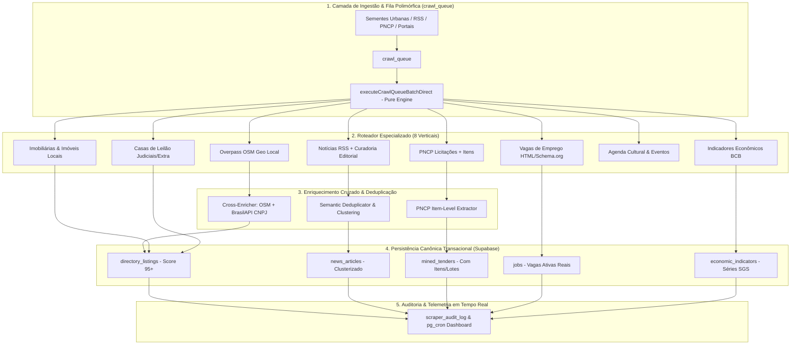

# Plano de Implementação: Industrialização, Otimização e Expansão dos Crawlers & Mineradores Urbanos

## Descrição do Objetivo & Arquitetura Alvo

Transformar a infraestrutura de mineração e crawlers urbanos da Waesy em um **motor industrial autônomo, desacoplado e de alta performance**, expandindo a cobertura para 8 tipos polimórficos de entidades (`news`, `jobs`, `places`, `tenders`, `real_estate`, `auctions`, `events`, `ecommerce`), implementando **enriquecimento cruzado de dados** (OpenStreetMap + BrasilAPI CNPJ), **extração em profundidade de itens de licitação do PNCP**, **clusterização semântica anti-duplicatas** e **desacoplamento total de runtime** para execução sem atrito via `pg_cron`, webhooks de borda e CLI.



---

## User Review Required

> [!IMPORTANT]
> **Desacoplamento do Runtime TanStack Start (`createServerFn`):**
> O processamento em lote da fila (`processCrawlQueueBatch`) atualmente encapsula a lógica de negócio dentro de `createServerFn`. Quando chamado fora de requisições HTTP (por exemplo, por scripts de cron, testes locais ou workers do Cloudflare), o TanStack Start emite `Error: No Start context found in AsyncLocalStorage`.
> **Decisão Proposta:** Extrair toda a lógica para uma função assíncrona pura `executeCrawlQueueBatchDirect` em `src/services/mining/crawler-batch-engine.ts`, mantendo `processCrawlQueueBatch` como um adapter leve. Isso garante 100% de compatibilidade tanto para chamadas de frontend quanto para rotinas de background.

> [!WARNING]
> **Taxa de Requisições na BrasilAPI & Overpass OSM:**
> O cruzamento mecânico entre nós geográficos do OpenStreetMap e dados corporativos da BrasilAPI deve respeitar limites de taxa (rate limiting de 3 requisições/segundo e backoff exponencial com jitter) para evitar bloqueio de IP. O motor implementará filas com delay adaptativo entre requisições.

---

## Open Questions

> [!NOTE]
> **Política de Retenção de Editais Encerrados:**
> Editais do PNCP cuja data de encerramento (`closing_date`) já expirou devem ser marcados como `status: 'closed'` ou arquivados após 90 dias?
> *(Recomendado: manter no histórico com status `'closed'` para alimentar inteligência de mercado e preços médios de contratação pública em Chapecó).*

---

## Mudanças Propostas no Código & Banco de Dados

```
├── supabase/migrations/
│   └── [NEW] 20270102000000_crawler_industrialization_indexes.sql
├── src/services/mining/
│   ├── [NEW] crawler-batch-engine.ts
│   ├── [NEW] places-cnpj-cross-enricher.ts
│   ├── [NEW] semantic-deduplicator.ts
│   ├── [NEW] real-estate-harvester.ts
│   ├── [NEW] auction-harvester.ts
│   ├── [MODIFY] pncp-extractor.ts
│   ├── [MODIFY] pncp-harvester.ts
│   └── [NEW] industrial-crawlers.test.ts
├── src/services/
│   └── [MODIFY] mining.functions.ts
└── scripts/
    └── [MODIFY] run_miners_benchmark.ts
```

---

### Componente 1: Desacoplamento do Motor & Roteamento Polimórfico de 8 Verticais

#### [NEW] `src/services/mining/crawler-batch-engine.ts`
- Função pura `executeCrawlQueueBatchDirect(options)` sem acoplamento a contexto de servidor HTTP.
- Roteador com suporte completo às 8 entidades:
  1. `jobs_portal` / `job` -> `job-opportunity-extractor.ts`
  2. `places` / `directory` -> `places-harvester.ts`
  3. `tenders` / `licitacao` -> `pncp-harvester.ts`
  4. `real_estate` / `imoveis` -> `real-estate-harvester.ts` [NOVO]
  5. `auctions` / `leiloes` -> `auction-harvester.ts` [NOVO]
  6. `events` / `agenda` -> `specialized-extractors.ts` (`extractEventFromJsonLd`)
  7. `news` / `rss` -> `mechanical-extractor.ts` + `editorial-squad.ts`
  8. `ecommerce` / `products` -> `specialized-extractors.ts` / `mined_products`
- Gravação transacional com status `completed` ou `failed` e atualização do `retry_count`.

#### [MODIFY] `src/services/mining.functions.ts`
- Atualizar `processCrawlQueueBatch` para atuar como proxy tipado para `executeCrawlQueueBatchDirect`.
- Atualizar `dispatchScheduledMiningJobFn` na branch `continuous-crawler` para chamar `executeCrawlQueueBatchDirect` diretamente, eliminando o erro de `AsyncLocalStorage`.

```ts
// Exemplo de refatoração em mining.functions.ts:
import { executeCrawlQueueBatchDirect, type CrawlBatchOptions, type CrawlBatchResult } from "./mining/crawler-batch-engine";

export const processCrawlQueueBatch = createServerFn({ method: "POST" })
  .validator(crawlBatchOptionsSchema)
  .handler(async ({ data }): Promise<CrawlBatchResult> => {
    return executeCrawlQueueBatchDirect(data);
  });
```

---

### Componente 2: Extratores Especializados para Entidades Pendentes na Fila

#### [NEW] `src/services/mining/real-estate-harvester.ts`
- Processa os 6 itens pendentes na fila (`chapecoimoveis.com.br`, `nostracasa.com.br`, `plazaimoveis.com.br`, `imobiliariasantamaria.com.br`, etc.).
- Extrai metadados da imobiliária (nome, telefone, endereço, especialidades, tipos de imóveis atendidos).
- Registra a empresa em `directory_listings` com `category: 'imobiliaria'`, `city: 'Chapecó'`, `state: 'SC'`.
- Registra a extração bruta em `mined_raw_extractions` com `content_type: 'empresas'`.

#### [NEW] `src/services/mining/auction-harvester.ts`
- Processa os 8 itens pendentes na fila (`baldisserapregoeiro.com.br`, `superbid.net`, `megaleiloes.com.br`, `centralsuldeleiloes.com.br`, etc.).
- Extrai dados da leiloeira (nome comercial, tipo de leilão judicial/extrajudicial, comarca de atuação, site oficial).
- Registra a leiloeira em `directory_listings` com `category: 'leiloes'`, `city: 'Chapecó'`.
- Salva o payload completo em `mined_raw_extractions` com `content_type: 'portais_publicos'`.

---

### Componente 3: Enriquecimento Cruzado (Overpass OSM + BrasilAPI CNPJ)

#### [NEW] `src/services/mining/places-cnpj-cross-enricher.ts`
- Função `enrichDirectoryListingsWithCnpj(options: { city?: string; limit?: number })`.
- Varre estabelecimentos em `directory_listings` que possuem geolocalização e nome, mas não possuem CNPJ (`cnpj IS NULL`).
- Consulta a BrasilAPI buscando por nome e município de Chapecó.
- Ao encontrar correspondência de alta confiança (score >= 80%):
  - Preenche `cnpj`, `cnae`, `contact_phone`, `contact_email`, `address`.
  - Adiciona sócios, capital social e CNAEs secundários no `metadata`.
  - Eleva o `data_quality_score` de 70 para 95.
  - Registra a telemetria em `scraper_audit_log`.

---

### Componente 4: Extração Profunda de Itens e Lotes de Editais do PNCP

#### [MODIFY] `src/services/mining/pncp-extractor.ts` & `pncp-harvester.ts`
- Adicionar função `fetchPncpContractItems(cnpj: string, ano: number, sequencial: number)`:
  - Consulta o endpoint oficial: `https://pncp.gov.br/api/consulta/v1/contratacoes/publicacao/{cnpj}/{ano}/{sequencial}/itens`.
  - Extrai lista de itens: número do item, descrição detalhada, quantidade, unidade de medida, valor unitário estimado e valor total.
- Gravar o detalhamento dos itens em `mined_tenders.ai_curated_digest.items`, permitindo que empresários e fornecedores locais pesquisem exatamente o que a Prefeitura está comprando (ex: "computador", "leite", "pneu", "asfalto").

---

### Componente 5: Clusterização Semântica Anti-Duplicatas de Notícias

#### [NEW] `src/services/mining/semantic-deduplicator.ts`
- Função `findArticleCluster(title: string, publishedAt: string)`:
  - Normaliza o título eliminando stopwords e pontuações.
  - Compara a similaridade de tokens com notícias publicadas nas últimas 24 horas.
  - Se similaridade >= 0.65 (Jaccard token match), associa ao mesmo `cluster_id`.
  - Permite agrupar diferentes coberturas jornalísticas do mesmo acontecimento na cidade em uma única história multimodal.

---

### Componente 6: Migrações SQL & Índices de Alta Performance

#### [NEW] `supabase/migrations/20270102000000_crawler_industrialization_indexes.sql`
- Índices otimizados para busca e ordenação nos mineradores:
  ```sql
  -- Índices para Licitações PNCP
  CREATE INDEX IF NOT EXISTS idx_mined_tenders_city_date ON public.mined_tenders (city, publication_date DESC);
  CREATE INDEX IF NOT EXISTS idx_mined_tenders_agency_cnpj ON public.mined_tenders (agency_cnpj);
  CREATE INDEX IF NOT EXISTS idx_mined_tenders_modality ON public.mined_tenders (modality);

  -- Índices para Diretório e Estabelecimentos
  CREATE INDEX IF NOT EXISTS idx_directory_listings_cat_city ON public.directory_listings (category, city) WHERE status = 'active';
  CREATE INDEX IF NOT EXISTS idx_directory_listings_cnpj ON public.directory_listings (cnpj) WHERE cnpj IS NOT NULL;

  -- Índices para Vagas de Emprego
  CREATE INDEX IF NOT EXISTS idx_jobs_status_created ON public.jobs (status, created_at DESC);
  CREATE INDEX IF NOT EXISTS idx_jobs_category ON public.jobs (category);

  -- Índices para Fila de Crawling
  CREATE INDEX IF NOT EXISTS idx_crawl_queue_status_prio ON public.crawl_queue (status, priority DESC, created_at ASC);
  ```

---

## Plano de Verificação

### Testes Automatizados (Vitest)
Execução da suíte completa de testes de integração mecânica:
```bash
cmd.exe /c "npx vitest run src/services/mining/industrial-crawlers.test.ts"
cmd.exe /c "npx vitest run src/services/mining/pncp-and-indicators.test.ts"
cmd.exe /c "npx vitest run src/services/mining-forensic-quality.test.ts"
```

### Execução de Verificação do Benchmark ao Vivo
Disparo da bateria de benchmark para validar os 6 mineradores + as 2 novas verticais (`real_estate` e `auctions`):
```bash
cmd.exe /c "npx tsx scripts/run_miners_benchmark.ts"
```

### Inspeção Transacional no Banco de Dados
Validação via queries SQL para comprovar:
1. Zero itens órfãos com erro de `AsyncLocalStorage`.
2. Diminuição da fila pendente de `real_estate` e `auctions` em `crawl_queue`.
3. Presença de itens detalhados nos editais do PNCP.
4. Enriquecimento de CNPJ em estabelecimentos do `directory_listings`.
