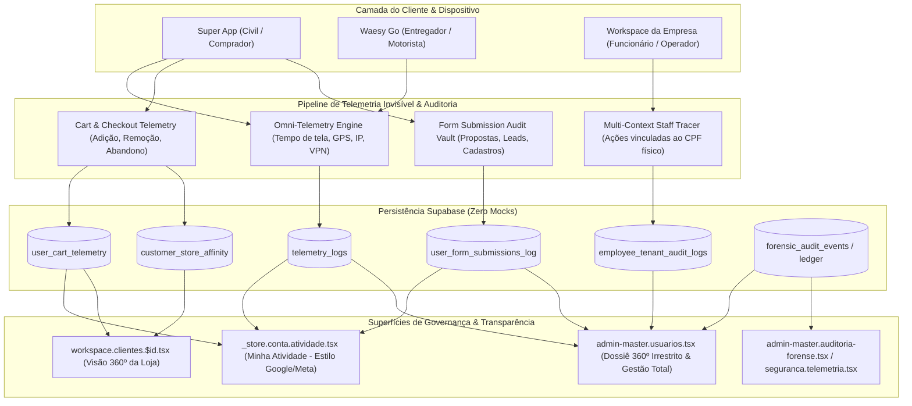

# Plano de Implementação Industrial — Governança Master 360º, Telemetria Invisível & Auditoria Irrestrita

## 1. Visão Geral e Arquitetura do Sistema
Este plano estabelece a infraestrutura integral de **Governança 360º, Telemetria Forense em Tempo Real, Rastreamento Multi-Contexto de Operadores e Centro de Controle Irrestrito do Master Admin** para o ecossistema Waesy. 

O sistema erradica pontos cegos operacionais e transforma toda interação (navegação segundo a segundo, formulários preenchidos, telemetria de carrinhos abandonados, rotas e paradas de GPS em mobilidade/frete, acessos corporativos por funcionários e assinaturas digitais) em **registros imutáveis auditáveis** com conciliação bilateral entre o cliente civil, a loja parceira e o Master Admin.

---

## 2. User Review Required

> [!IMPORTANT]
> **Privacidade, Consentimento e Conformidade com LGPD (Art. 7º e 9º da Lei 13.709/2018)**
> Toda telemetria capturada (IP, User-Agent, coordenadas de geolocalização e preenchimento de campos) é atrelada estritamente às bases legais de execução de contrato, prevenção a fraudes financeiras e segurança do usuário. As senhas brutas e dados sigilosos de cartão nunca são gravados em logs, e o consumidor possui visibilidade simétrica na rota pública `/_store/conta/atividade`.

> [!WARNING]
> **Troca Rápida de Senha e Transferência de Titularidade de Lojas**
> O Admin Master terá poderes atômicos para:
> 1. Alterar a senha de qualquer usuário diretamente ou despachar Magic Link de recuperação instantâneo.
> 2. Transferir a titularidade de empresas (`stores.owner_id`) de forma atômica com emissão de recibo no log forense imutável.
> 3. Aplicar suspensão preventiva, banimento cross-module em cascata ou shadowban em 1 clique.

---

## 3. Escopo de Implementação por Componente

### 3.1 Camada de Banco de Dados e Migrations (`supabase/migrations/`)
#### [NEW] `supabase/migrations/20270105000000_master_360_telemetry_and_governance.sql`
- **`user_form_submissions_log`**: Registra todo formulário submetido na plataforma (orçamentos, propostas de classificados, agendamentos, candidaturas, suporte, cadastros) com: `id`, `user_id`, `civil_id`, `form_type`, `form_route`, `fields_payload_sanitized` (JSONB sem dados confidenciais), `status`, `ip_address`, `is_vpn`, `user_agent`, `created_at`.
- **`user_cart_telemetry`**: Registra eventos de carrinho em tempo real: `id`, `user_id`, `store_id`, `action` (`add_item`, `remove_item`, `update_quantity`, `cart_abandoned`, `checkout_started`), `product_id`, `item_price_cents`, `quantity`, `cart_total_cents`, `created_at`.
- **`employee_tenant_audit_logs`**: Registra cada clique e mutação realizada por funcionários ou operadores em nome de uma empresa: `id`, `user_id` (CPF físico do operador), `store_id` (empresa operada), `role_in_tenant` (`operator`, `manager`, `attendant`), `action_type`, `module_name`, `entity_type`, `entity_id`, `action_summary`, `ip_address`, `created_at`.
- **`customer_store_affinity`**: Tabela agregada de inteligência comercial: `id`, `customer_id`, `store_id`, `affinity_tier` (`lead`, `visitor`, `shopper`, `fan`, `vip`), `total_views`, `total_adds_to_cart`, `total_purchases_cents`, `total_orders_completed`, `total_orders_cancelled`, `last_interaction_at`, `updated_at`.
- **Índices Otimizados & Políticas RLS (Deny-by-Default)**: Políticas estritas permitindo consulta pelo Admin Master e leitura simétrica pelo titular da conta na sua respectiva visão.

---

### 3.2 Camada BFF / Server Functions (`src/services/`)
#### [NEW] `src/services/admin-360-governance.functions.ts`
- **`getUserFull360Activity`**: Dossiê completo agregando 7 dimensões:
  1. *Identidade & Acessos:* Papéis, verificações, histórico de senhas/logins e dados civis.
  2. *Auditoria de Formulários:* Histórico cronológico de formulários preenchidos pelo usuário.
  3. *Telemetria de Comportamento:* Páginas navegadas, tempo de permanência, histórico de buscas e termos.
  4. *Carrinho & E-Commerce:* Adições, remoções, carrinhos abandonados, compras e devoluções.
  5. *Mobilidade & GPS:* Corridas, fretes, rotas, tolerância de 3 min e dívidas em aberto.
  6. *Ações Corporativas (como Funcionário):* Histórico de ações executadas em painéis de terceiros.
  7. *Documentos & Biometria KYC:* Fichas submetidas, fotos e validações.
- **`adminForceSetUserPassword`**: Permite ao Master definir uma nova senha temporária para o usuário via Admin Auth API do Supabase.
- **`adminTransferStoreOwnership`**: Transfere a propriedade de uma empresa de um usuário para outro com validação transacional e registro no ledger forense.
- **`adminToggleUserAccess`**: Ativa/Desativa o acesso de um usuário imediatamente (bloqueio ou desbloqueio).
- **`recordFormSubmissionAudit`**: Ingestor de telemetria para formulários.
- **`recordCartTelemetryEvent`**: Ingestor de telemetria de carrinho e cálculo assíncrono de afinidade do cliente.
- **`recordStaffActionLog`**: Ingestor de telemetria de ações de funcionários em workspaces.
- **`getMyActivityHistory`**: BFF para o módulo civil "Minha Atividade", permitindo ao cliente auditar suas próprias interações.

---

### 3.3 Superfícies de Interface no Master Admin (`src/routes/admin-master.*`)
#### [MODIFY] `src/routes/admin-master.usuarios.tsx`
- **Expansão do Modal/Sheet Dossiê 360º para 7 Abas Operacionais**:
  - **Aba 1 (Geral & Acessos):** Dados de contato, status da conta (Ativo/Suspenso), redefinição de senha rápida (input com botão Salvar), disparo de Magic Link, alteração de nível de acesso e botão para transferir titularidade de lojas.
  - **Aba 2 (Documentos & KYC):** Visualização de CNH/RG, selfie biométrica, status da validação facial e botão de aprovação/rejeição imediata.
  - **Aba 3 (Formulários & Cadastros):** Tabela detalhada de todos os formulários submetidos (data, tipo, rota, IP, resumo dos dados preenchidos).
  - **Aba 4 (Telemetria & Navegação):** Linha do tempo segundo a segundo das páginas acessadas, buscas realizadas, tempo de tela, IP com indicador de VPN e dispositivo.
  - **Aba 5 (E-Commerce & Carrinhos):** Produtos vistos, adições/remoções de carrinho, carrinhos abandonados, pedidos finalizados e relação de afinidade por loja.
  - **Aba 6 (Mobilidade & GPS):** Histórico de viagens, fretes, coletas de entrega, tolerância cronometrada e status de calote/adimplência no CPF.
  - **Aba 7 (Ações como Operador):** Histórico de atividades corporativas realizadas pelo usuário ao acessar o painel de qualquer empresa parceira.
- **Ações Rápidas na Tabela Principal**:
  - Filtros por papel (`customer`, `store_owner`, `operator`, `platform_admin`), status (`active`, `suspended`, `unverified`) e busca preditiva.
  - Botão de bloqueio/desbloqueio em 1 clique com motivo documentado.
  - Anéis de foco teclado (`:focus-visible`) e alvos de toque >= 44px (`h-11 min-h-11`) em 100% dos controles.

#### [NEW] `src/routes/_store.conta.atividade.tsx`
- **Módulo Civil "Minha Atividade" (Padrão Apple / Meta Privacy)**:
  - Permite ao cliente visualizar tudo o que a plataforma registrou sobre ele: anúncios visualizados, formulários enviados, carrinhos, produtos navegados e buscas.
  - Abas: "Visão Geral", "Anúncios e Buscas", "Formulários Enviados", "Carrinhos e Pedidos" e "Segurança e Dispositivos".
  - Opção para baixar histórico em JSON e limpar dados transitórios de busca.

---

## 4. Plano de Verificação e Evidências

### 4.1 Testes Automatizados Unitários e de Integração
- Criar `src/services/admin-360-governance.functions.test.ts`:
  1. Teste de ingestão de telemetria de formulário e sanitização de campos confidenciais.
  2. Teste de telemetria de carrinho e agregação de score de afinidade do cliente com a loja.
  3. Teste de registro de ação de funcionário vinculando `user_id` e `store_id`.
  4. Teste de bloqueio de acesso e transferência de titularidade de empresa.
  5. Teste de geração de hash criptográfico SHA-256 do dossiê 360º.
- Execução com Vitest: `cmd.exe /c "npx vitest run src/services/admin-360-governance.functions.test.ts"`.

### 4.2 Catraca de Design Lint (DL-01 a DL-30)
- Execução da catraca: `cmd.exe /c "node scripts/design-lint.mjs --ratchet"`.
- Garantia de 0 violações P0 e 0 violações P1 introduzidas.
- Alvos de toque estritamente >= 44px (`h-11 min-h-11`) e anéis `:focus-visible:ring-2`.

### 4.3 Compilação de Produção e Deploy Cloudflare Pages
- Compilação: `cmd.exe /c "npm run build"`.
- Deploy: `cmd.exe /c "npx wrangler pages deploy dist --project-name usewaesy --commit-dirty=true --no-bundle"`.
- Smoke Tests HTTP reais via `read_url_content`:
  - `https://usewaesy.pages.dev/admin-master/usuarios`
  - `https://usewaesy.pages.dev/conta/atividade`
