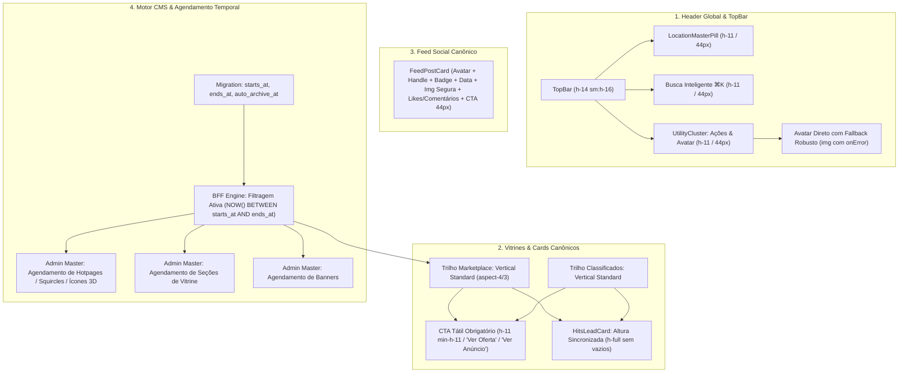

# PLANO MESTRE DE ALINHAMENTO VISUAL, PADRONIZAÇÃO DE CARDS, FEED CANÔNICO E AGENDAMENTO CMS (CAMPANHAS TEMPORAIS)

> **Status:** Aguardando Aprovação do Usuário (`/plan`)  
> **Mandato:** Principal Software Architect & Lead Design Systems Engineer  
> **Escopo:** Header Global, Cards de Vitrine/Classificados, Feed Social, Motor CMS Bilateral e Agendamento Temporal de Campanhas  

---

## 1. Descrição do Objetivo e Diagnóstico Forense

Com base na auditoria visual das evidências submetidas (`media_1791172012453.png`, `media_1791172221341.png`, `media_1791172307787.png`), foram isoladas 5 anomalias críticas no código-fonte real:

1. **Desalinhamento e Disparidade de Altura no Header Global (`TopBar` & `UtilityCluster`):**
   - O `LocationMasterPill` opera em `h-11 min-h-11` (44px), enquanto a barra de busca está com `py-2` (~36px) e os botões de ação do cluster (`MessageSquare`, `ShoppingBag`, `ThemeToggle`, `Avatar`) estão em `size-8` (32px), quebrando o ritmo visual da barra superior e violando o piso tátil de 44px (DL-14).
   - O botão de perfil exibe a letra inicial `"E"` em vez da foto real do usuário (`avatar_url`), devido ao acoplamento exclusivo a `session.user.user_metadata` e à dependência de máquina de estados interna do Radix Avatar que falha silenciosamente durante a renderização.

2. **Compressão Horizontal Assimétrica no Marketplace vs. Classificados:**
   - Na rota `_store.index.tsx`, a seção Marketplace utiliza o componente `OfferCard` no modo horizontal split (`h-36 sm:h-40`), esmagando os textos à direita, truncando valores (`R$..`) e exibindo um mini-botão desproporcional.
   - Os cards da seção Classificados logo abaixo utilizam orientação vertical com imagem `aspect-square`, criando uma quebra gritante de consistência e padrão visual.

3. **Ausência de CTAs Táteis nos Cards de Classificados e Desalinhamento do Card Laranja:**
   - Os cards de classificados não possuem nenhum botão de Call to Action (Call to Action Primário), apenas texto de título, preço e localização, violando a regra B.22 (`AGENTS.md`).
   - O card editorial laranja ("Feirão & Desapego", `HitsLeadCard`) possui altura fixa subdimensionada em relação aos cards da fileira, deixando um vão preto vazio abaixo dele.

4. **Quebra Estrutural e Caixas Órfãs de Imagem no Trilho do Feed Social:**
   - No trilho do feed da Home (`_store.index.tsx`), publicações sem imagem ou com URLs inválidas renderizam uma caixa vazia com contorno e ícone de imagem quebrada do navegador.
   - Falta a estrutura canônica de post social: cabeçalho com avatar nítido, nome, handle, selo de verificação, texto limpo, contadores de curtidas/comentários e botão tátil "Ver publicação".

5. **Necessidade de Agendamento Temporal e Auto-Arquivamento de Campanhas no CMS Master:**
   - Os 4 cards herói squircles do topo ("Compras do Dia a Dia", "Places", "Gastronomia", "Supermercado"), pills de categoria, ícones 3D e banners precisam de controle bilateral completo no Admin Master:
     - Datas de início e fim da campanha (`starts_at`, `ends_at`).
     - Auto-ocultamento e auto-arquivamento quando o prazo expirar (`auto_archive_at`).
     - Upload direto de backgrounds e ícones 3D para buckets do Supabase Storage.
     - Suporte das engines BFF para filtrar automaticamente registros fora do período de veiculação e omitir seções vazias.

---

## 2. Revisão do Usuário Obrigatória

> [!IMPORTANT]
> **Padronização Vertical Canônica de Cards de Vitrine:**
> Os cards de Marketplace serão alinhados ao formato vertical padrão (`aspect-[4/3]`), unificando a experiência de Marketplace, Classificados e Places. Todo card conterá CTA explícito com altura mínima de 44px (`h-11 min-h-11`), eliminando qualquer compressão de texto ou truncamento de preço.

> [!IMPORTANT]
> **Adição de Colunas de Agendamento no Supabase:**
> Criaremos a migration `20270106000000_campaign_scheduling_and_auto_archive.sql` adicionando `starts_at TIMESTAMPTZ`, `ends_at TIMESTAMPTZ` e `auto_archive_at TIMESTAMPTZ` às tabelas `marketplace_sections` e `hotpages`, garantindo conformidade retroativa e denegação de registros expirados.

---

## 3. Plano de Arquitetura e Engenharia



---

## 4. Mudanças Propostas por Componente

### Camada 1: Banco de Dados & Migrations (Supabase)
#### [NEW] `supabase/migrations/20270106000000_campaign_scheduling_and_auto_archive.sql`
- Adiciona `starts_at TIMESTAMPTZ`, `ends_at TIMESTAMPTZ` e `auto_archive_at TIMESTAMPTZ` às tabelas `hotpages` e `marketplace_sections`.
- Cria índice parcial `idx_hotpages_campaign_active` para consultas performáticas de itens ativos no intervalo atual.
- Adiciona trigger ou função para auto-arquivamento de registros expirados.

---

### Camada 2: Camada BFF & Contratos de Dados (Server Functions)
#### [MODIFY] `src/services/hotpage.functions.ts`
- Atualiza `HotpageDTO` e schemas Zod (`CreateHotpageSchema`, `UpdateHotpageSchema`) incluindo `starts_at`, `ends_at`, `auto_archive_at`.
- Atualiza queries `listHotpages`, `listHeroSquircleCards`, `listEditorialHotpages` com filtro defensivo:
  ```ts
  const now = new Date().toISOString();
  // (starts_at IS NULL OR starts_at <= now) AND (ends_at IS NULL OR ends_at >= now)
  ```
- Garante auto-arquivamento se `auto_archive_at <= now` marcando `is_active = false`.

#### [MODIFY] `src/services/surface-cms.functions.ts`
- Atualiza `SurfaceSectionDTO` e schemas de inserção/edição para contemplar `starts_at`, `ends_at`, `auto_archive_at`.
- Atualiza `getSurfaceWithSections` e `listSurfaceSections` para filtrar seções ativas no período.

---

### Camada 3: Componentes de Interface & Design System (UI)
#### [MODIFY] `src/components/shell/top-bar.tsx`
- Padroniza o container do cabeçalho em `h-14 sm:h-16`.
- Atualiza o link de busca global para altura canônica `h-11 min-h-11` (44px) com alinhamento vertical exato ao `LocationMasterPill`.
- Alinha o botão de busca mobile para `size-11 min-h-11 min-w-11` (44px).

#### [MODIFY] `src/components/shell/utility-cluster.tsx`
- Padroniza todos os botões de utilidades (`MessageSquare`, `ShoppingBag`, `NotificationsPopover`, `ThemeToggle`) para `size-11 min-h-11 min-w-11` (44px) com ícones centralizados (`size-5`).
- Refatora o gatilho de perfil:
  - Extrai `userAvatar` com fallback resiliente:
    ```tsx
    const userAvatar = 
      session?.user?.user_metadata?.avatar_url || 
      session?.user?.avatar_url || 
      session?.avatar_url || 
      session?.profile?.avatar_url || 
      "";
    ```
  - Substitui o estado opaco do Radix Avatar por um elemento `` direto com captura de erro (`onError`), renderizando a foto perfeitamente e recorrendo à inicial apenas se a foto falhar ou não existir.
  - Dimensiona o botão do avatar para `size-11 min-h-11 min-w-11` (44px) com anel `:focus-visible:ring-2`.

#### [MODIFY] `src/components/commerce/offer-card.tsx`
- Refatora o layout padrão de `OfferCard` para exibição **Vertical Canônica**:
  - Imagem no topo em proporção harmoniosa (`aspect-[4/3]`) com badges de desconto e temporizador flutuante.
  - Informações do produto no corpo: nome da loja parceira, título com tipografia nítida (sem truncar prematuramente) e preço formatado proeminente.
  - CTA primário na base com largura total e altura canônica de 44px (`h-11 min-h-11`): botão proeminente "Ver Oferta" / "Adicionar" com `:focus-visible:ring-2`.
  - Suporta prop opcional `layoutVariant="vertical" | "horizontal"` (mantendo retrocompatibilidade onde explicitamente solicitado).

#### [MODIFY] `src/components/commerce/hits-lead-card.tsx`
- Ajusta as classes de altura de `HitsLeadCard` para responder dinamicamente ao container pai (`h-full min-h-[360px]`), eliminando qualquer descompasso de altura ou espaço vazio em relação aos cards vizinhos da mesma linha.

#### [MODIFY] `src/routes/_store.index.tsx`
- **Marketplace Rail:** Alinha para renderizar os cards verticais padronizados com CTA tátil `h-11`.
- **Classificados Rail:** Atualiza a renderização de cada anúncio para incluir o CTA tátil proeminente `h-11 min-h-11` ("Ver Anúncio"), alinhado com o piso WCAG 2.2 AA e regra B.22.
- **Feed Rail:** Substitui a renderização crua por cards canônicos de post social (`FeedPostCard`), tratando imagens com segurança (ocultando bloco se URL for vazia ou inválida, zero ícones quebrados do navegador) e adicionando métricas e botão de interação.
- **Card Editorial Laranja:** Alinha a altura de `HitsLeadCard` para `h-full min-h-[360px]` sincronizado com a fileira de classificados.

---

### Camada 4: Painel Admin Master (CMS de Campanhas e Squircles)
#### [MODIFY] `src/routes/admin-master.botoes.tsx`
- Adiciona campos de agendamento temporal no modal/sheet de edição de Hotpages e Squircles:
  - `Data/Hora de Início (starts_at)`
  - `Data/Hora de Fim (ends_at)`
  - `Auto-Arquivamento (auto_archive_at)`
- Garante preview visual e upload direto de imagens/ícones 3D para o bucket `brand-assets` ou `post-media` do Supabase Storage via `MediaUploader`.
- Exibe badge de status de campanha: "Ativa", "Agendada", "Expirada".

#### [MODIFY] `src/routes/admin-master.vitrines.tsx`
- Adiciona campos de agendamento temporal para seções de vitrines (`starts_at`, `ends_at`).
- Permite configurar auto-ocultamento de seções sem itens cadastrados.

#### [MODIFY] `src/routes/admin-master.banners.tsx`
- Reforça os controles de agendamento de banners com date pickers e status visual de campanha.

---

## 5. Plano de Verificação

### Testes Automatizados
```bash
# 1. Execução de testes unitários dos serviços BFF e agendamento
npx vitest run src/services/hotpage.functions.test.ts src/services/surface-cms.functions.test.ts

# 2. Execução da catraca de design lint com teto estrito
node scripts/design-lint.mjs --ratchet

# 3. Compilação TypeScript estrita
npm run typecheck
```

### Verificação de Produção
```bash
# 1. Build limpo de produção
npm run build

# 2. Deploy no Cloudflare Pages
npx wrangler pages deploy dist --project-name usewaesy --commit-dirty=true --no-bundle

# 3. Smoke tests HTTP reais
# Validação da rota principal '/', '/admin-master/botoes', '/admin-master/vitrines'
```

---

## 6. Solicitação de Aprovação

Por favor, revise o plano acima e confirme para iniciarmos imediatamente a implementação física das melhorias.
