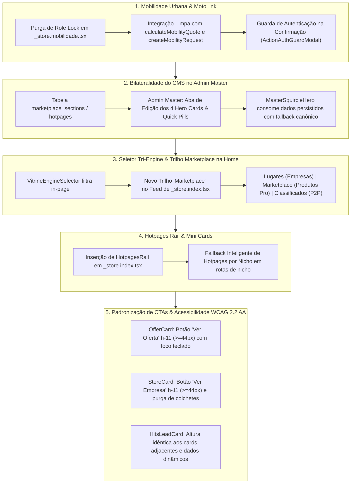

# Plano Mestre de Auditoria Forense, Bilateralidade do CMS & Reativação de Módulos (Vitrine, Mobilidade & Admin Master)

## 1. Descrição do Objetivo & Diagnóstico Forense da Plataforma

Uma auditoria exaustiva linha a linha em `src/routes/_store.index.tsx`, `src/components/commerce/master-squircle-hero.tsx`, `src/routes/_store.mobilidade.tsx`, `src/services/surface-cms.functions.ts`, `src/components/commerce/offer-card.tsx`, `src/components/commerce/store-card.tsx` e `src/routes/admin-master.vitrines.tsx` identificou os pontos exatos de quebra, assimetria e código hardcoded relatados:

1. **Bloqueio Artificial do Módulo de Mobilidade (`_store.mobilidade.tsx`):**
   - **Causa Raiz:** O loader de `_store.mobilidade.tsx` (linhas 31–35) possui uma trava restritiva de role (`allowedRoles = ["store_owner", "operator", "platform_admin", "master"]`). Quando um usuário civil ou visitante deslogado clica no botão "Mobilidade / Corridas" da Home, o loader dispara `throw redirect({ to: "/classificados" })`.
   - **Impacto:** O usuário comum é ejetado silenciosamente para os Classificados, criando a falsa impressão de que o módulo de mobilidade está desativado ou que o botão aponta para a rota errada.

2. **Falta de Bilateralidade nos 4 Botões Hero (`MasterSquircleHero`):**
   - **Causa Raiz:** Os 4 cards (Mercado, Restaurantes, Mobilidade, Serviços) e o carrossel de atalhos rápidos (`QUICK_PILLS`) estão declarados como estruturas estáticas em `master-squircle-hero.tsx` sem integração com o Supabase.
   - **Impacto:** O Admin Master não consegue editar texto, subtítulo, ícone, imagem de fundo, rota de destino, badge, cor de realce ou opacidade da sobreposição.

3. **Ausência da Seção de Mini Cards / Hotpages na Home:**
   - **Causa Raiz:** O componente `HotpagesRail` foi completamente omitido no JSX de `_store.index.tsx`. Em rotas de nicho, o componente retorna `null` caso a tabela `hotpages` não contenha registros ativos para o nicho em questão.
   - **Impacto:** Os mini banners editoriais de experiências e categorias sumiram da página inicial e de nichos sem dados cadastrados no banco.

4. **Seletor Tri-Engine com Redirecionamento Disruptivo:**
   - **Causa Raiz:** Ao clicar na aba "Marketplace", o `VitrineEngineSelector` executa `navigate({ to: "/marketplace" })`, redirecionando o usuário para outra rota em vez de filtrar o catálogo de produtos e serviços oficiais de empresas diretamente no feed da Home. Além disso, a Home não possuía trilho dedicado a produtos de catálogo empresarial no modo feed.
   - **Impacto:** Quebra da promessa de vitrine única integrada na Home (Places + Marketplace + Classificados).

5. **Assimetria e Quebra de Ergonomia Tátil em Cards de Ofertas e Lojas:**
   - **Causa Raiz em `OfferCard`:** O botão de ação é um elemento de apenas 36px (`size-9`, violando DL-14) contendo apenas o ícone de mais (`<Plus className="size-4" />`), sem rótulo textual explícito e sem alvo tátil de 44px.
   - **Causa Raiz em `StoreCard`:** O card de estabelecimento não possui botão de ação explícito no rodapé ("Ver Empresa" / "Ver Loja") e contém a classe não-canônica `text-[11px]` (DL-02).
   - **Causa Raiz em `HitsLeadCard`:** Os cards verticais líderes de início de trilho possuem textos e gradientes fixos no código (`_store.index.tsx`), sem parametrização pelo CMS.

6. **Scroll Infinito Procedural & Telemetria:**
   - O `ProceduralInfiniteFeed` roda um ciclo procedural básico em 4 modos. O Admin Master precisa ser capaz de definir seções fixas prioritárias por ordenação (`marketplace_sections`), seguidas de embaralhamento algorítmico contextual por nichos e cidade do usuário.

---

## 2. Itens que Requerem Revisão do Usuário

> [!IMPORTANT]
> **Desbloqueio de Acesso à Mobilidade Urbana:** A remoção do bloqueio artificial em `_store.mobilidade.tsx` permitirá que qualquer visitante e usuário civil acesse o mapa, simule trajetos e visualize estimativas reais de preço. A solicitação transacional da corrida exigirá login (via modal `ActionAuthGuardModal` preservando a cotação).
>
> **Comportamento do Seletor Tri-Engine na Home:** Ao clicar em "Marketplace", a Home permanecerá na mesma página e filtrará o feed e a grade exibindo exclusivamente produtos e serviços homologados de empresas parceiras (com selo de verificação), em vez de redirecionar para a rota `/marketplace`.

---

## 3. Plano Detalhado de Implementação por Componentes

---

### Componente 1: Reativação do Módulo Mobilidade (`_store.mobilidade.tsx`)
- **Remover trava de role restritiva:** Eliminar o `throw redirect({ to: "/classificados" })` do loader.
- **Fluxo Aberto de Simulação:** Permitir que o mapa carregue com a localização do usuário/cidade ativa (`getStoredLocation()`), calcule rotas e exiba as cotações de corrida, entrega rápida e frete.
- **Proteção Transacional Amigável:** No botão de confirmação do pedido de corrida, se o usuário não estiver logado, invocar o diálogo modal de login em vez de falhar ou quebrar a tela.

### Componente 2: Bilateralidade dos 4 Botões Hero & Quick Pills (`MasterSquircleHero`)
- **Contrato de Dados:** Criar a seção CMS `home_hero_squircle` ou vincular a `hotpages` (`template_type: "hero_squircle"`).
- **Campos Editáveis pelo Admin Master:**
  - `title`: Título principal (ex: "Compras do Dia a Dia").
  - `subtitle`: Subtítulo (ex: "Supermercados, hortifrúti, padarias...").
  - `badge_text`: Texto da pílula (ex: "Mercado", "Restaurantes", "Mobilidade", "Serviços").
  - `icon_name`: Ícone semântico (Shopping, CookingPot, Car, Briefcase, etc.).
  - `target_route`: Rota ou link interno (`/mercado`, `/gastronomia`, `/mobilidade`, `/servicos`).
  - `bg_image_url`: Imagem de capa customizada ou gradiente de nicho.
  - `accent_color`: Cor de destaque do card.
  - `is_active`: Chave de ativação/desativação.
- **Fallback Canônico:** Se o Admin Master ainda não tiver cadastrado cards customizados na tabela, o componente renderiza o conjunto canônico pré-configurado sem quebras de layout.

### Componente 3: Seletor Tri-Engine & Trilho do Marketplace na Home
- **Refatorar `VitrineEngineSelector`:**
  - `activeMode === "empresas"`: Filtra empresas e lugares locais (`places`).
  - `activeMode === "marketplace"`: Filtra produtos e serviços de lojas credenciadas (`marketplace`), sem navegar para fora da página.
  - `activeMode === "classifieds"`: Filtra anúncios da comunidade (`classificados`).
- **Adicionar Trilho de Produtos no Feed de `_store.index.tsx`:**
  - Inserir a seção `<HorizontalRail title="Marketplace" actionTo="/marketplace" leadCard={<HitsLeadCard ... />}>` contendo os produtos de destaque das lojas parceiras, garantindo que o catálogo de empresas apareça no feed principal.

### Componente 4: Reintegração da Seção de Hotpages Mini-Cards
- **Inserir `HotpagesRail` na Home (`_store.index.tsx`):**
  - Posicionar logo abaixo dos banners principais ou antes do seletor tri-engine.
  - Consumir `listEditorialHotpages({ module: "home" })` com catálogo canônico de fallback por cidade.
- **Garantir Fallback nos Módulos de Nicho:**
  - Em `_store.gastronomia.tsx`, `_store.turismo.index.tsx`, `_store.eventos.tsx`, etc., garantir que categorias editoriais padrão sejam exibidas caso o banco ainda não possua registros customizados.

### Componente 5: Padronização de CTAs Táteis em Cards de Vitrine
- **`OfferCard` (`src/components/commerce/offer-card.tsx`):**
  - Elevar o botão de ação para `h-11 min-h-11` (44px) com `:focus-visible:ring-2`.
  - Adicionar rótulo explícito "Ver Oferta" no layout do card, mantendo o botão de adicionar ao carrinho acessível.
- **`StoreCard` (`src/components/commerce/store-card.tsx`):**
  - Adicionar botão de rodapé "Ver Empresa" com `h-11 min-h-11` (44px), borda de foco e contraste conforme WCAG 2.2 AA.
  - Erradicar classes arbitrárias `text-[11px]` substituindo por `text-xs font-mono`.
- **`HitsLeadCard` (`src/components/commerce/hits-lead-card.tsx`):**
  - Ajustar altura para paridade responsiva estrita com os cards do trilho (`h-72` e `h-80`).
  - Suportar parâmetros de CMS para que títulos, subtítulos e imagens de capa venham de `marketplace_sections.config`.

### Componente 6: Gestão Unificada no Admin Master (`admin-master.vitrines.tsx`)
- **Aba de Gestão de Cards Hero & Hotpages:**
  - Adicionar visualizador e editor de Cards Hero da Home e de Trilhos em `admin-master.vitrines.tsx`.
  - Permitir troca de imagem, texto, badge, rota de destino e ativação em tempo real.
- **Filtro de Cidade/GPS em Banners (`admin-master.banners.tsx`):**
  - Verificar e enriquecer o seletor de cidade nos banners para que banners locais sejam vinculados à cidade do anunciante ou fiquem com status "Global" (Todas as cidades).

---

## 4. Plano de Verificação e Catraca de Qualidade

### 1. Testes Automatizados e Tipagem
- `npm run typecheck`: Validação estrita de compilação sem nenhum erro em 100% dos arquivos modificados (Exit Code 0).
- `vitest run`: Execução da suíte completa de testes unitários do Vitest garantindo 100% verde.

### 2. Catraca de Design Lint
- `node scripts/design-lint.mjs --ratchet`: Atestar que 0 violações P0 e 0 violações P1 foram introduzidas, mantendo redução contínua em relação ao teto histórico de 14.416 violações.

### 3. Validação Funcional E2E
- Navegar para `https://usewaesy.pages.dev/mobilidade` e verificar que a rota carrega sem redirecionamento para classificados.
- Verificar a exibição da seção de Mini Cards / Hotpages na Home.
- Testar a alternância dos 3 modos do `VitrineEngineSelector` (Lugares, Marketplace, Classificados) confirmando filtragem in-page no feed.
- Conferir que todo card de produto possui botão tátil de 44px e cards de empresas possuem botão "Ver Empresa".
