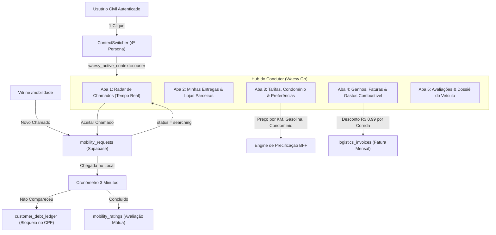

# Plano Mestre de Arquitetura Forense e Implementação Integral: Waesy Go (Entregadores, Motoristas, Fretes & Frotas)

## [Goal Description]
Construir e consolidar o ecossistema autônomo de mobilidade e logística da plataforma (**Waesy Go**), assegurando que qualquer usuário civil possa se credenciar como motoboy, motorista particular ou freteiro de mudanças, obtendo autonomia integral para definir suas tarifas (base, KM, adicionais de condomínio e apartamento), controlar sua disponibilidade (Online/Offline), vincular-se a comércios parceiros (Waesy Go B2B) ou atender o pool público de passageiros e encomendas.

A plataforma adota o modelo de **Intermediação Justa com Taxa Fixa de R$ 0,99 por corrida concluída** (sem comissões percentuais abusivas de 15% a 30%), apurada via Fatura Periódica do Condutor quando o recebimento for direto (dinheiro, maquininha ou gateway próprio). A tolerância no ponto de embarque/coleta é estritamente regulada em **3 minutos de espera**, convertendo desistências ou não-comparecimento em débito compulsório vinculado ao CPF do passageiro/cliente com bloqueio de novos pedidos na plataforma.

---

## 1. Inventário Forense e Diagnóstico da Base Atual

### 1.1 Recursos Já Existentes no Repositório:
- **Tabelas Supabase:**
  - `courier_profiles`: Dados de identificação, veículo (moto, carro, van, caminhão), placa, modelo, cor, rating e GPS em tempo real.
  - `couriers`: Registro operacional e configurações de entrega na porta (`allows_door_delivery`, `door_delivery_fee_cents`, `max_waiting_time_minutes`).
  - `logistics_price_tables`: Tabelas de preços com tarifa base, valor por KM, minuto e ajudantes.
  - `mobility_requests`: Registro de viagens e fretes com paradas múltiplas (`mobility_stops`) e negociações (`mobility_offers_negotiations`).
  - `courier_onboarding_applications`: Esteira de validação biométrica com CNH frente/verso, selfie, minivídeo liveness e cross-check anti-fraude.
  - `courier_surge_pricing_rules`: Regras dinâmicas para chuva, horário de pico e horário noturno.
  - `logistics_invoices`: Faturas de liquidação e repasse.
- **Rotas Existentes:**
  - `_store.entregador.cadastro.tsx`: Onboarding de 3 passos do condutor.
  - `admin-master.entregadores.auditoria.tsx`: Painel forense de aprovação de CNHs e biometria pelo Admin Master.
  - `_store.entrega.$token.tsx`: Link mágico de entrega com telemetria GPS, confirmação por PIN e comprovante fotográfico.
  - `_store.motorista.$slug.tsx`: Perfil público do motorista.
  - `workspace.pedidos.frota.tsx` & `workspace.pedidos.entregadores.*`: Gestão de frota pelas lojas.
- **Serviços BFF:**
  - `mobility.functions.ts`, `waesy-go.functions.ts`, `courier-verification.functions.ts`, `fleet.functions.ts`.

### 1.2 Lacunas Estruturais Diagnosticadas:
1. **Ausência da 4ª Persona no Context Switcher:** O alternador rápido de identidade (`ContextSwitcher`) não contempla o perfil "Condutor / Entregador (Waesy Go)".
2. **Bloqueio Artificial em `/conta/mobilidade`:** Usuários civis eram impedidos por verificação de role restrita.
3. **Ausência do Hub Dedicado `/conta/entregador`:** Não havia interface onde o condutor visualiza o Radar de Chamados, frotas vinculadas, editor de tarifas e extrato financeiro.
4. **Governança de Inadimplência e Tolerância de 3 Minutos:** Não havia motor para converter não-comparecimento em débito ativo no CPF com bloqueio de novos chamados.
5. **Submódulo "Gastos vs. Entradas" (Combustível & Manutenção):** Condutor não possuía acompanhamento do lucro líquido real descontando combustível e manutenção.
6. **Engine de Inteligência de Preço de Combustível por Cidade:** Precificação dinâmica sem calibragem pelo valor local da gasolina.
7. **Avaliações Bilaterais com Notas e Depoimentos:** Ausência de tabela específica para avaliação mútua entre passageiro e condutor.

---

## 2. Decisões Arquiteturais Homologadas

### 2.1 Hub Dedicado em `/_store/conta/entregador` + 4ª Persona no Context Switcher
- Inclusão do modo `courier` no `ContextSwitcher`.
- Se o usuário possuir credenciamento aprovado, pode alternar para o "Modo Entregador / Condutor" em 1 clique.
- Acesso rápido pelo menu da conta civil e por card de destaque no hub principal.

### 2.2 Motor Tarifário Híbrido e Tri-Engine de Cotação
- **Piso Tarifário Mínimo de Mercado (Benchmark 2026):**
  - **Motos (Delivery & Passageiro):** Saída R$ 8,00 a R$ 10,00 | Mínimo R$ 2,00 por KM rodado.
  - **Carros (Mobilidade Particular):** Saída R$ 10,00 a R$ 12,00 | Mínimo R$ 2,50 por KM rodado + R$ 0,30/min.
  - **Fretes / Mudanças (Vans & Caminhões):** Saída R$ 120,00 a R$ 200,00 | R$ 5,00 a R$ 7,50 por KM + R$ 60,00 por ajudante.
- **Tri-Engine de Cotação na Vitrine `/mobilidade`:**
  1. *Cotação de Mercado Dinâmica:* Calculada pela média de mercado calibrada por gasolina, chuva e horário de pico.
  2. *Contratação Direta no Perfil (`/motorista/$slug`):* Aplica as tarifas personalizadas do condutor escolhido.
  3. *Leilão / Contra-Propostas em Tempo Real:* Permite que motoristas próximos enviem lances e propostas no chamado.
- **Adicionais de Portaria e Condomínio:**
  - Taxa de entrada em condomínio fechado (R$ 3,00 padrão, configurável pelo condutor).
  - Taxa de subida ao apartamento / entrega na porta (R$ 5,00 padrão, configurável pelo condutor).

### 2.3 Modelo de Cobrança da Taxa de R$ 0,99 & Fatura Periódica
- **Corridas Pagas pelo App:** A taxa de R$ 0,99 é deduzida no split de liquidação.
- **Corridas Pagas em Dinheiro / Maquininha / Gateway Próprio do Condutor:**
  - A taxa de R$ 0,99 acumula na **Fatura Periódica do Condutor** (`logistics_invoices`).
  - O condutor liquida sua fatura mensalmente ou ao atingir o teto de tolerância via PIX no Admin Master.

### 2.4 Tolerância de 3 Minutos, Débito Compulsório e Bloqueio no CPF
- Ao chegar no ponto de embarque/coleta, o condutor aciona o botão **"Cheguei no Local"**, disparando o cronômetro oficial de **3 minutos**.
- O passageiro/cliente recebe notificação push e visualiza a contagem regressiva no mapa.
- Expirados os 3 minutos sem embarque ou atendimento:
  - O condutor pode finalizar a viagem por **"Não Comparecimento do Cliente"**.
  - O valor integral da corrida/deslocamento é cobrado do cliente.
  - Caso o cliente não pague, o débito é registrado na tabela `customer_debt_ledger` atrelado ao **CPF do cliente**.
  - **Bloqueio progressivo em escala:** O cliente fica sumariamente impedido de solicitar novas corridas, novos fretes ou fazer pedidos de delivery de comida até quitar o débito pendente.

### 2.5 Submódulo Financeiro "Gastos com Combustível vs. Entradas"
- Painel para o motorista/entregador registrar:
  - Abastecimentos (litros, preço do combustível, valor total, upload do comprovante).
  - Manutenções (troca de óleo, pneu, revisão mecânica).
  - Custos fixos (seguro, IPVA rateado).
- Cálculo automatizado de **Lucro Líquido Real**, **Custo Médio por KM Rodado** e **Eficiência Energética**.

### 2.6 Sistema de Avaliações Bilaterais com Fotos Reais
- Criação da tabela `mobility_ratings`:
  - Passageiro avalia condutor (estrelas 1-5, tags como "Direção Segura", "Carro Limpo", "Pontual", comentário).
  - Condutor avalia passageiro (estrelas 1-5, tags como "Educado", "Estava no Ponto", "Respeitoso").
  - Avaliação liberada exclusivamente após status `completed` em `mobility_requests`.
  - Exibição pública no perfil do motorista (`_store.motorista.$slug.tsx`) acompanhado de foto do veículo, modelo, cor e placa verificada.

---

## 3. Arquitetura de Componentes e Arquivos



---

## 4. Alterações Propostas por Módulo

### 4.1 Banco de Dados & Migrations (Supabase)
#### [NEW] `supabase/migrations/20270104000000_waesy_go_courier_governance_and_ratings.sql`
- Expansão de `courier_profiles`:
  - `work_mode`: `'mixed' | 'delivery_only' | 'rides_only' | 'commercial_only' | 'moving_only'`
  - `passenger_preference`: `'all' | 'women_only'`
  - `condo_entry_fee_cents`: INTEGER DEFAULT 300
  - `apartment_floor_fee_cents`: INTEGER DEFAULT 500
  - `vehicle_capacity_kg`: NUMERIC(8,2)
  - `vehicle_capacity_m3`: NUMERIC(8,2)
  - `serviced_neighborhoods`: TEXT[]
  - `serviced_cities`: TEXT[]
  - `working_hours_start`: TIME DEFAULT '07:00'
  - `working_hours_end`: TIME DEFAULT '22:00'
- Criação de `customer_debt_ledger`:
  - `id`, `customer_id`, `customer_cpf`, `request_id`, `amount_cents`, `reason`, `status ('pending', 'paid')`, `blocked_services TEXT[]`, `created_at`.
- Criação de `courier_expense_logs`:
  - `id`, `courier_profile_id`, `expense_type ('fuel', 'maintenance', 'insurance', 'other')`, `amount_cents`, `liters`, `fuel_type`, `receipt_url`, `notes`, `created_at`.
- Criação de `mobility_ratings`:
  - `id`, `request_id`, `reviewer_id`, `reviewee_id`, `courier_profile_id`, `role_reviewed ('courier', 'customer')`, `rating (1..5)`, `comment`, `tags TEXT[]`, `created_at`.
- Políticas RLS rigorosas de isolamento e auditoria.

### 4.2 Camada BFF (Server Functions)
#### [MODIFY] `src/services/mobility.functions.ts`
- Implementar:
  - `listAvailableMobilityDemands`: busca chamados ativos `status='searching'` na proximidade.
  - `acceptMobilityDemand`: vincula o motorista, gera o PIN e transiciona para `accepted`.
  - `recordArrivalAndStartTimer`: inicia o timer de 3 minutos de tolerância.
  - `cancelByCustomerNoShow`: encerra corrida por ausência do cliente e lança débito no CPF.
  - `submitMobilityRating`: grava avaliação bilateral e atualiza média do motorista.
  - `logCourierExpense` / `listCourierExpenses`: registra e lista gastos de combustível com comprovante.
  - `updateMyCourierPreferences`: salva tarifas personalizadas e horários.
  - `getCourierMonthlyInvoice`: calcula a fatura mensal com base na taxa de R$ 0,99 por corrida.

#### [MODIFY] `src/services/waesy-go.functions.ts`
- Atualização para suportar tolerância oficial de 3 minutos e taxas de condomínio e apartamento.

### 4.3 Shell de Identidade & Alternador de Contexto
#### [MODIFY] `src/components/profile/context-switcher.tsx`
- Adicionar persona `courier` com ícone de moto/veículo e badge "Waesy Go".
- Salvar cookie `waesy_active_context=courier` e navegar para `/conta/entregador`.

#### [MODIFY] `src/routes/_store.conta.index.tsx`
- Adicionar card "Waesy Go — Painel do Entregador e Motorista" com status de aprovação.

#### [MODIFY] `src/routes/_store.conta.mobilidade.tsx`
- Remover bloqueio artificial de roles.
- Exibir histórico de viagens do cliente e botão de acesso ao Painel do Condutor.

### 4.4 Hub Dedicado do Entregador e Motorista
#### [NEW] `src/routes/_store.conta.entregador.tsx`
- Interface com 5 abas modulares:
  1. **Radar de Chamados:** visualização de corridas disponíveis, mapa, aceitar/recusar chamado.
  2. **Minhas Entregas & Lojas:** lista de entregas de frotas comerciais parceiras.
  3. **Minhas Tarifas:** configuração de valor por KM, saída, condomínio, apartamento e modo de trabalho.
  4. **Financeiro & Despesas:** resumo de ganhos, fatura de R$ 0,99, registro de combustível com recibo e lucro líquido real.
  5. **Avaliações & Veículo:** notas de clientes, tags recebidas e foto do veículo.

### 4.5 Perfil Público e Vitrine
#### [MODIFY] `src/routes/_store.motorista.$slug.tsx`
- Exibir modelo, foto do veículo, placa verificada, selo de KYC e lista de depoimentos reais de clientes.

---

## 5. Plano de Verificação e Evidências

### 5.1 Testes Unitários Automatizados
- Execução de suíte em Vitest:
  ```bash
  cmd.exe /c "npx vitest run src/services/mobility.functions.test.ts"
  ```
  - Testar cálculo da taxa fixa de R$ 0,99.
  - Testar cálculo de tolerância de 3 minutos e geração de débito em caso de no-show.
  - Testar cálculo de lucro líquido deduzindo combustível.

### 5.2 Design Lint e Integridade Visual
- Execução do linter com zero violações P0 e P1:
  ```bash
  cmd.exe /c "node scripts/design-lint.mjs"
  ```

### 5.3 Compilação e Deploy de Produção
- Build de produção limpo:
  ```bash
  cmd.exe /c "npm run build"
  ```
- Deploy no Cloudflare Pages:
  ```bash
  cmd.exe /c "npx wrangler pages deploy dist --project-name usewaesy --commit-dirty=true --no-bundle"
  ```
