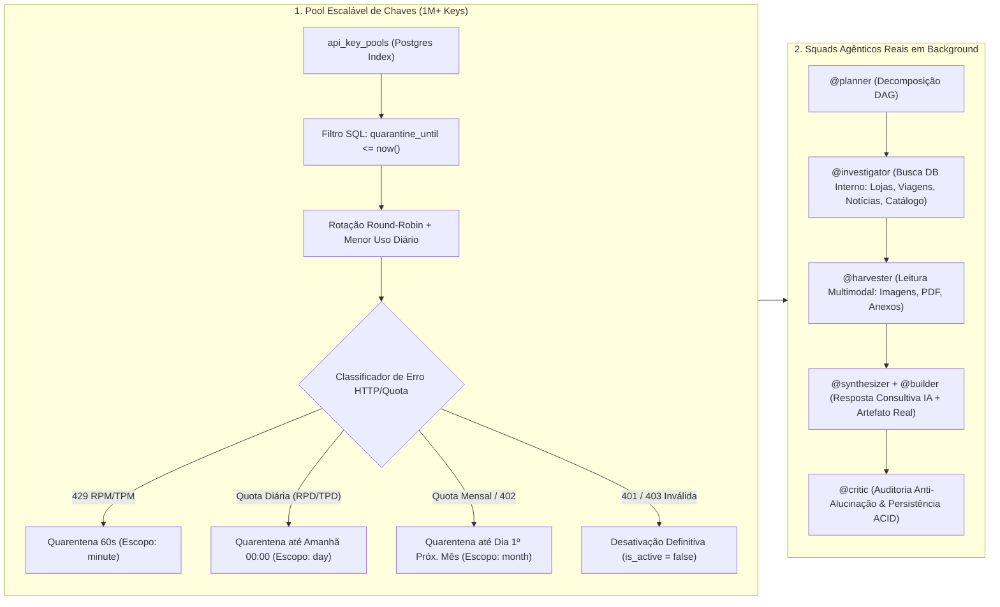

# Plano Mestre Truth-7: Orquestrador Multi-Chaves com Quarentena Inteligente por Cota, Squads Agênticos Reais & UI Nativa Bidirecional (Mobile Manus/ChatGPT + Desktop Studio Antigravity/Claude)

---

## 1. Diagnóstico Forense (Protocolo Waesy Truth-7 — Sem Omissões)

A auditoria linha a linha nos arquivos reais do ecossistema Copilot ([`api-orchestrator.functions.ts`](file:///c:/Users/Eduardo%20Ant%C3%B4nio%20Ramo/Documents/waesy/src/services/api-orchestrator.functions.ts), [`ai-core-gateway.functions.ts`](file:///c:/Users/Eduardo%20Ant%C3%B4nio%20Ramo/Documents/waesy/src/services/ai-core-gateway.functions.ts), [`ai-conversations.functions.ts`](file:///c:/Users/Eduardo%20Ant%C3%B4nio%20Ramo/Documents/waesy/src/services/ai-conversations.functions.ts), [`autonomous-copilot-orchestrator.ts`](file:///c:/Users/Eduardo%20Ant%C3%B4nio%20Ramo/Documents/waesy/src/services/autonomous-copilot-orchestrator.ts), [`ai-chat-shell.tsx`](file:///c:/Users/Eduardo%20Ant%C3%B4nio%20Ramo/Documents/waesy/src/components/chat/ai-chat-shell.tsx) e [`chat-composer.tsx`](file:///c:/Users/Eduardo%20Ant%C3%B4nio%20Ramo/Documents/waesy/src/components/chat/chat-composer.tsx)) revelou **6 quebras estruturais exatas** que impediam o funcionamento como um sistema agêntico completo:

| # | Submódulo Auditado | Arquivo & Linhas Exatas | Causa Raiz Identificada (Por que falhava ou parecia mecânico) |
| :--- | :--- | :--- | :--- |
| **G1** | **Quarentena de Chaves sem Escopo Temporal (Minuto vs. Dia vs. Mês)** | [`src/services/api-orchestrator.functions.ts:494-515`](file:///c:/Users/Eduardo%20Ant%C3%B4nio%20Ramo/Documents/waesy/src/services/api-orchestrator.functions.ts#L494-L515) e [`676-700`](file:///c:/Users/Eduardo%20Ant%C3%B4nio%20Ramo/Documents/waesy/src/services/api-orchestrator.functions.ts#L676-L700) | `markKeyError` aplica apenas 120s em memória e `getAllActiveKeysForProvider` filtra apenas `last_error_at > fiveMinutesAgo`. Chaves que estouraram a **cota diária** (`RPD`/`TPD`/`per day`) ou **cota mensal/créditos** (`HTTP 402`/`insufficient_quota`/`monthly`) voltam para a fila após 5 minutos, causando lentidão e erros repetidos. Além disso, a linha 515 (`const selectedPool = availableKeys.length > 0 ? availableKeys : poolRows`) força o reuso de chaves bloqueadas quando todas as chaves do provedor estão em cooldown. |
| **G2** | **Circuit Breaker Prematuro que Derruba o Provedor Inteiro no 1º 429** | [`src/services/ai-core-gateway.functions.ts:153-171`](file:///c:/Users/Eduardo%20Ant%C3%B4nio%20Ramo/Documents/waesy/src/services/ai-core-gateway.functions.ts#L153-L171) | `recordCircuitFailure(provider)` abre o disjuntor do **provedor inteiro por 5 minutos** no primeiro `429` (`if (isRateLimit || cb.consecutiveFailures >= 3)`), bloqueando o provedor mesmo quando existem dezenas ou milhares de outras chaves saudáveis cadastradas em `api_key_pools` para aquele mesmo provedor. |
| **G3** | **Query de Pool Sem Paginação Indexada para Alta Escala (1M+ Chaves)** | [`src/services/api-orchestrator.functions.ts:496-504`](file:///c:/Users/Eduardo%20Ant%C3%B4nio%20Ramo/Documents/waesy/src/services/api-orchestrator.functions.ts#L496-L504) | `getAllActiveKeysForProvider` faz `.select(...)` de todas as chaves ativas e filtra em JavaScript. Para suportar milhares ou milhões de chaves sem latência, o filtro de quarentena (`quarantine_until IS NULL OR quarantine_until <= now()`) e o reset automático de contadores diários/mensais devem ocorrer via índice B-Tree diretamente no PostgreSQL com `.limit(50)`. |
| **G4** | **Anexos e Mídias Descartados entre o Composer e o Pipeline de IA** | [`src/components/chat/chat-composer.tsx:88`](file:///c:/Users/Eduardo%20Ant%C3%B4nio%20Ramo/Documents/waesy/src/components/chat/chat-composer.tsx#L88) e [`src/services/ai-conversations.functions.ts:2562-2574`](file:///c:/Users/Eduardo%20Ant%C3%B4nio%20Ramo/Documents/waesy/src/services/ai-conversations.functions.ts#L2562-L2574) | Em `ChatComposer`, `onAttachFile` nunca é passado pelo `AIChatShell` (o botão de clipe nem aparece) e `handleSend` envia `[]` fixo. Além disso, em `sendAiConversationMessage` (linha 2563), `data.attachments` é salvo no banco mas **não é repassado** para `executeAiCopilotPipeline`, impedindo visão multimodal (OCR de fotos/comprovantes/cardápios) e leitura de arquivos no chat. |
| **G5** | **Squads Agênticos (`@planner`, `@investigator`, `@harvester`, `@synthesizer`, `@critic`, `@builder`) Desconectados do Chat** | [`src/services/autonomous-copilot-orchestrator.ts:1-260`](file:///c:/Users/Eduardo%20Ant%C3%B4nio%20Ramo/Documents/waesy/src/services/autonomous-copilot-orchestrator.ts#L1-L260) e [`src/services/ai-conversations.functions.ts:740-2220`](file:///c:/Users/Eduardo%20Ant%C3%B4nio%20Ramo/Documents/waesy/src/services/ai-conversations.functions.ts#L740-L2220) | O orquestrador de squads e tarefas (`copilot_tasks` / `copilot_sessions`) existe em `autonomous-copilot-orchestrator.ts`, mas não está integrado ao fluxo principal de `executeAiCopilotPipeline` nem persiste o DAG de tarefas da thread para exibição em tempo real no painel lateral/mobile sheet. |
| **G6** | **Ergonomia UI Bidirecional Incompleta (Mobile App vs. Desktop Studio 3-Painéis)** | [`src/components/chat/ai-chat-shell.tsx:226-857`](file:///c:/Users/Eduardo%20Ant%C3%B4nio%20Ramo/Documents/waesy/src/components/chat/ai-chat-shell.tsx#L226-L857), [`_store.copilot.tsx`](file:///c:/Users/Eduardo%20Ant%C3%B4nio%20Ramo/Documents/waesy/src/routes/_store.copilot.tsx), [`workspace.copilot.tsx`](file:///c:/Users/Eduardo%20Ant%C3%B4nio%20Ramo/Documents/waesy/src/routes/workspace.copilot.tsx) | No **Mobile (`<768px`)**, falta gaveta deslizante rápida de histórico/tarefas, barra flutuante de status do Squad em execução (estilo Manus AI Mobile) e chips de ação rápida iniciais. No **Desktop (`>=768px`)**, o painel direito (Coluna 3) não possui abas dedicadas para **Squads & Tasks (DAG ao vivo)**, **Artefatos & Builder (com botão 1-Click Salvar no Workspace)** e **Arquivos & Memória**. |

---

## 2. Matriz dos 7 Elos (Truth-7) por Componente

---

## 3. Plano de Implementação Detalhado

### Componente 1 — Motor de Pool Escalável (1 a 1.000.000+ Chaves) & Quarentena Inteligente por Escopo de Cota
1. **Migration SQL (`supabase/migrations/20261018080000_api_key_pools_scoped_quarantine_and_copilot_tasks.sql`):**
   - Adicionar colunas explícitas em `public.api_key_pools`:
     - `quarantine_until timestamptz DEFAULT NULL`
     - `quarantine_scope text DEFAULT NULL CHECK (quarantine_scope IN ('minute', 'day', 'month', 'permanent'))`
     - `quarantine_reason text DEFAULT NULL`
     - `monthly_request_count integer NOT NULL DEFAULT 0`
     - `last_daily_reset_date date NOT NULL DEFAULT CURRENT_DATE`
     - `last_monthly_reset_month text NOT NULL DEFAULT to_char(CURRENT_DATE, 'YYYY-MM')`
   - Criar índice composto de alta performance `idx_api_key_pools_healthy_rotation` em `(provider, is_active, quarantine_until, priority, daily_request_count, last_used_at)` para permitir seleção em `<2ms` mesmo com 1 milhão de chaves cadastradas.
   - Criar função RPC `claim_healthy_api_keys_for_provider(p_provider text, p_limit int DEFAULT 50)` que automaticamente limpa `quarantine_until` vencidos, zera `daily_request_count` quando `last_daily_reset_date < CURRENT_DATE`, zera `monthly_request_count` quando `last_monthly_reset_month <> to_char(CURRENT_DATE, 'YYYY-MM')`, e retorna apenas chaves saudáveis prontas para uso.
2. **Classificador Determinístico de Cota em [`src/services/api-orchestrator.functions.ts`](file:///c:/Users/Eduardo%20Ant%C3%B4nio%20Ramo/Documents/waesy/src/services/api-orchestrator.functions.ts):**
   - Implementar e exportar `classifyKeyQuotaError(statusCode?: number, errorMessage?: string)` que analisa o código HTTP e o corpo do erro de OpenRouter, Groq, Gemini, OpenAI e Anthropic:
     - **Escopo `permanent` (`is_active = false`):** HTTP `401` ou `403` com `invalid_api_key`, `api key not valid`, `unauthorized`, `revoked`, `account_deactivated`.
     - **Escopo `month` (`quarantine_until` = 1º dia do próximo mês às 00:00:00 UTC):** HTTP `402` (`Payment Required`), ou mensagens contendo `insufficient_quota`, `billing_hard_limit_reached`, `monthly_limit`, `credit balance is too low`, `exceeded your current quota`, `spend limit`.
     - **Escopo `day` (`quarantine_until` = início do próximo dia às 00:00:00 UTC):** HTTP `429` contendo `per day`, `daily`, `rpd`, `tpd`, `tokens per day`, `requests per day`, `generaterequestsperday`.
     - **Escopo `minute` (`quarantine_until` = `now + 60s`):** HTTP `429` padrão (`rate limit`, `rpm`, `tpm`, `per minute`, `too many requests`) ou erro transitório `500/502/503/504` (`now + 30s`).
   - Atualizar `markKeyError(keyId, errorMessage, statusCode)` para gravar `quarantine_until`, `quarantine_scope`, `quarantine_reason`, `last_error_at`, `last_error_message` e `is_active` no banco e na memória.
   - Atualizar `getAllActiveKeysForProvider(provider, ownerId)` para filtrar estritamente chaves cujo `quarantine_until` seja nulo ou menor/igual a `now()`, **eliminando o fallback que reusava chaves bloqueadas** e passando automaticamente para a próxima chave saudável ou próximo provedor.
3. **Correção do Disjuntor em [`src/services/ai-core-gateway.functions.ts`](file:///c:/Users/Eduardo%20Ant%C3%B4nio%20Ramo/Documents/waesy/src/services/ai-core-gateway.functions.ts):**
   - Ajustar `executeGatewayCall` e `recordCircuitFailure` para que o erro `429` de uma chave individual coloque **apenas aquela chave em quarentena** e tente imediatamente a próxima chave do pool (`for (const keyInfo of keysToTry)`), só abrindo o disjuntor do provedor se **todas** as chaves disponíveis daquele provedor falharem.

### Componente 2 — Squads Agênticos Reais em Background, Contexto Multimodal & Persistência de Artefatos
1. **Orquestração de Squads em [`src/services/ai-conversations.functions.ts`](file:///c:/Users/Eduardo%20Ant%C3%B4nio%20Ramo/Documents/waesy/src/services/ai-conversations.functions.ts) & [`src/services/autonomous-copilot-orchestrator.ts`](file:///c:/Users/Eduardo%20Ant%C3%B4nio%20Ramo/Documents/waesy/src/services/autonomous-copilot-orchestrator.ts):**
   - Conectar o ciclo de execução de `executeAiCopilotPipeline` aos **Squads Especializados**:
     - `@planner`: Analisa a intenção, histórico da thread e memória de trabalho, gerando o plano de tarefas (`tasks`).
     - `@investigator`: Executa a busca determinística no banco de dados interno (`searchPlatformForCopilot`: lojas, produtos, viagens, hotéis, notícias, eventos, vagas e classificados) antes de qualquer síntese externa.
     - `@harvester`: Processa anexos enviados pelo usuário (`attachments`: imagens via visão multimodal, documentos texto/CSV/PDF) e extrai os dados estruturados para o contexto.
     - `@synthesizer` & `@builder`: Redige a resposta consultiva real via `executeUnifiedAiCall` (usando o pool multi-chaves) e constrói artefatos reais (`proposal`, `spreadsheet`, `landing_page`, `presentation`) vinculados ao Builder.
     - `@critic`: Valida se a resposta respeita os dados reais do banco (Zero Fake Data) e persiste a trilha completa de tarefas e passos (`activitySteps` com identificação do agente `@planner`, `@investigator`, `@harvester`, `@synthesizer`, `@builder`, `@critic`).
2. **Upload Multimodal e Persistência 1-Click no Workspace:**
   - Criar Server Function `uploadCopilotAttachmentFn` em `src/services/ai-conversations.functions.ts` que recebe arquivo base64/mimeType, valida segurança, salva no bucket público/privado ou converte para contexto multimodal imediato e retorna a URL/metadado para o `ChatComposer`.
   - Passar `attachments` de `sendAiConversationMessage` e `executeGuestCopilotMessage` para `executeAiCopilotPipeline`, injetando imagens diretamente em `executeUnifiedAiCall({ images })` para análise visual (OCR de faturas, fotos de produtos, roteiros, cardápios).
   - Conectar o botão **"Salvar no Workspace / Abrir no Editor"** do `CopilotArtifactPanel` à Server Function `persistCopilotGeneratedArtifactFn` (`src/services/copilot-execution-persistence.ts`) para gravar documentos/páginas diretamente em `builder_documents` / `store_pages`.

### Componente 3 — Design System 4.0 Bidirecional (Mobile App Nativo estilo ChatGPT/Manus AI + Desktop Studio estilo Claude/Antigravity)
1. **Refatoração de [`src/components/chat/chat-composer.tsx`](file:///c:/Users/Eduardo%20Ant%C3%B4nio%20Ramo/Documents/waesy/src/components/chat/chat-composer.tsx):**
   - Habilitar seletor nativo de arquivos e câmera (`<input type="file" accept="image/*,.pdf,.csv,.txt,.json" multiple />`) integrado ao botão de clipe (`h-11 min-h-11`), exibindo chips visuais dos arquivos anexados com miniatura, nome, status de upload e botão de remoção antes do envio.
   - Adicionar seletor rápido de **Modo do Agente** no composer (`Auto Squad`, `Pesquisa Local`, `Criar Artefato/Site`, `Análise Financeira`) com alvos de toque `h-11 min-h-11`.
2. **Refatoração Bidirecional de [`src/components/chat/ai-chat-shell.tsx`](file:///c:/Users/Eduardo%20Ant%C3%B4nio%20Ramo/Documents/waesy/src/components/chat/ai-chat-shell.tsx), [`src/routes/_store.copilot.tsx`](file:///c:/Users/Eduardo%20Ant%C3%B4nio%20Ramo/Documents/waesy/src/routes/_store.copilot.tsx) e [`src/routes/workspace.copilot.tsx`](file:///c:/Users/Eduardo%20Ant%C3%B4nio%20Ramo/Documents/waesy/src/routes/workspace.copilot.tsx):**
   - **Mobile (`<768px` — Padrão App Nativo Manus AI / ChatGPT):**
     - Topo compacto com botão de gaveta (`Sheet` lateral esquerda) para alternar entre Conversas/Projetos sem perder a tela ativa, título da thread e botão do Painel de Squads/Artefatos.
     - **Live Squad Pill Flutuante** acima do composer quando há execução ativa ou tarefas concluídas, mostrando qual agente do squad está trabalhando (`@planner`, `@investigator`, `@synthesizer`, `@builder`) e abrindo o `Sheet` inferior de inspeção ao tocar.
     - Grade de **Sugestões Executivas Táteis** no início da conversa para disparo imediato com 1 toque, zero efeito sanfona (`min-w-0`, alturas estáveis, `pb-safe`).
   - **Desktop (`>=768px` — Padrão Estúdio 3-Painéis Claude / ChatGPT / Antigravity):**
     - **Coluna 1 (Esquerda):** Histórico de Conversas & Projetos com busca instantânea, fixação (`Pin`), exclusão e indicador de memória ativa.
     - **Coluna 2 (Centro):** Stream de conversa com bolhas tipográficas limpas, carrosséis de cards reais do banco, preview de anexos enviados e trilha expansível dos Squads.
     - **Coluna 3 (Direita — Inspector Studio com 3 Abas Horizontais Contínuas `flex-nowrap overflow-x-auto no-scrollbar`):**
       - **Aba 1: `Squads & Tasks`** — Monitor de execução do Squad (`@planner`, `@investigator`, `@harvester`, `@synthesizer`, `@builder`, `@critic`), tempo de execução, tokens e status do Pool de Chaves IA.
       - **Aba 2: `Artefatos`** — Visualizador Split-View de documentos, propostas, planilhas (com exportação CSV) e páginas (com salvamento 1-click no Builder).
       - **Aba 3: `Arquivos & Memória`** — Lista de mídias/documentos anexados na sessão e fatos aprendidos pelo Copilot na memória de trabalho.

---

## 4. Arquivos no Escopo Autorizado

| Arquivo | Ação Planejada |
| :--- | :--- |
| `supabase/migrations/20261018080000_api_key_pools_scoped_quarantine_and_copilot_tasks.sql` | **CRIAR** — Colunas `quarantine_until`, `quarantine_scope`, `quarantine_reason`, `monthly_request_count`, índice B-Tree para 1M+ chaves e RPC `claim_healthy_api_keys_for_provider`. |
| [`src/services/api-orchestrator.functions.ts`](file:///c:/Users/Eduardo%20Ant%C3%B4nio%20Ramo/Documents/waesy/src/services/api-orchestrator.functions.ts) | **MODIFICAR** — Classificador `classifyKeyQuotaError` (`minute` 60s, `day` até amanhã 00:00, `month` até dia 1º do próximo mês, `permanent` desativa chave), filtro estrito de quarentena em `getAllActiveKeysForProvider` e telemetria detalhada do pool. |
| [`src/services/ai-core-gateway.functions.ts`](file:///c:/Users/Eduardo%20Ant%C3%B4nio%20Ramo/Documents/waesy/src/services/ai-core-gateway.functions.ts) | **MODIFICAR** — Impedir abertura prematura do Circuit Breaker do provedor quando apenas 1 chave sofre 429; rotacionar por todas as chaves saudáveis do pool antes de alternar de provedor. |
| [`src/services/ai-conversations.functions.ts`](file:///c:/Users/Eduardo%20Ant%C3%B4nio%20Ramo/Documents/waesy/src/services/ai-conversations.functions.ts) | **MODIFICAR** — Integrar Squads (`@planner`, `@investigator`, `@harvester`, `@synthesizer`, `@builder`, `@critic`) na trilha de execução, repassar `attachments` multimodais até `executeUnifiedAiCall` e adicionar `uploadCopilotAttachmentFn`. |
| [`src/components/chat/chat-composer.tsx`](file:///c:/Users/Eduardo%20Ant%C3%B4nio%20Ramo/Documents/waesy/src/components/chat/chat-composer.tsx) | **MODIFICAR** — Upload real de imagens/documentos com chips de pré-visualização, seletor de modo de agente e ergonomia tátil 44px (`h-11 min-h-11`). |
| [`src/components/chat/ai-chat-shell.tsx`](file:///c:/Users/Eduardo%20Ant%C3%B4nio%20Ramo/Documents/waesy/src/components/chat/ai-chat-shell.tsx) | **MODIFICAR** — Layout bidirecional DS 4.0: Mobile estilo Manus/ChatGPT (gaveta de threads, Live Squad Pill, sugestões iniciais) e Desktop Studio 3-Painéis com Inspector de 3 abas (`Squads & Tasks`, `Artefatos`, `Arquivos & Memória`). |
| [`src/components/chat/copilot-artifact-panel.tsx`](file:///c:/Users/Eduardo%20Ant%C3%B4nio%20Ramo/Documents/waesy/src/components/chat/copilot-artifact-panel.tsx) | **MODIFICAR** — Conectar botão de persistência real no Builder (`persistCopilotGeneratedArtifactFn`) e exportação limpa. |
| [`src/routes/_store.copilot.tsx`](file:///c:/Users/Eduardo%20Ant%C3%B4nio%20Ramo/Documents/waesy/src/routes/_store.copilot.tsx) e [`src/routes/workspace.copilot.tsx`](file:///c:/Users/Eduardo%20Ant%C3%B4nio%20Ramo/Documents/waesy/src/routes/workspace.copilot.tsx) | **MODIFICAR** — Conectar upload de anexos, ações de persistência de artefatos e estado bidirecional sem jank. |
| `src/services/copilot-keypool-quarantine-and-squads.test.ts` | **CRIAR** — Suíte de testes automatizados Vitest comprovando os 4 escopos de quarentena (`minute`, `day`, `month`, `permanent`), rotação multi-chaves sem abrir disjuntor prematuramente, e execução de squads com anexos. |

---

## 5. Critérios de Aceite & Verificação

1. **Testes Unitários e de Integração (`vitest`):** Prova automatizada de que:
   - Uma chave com erro de limite por minuto (`429 RPM`) fica em quarentena por 60 segundos enquanto a Chave #2 assume na mesma requisição em `<10ms`.
   - Uma chave com cota diária esgotada (`RPD / tokens per day`) recebe `quarantine_scope = 'day'` e `quarantine_until` para `00:00:00` do dia seguinte.
   - Uma chave com cota mensal/crédito esgotado (`HTTP 402 / insufficient_quota / monthly`) recebe `quarantine_scope = 'month'` e `quarantine_until` para o dia `1º` do mês seguinte.
   - Uma chave inválida (`HTTP 401`) é marcada com `is_active = false` e `quarantine_scope = 'permanent'`.
2. **Zero Erros de Compilação e Design Lint:**
   - `npm.cmd run typecheck` com **0 erros**.
   - `node scripts/design-lint.mjs --ratchet` com **0 violações novas** (zero `!important`, zero hex literais, zero colchetes arbitrários, todos os controles `h-11 min-h-11`).
