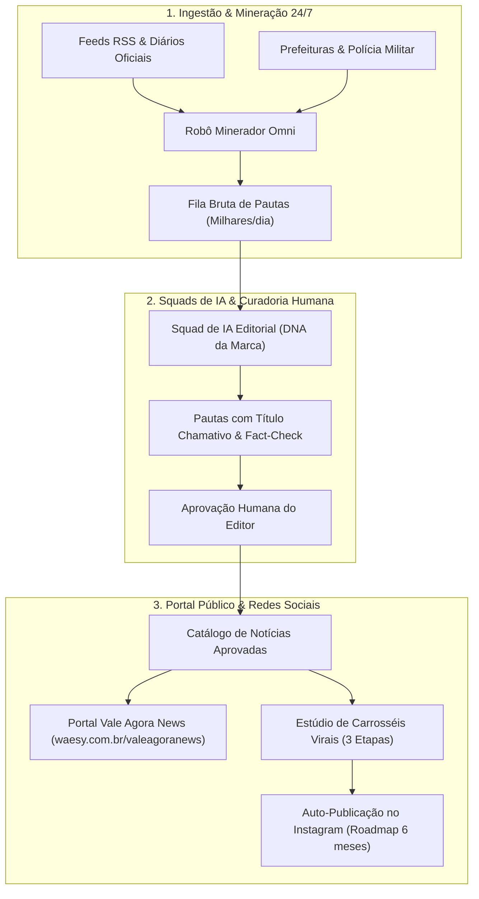

# Relatório Técnico: Template Editorial Omni & Portal Vale Agora News

## 1. Decomposição Visual das 5 Imagens Anexas

| Imagem / Referência | Elementos Visuais e Geometria | Tipografia & Cores | Grid & Layout | Padrão Apple HIG / Ergonomia |
| :--- | :--- | :--- | :--- | :--- |
| **Imagem 1: The Boston Globe Concept** | Logotipo clássico em serif/blackletter, slogan de splash *"Our lives. Your news."*, cabeçalho de seções `MYGLOBE • SECTIONS` com destaque em vermelho, cards de feed com thumbnail quadrado à esquerda e texto à direita. | Serif clássico para manchetes, sans-serif monocromático para metadados, fundo off-white limpo sem sombras decorativas. | Feed vertical denso de alta legibilidade, separadores sutis de 1px, proporção `aspect-square` para imagens. | Touch targets de 44px, alinhamento vertical rigoroso, hierarquia clara entre manchete, resumo e data. |
| **Imagens 2 e 4: iNEWS / Prométhée** | Topo com logotipo em domo geométrico minimalista e sino de alertas; régua de abas com botão `+` à esquerda e aba ativa com indicador inferior; card squircle central com foto arredondada, pílula de categoria translúcida (`Politique`) no canto inferior esquerdo e pílula de tempo (`Há 4h`) no canto inferior direito; parágrafo de lead com alta densidade tipográfica. | Tipografia sans-serif humanista (padrão SF Pro / Inter), alto contraste preto/branco, pílulas de vidro fumê (`bg-black/75 backdrop-blur-md text-white`). | Card squircle em destaque com cantos orgânicos, proporção `aspect-video` / `aspect-[16/10]`, folga interna generosa. | Padrão iOS contemporâneo com Dynamic Island, zero clutter visual, affordance tátil evidente no botão `+`. |
| **Imagem 5: Prométhée Mobile em Mão** | Visão ergonômica em uso real: rodapé do card com texto "Lire plus", contador de aplausos/curtidas (`203`), contador de comentários (`13`), ícone de compartilhamento e marcador de favoritos; dock bar inferior flutuante com 4 destinos (`Actualités`, `Découverte`, `Chat`, `Profil`). | Paleta neutra minimalista, ícones finos monocromáticos, micro-interações de estado selecionado. | Cartão superior terminando com continuidade visual do próximo card logo abaixo (feed infinito sem estalo visual). | Área de polegar desobstruída, alvos de toque superiores a 44x44px (`h-11 min-h-11`), safe-area inferior respeitada. |
| **Imagem 3: Breaking News Live** | Barra de busca no topo com foto de perfil e filtro; abas em pílula (`• Latest`, `For You`, `World`, `Local`); bloco "Breaking News (7)" com marcador amarelo-limão fluorescente; card de notícia ao vivo com badge `• LIVE 8.1k`, botão de play, barra de progresso de vídeo `((•)) 5:36` e selo de fonte verificada (`Post Publishing`). | Contraste acentuado com badge neon amarelo/lima para urgência extrema, vermelho vivo para telemetria ao vivo. | Trilho horizontal de alta urgência com cartões compactos de leitura rápida. | Ergonomia tátil de snap-scroll contínuo, affordance multimídia com indicador de vídeo. |

---

## 2. Arquitetura do Template Omni Builder para Jornais

O template `template_editorial_news` foi registrado na matriz canônica `NICHE_TEMPLATE_MATRIX` (`src/lib/builder/omni-templates.ts`), permitindo que qualquer jornal, emissora ou agência de comunicação crie, edite e personalize seu portal:

### Invariante de Isolamento de Mineração
O minerador automático pode rastrear milhares de notícias externas brutas por dia. No entanto, o site público consome **exclusivamente** os registros que possuem `status = 'published'` pertencentes à loja/empresa e aprovados editorialmente pela curadoria. Isso elimina riscos de fake news, duplicidades ou publicações descontextualizadas.

---

## 3. Estrutura da Página Vale Agora News (`/valeagoranews`)

- **URL Canônica**: `waesy.com.br/valeagoranews` (definida em [src/routes/valeagoranews.tsx](file:///c:/Users/Eduardo%20Ant%C3%B4nio%20Ramo/Documents/waesy/src/routes/valeagoranews.tsx)).
- **Isolamento de Casca**: Rota de nível raiz (`Root Route`), livre de qualquer menu, header, footer ou branding padrão da plataforma.
- **Visualização Dupla**: Switcher nativo que permite alternar entre **Mockup de Celular (iPhone 16 Pro com Dynamic Island)** e **Portal Web Completo (Widescreen responsivo)**.
- **Filtro Geográfico**: Cobertura das cidades do Vale (São José dos Campos, Taubaté, Jacareí, Pindamonhangaba, Guaratinguetá, Caçapava, Lorena, Caraguatatuba, Ubatuba, São Sebastião, Campos do Jordão) e filtro global "Notícias do Vale".
- **Plantão & Urgência (Carrossel Horizontal)**: Trilho de rolagem tátil elástica com indicadores de `AO VIVO` e tempo de leitura (`2 min`).
- **Card Prométhée (Destaque Principal)**: Squircle card com pílula de categoria translúcida, timestamp de leitura, métricas de likes/aplausos, comentários e compartilhamento instantâneo via clipboard.
- **Espaços de Publicidade (ADS)**:
  - Leaderboard superior responsivo (728x90 desktop / 320x50 mobile).
  - Card nativo in-feed para marcas e empresas do Vale.
  - Retângulo médio lateral (300x250) com precificação e conversão de anunciantes.
- **Pauta Cidadã (Botão `+`)**: Modal interativo estilo Threads para envio de furos de reportagem por leitores com encaminhamento para checagem da redação.

---

## 4. Proposta Comercial Turnkey (Modal Integrado)

- **Escopo Completo**:
  1. Design & Personalização Exclusiva do Portal (Apple HIG, tema light).
  2. Deploy & Hospedagem Instantânea (Edge CDN, SSL, 99.9% uptime).
  3. Estruturação de Mineradores Locais de Notícias (24/7).
  4. Squads de IA Jornalística com DNA Editorial da Marca.
  5. Criador de Posts & Carrosséis Virais (Metodologia: Capa Chamativa $\to$ Destrinchar $\to$ Call to Action).
  6. Em 6 meses: Auto-publicação direta no Instagram e redes sociais.
- **Condições Comerciais**:
  - **Setup**: R$ 2.000,00 em **1 + 2 parcelas** de R$ 666,66 ou até **12x sem juros no cartão**.
  - **À Vista**: 15% de desconto no PIX = **R$ 1.700,00**.
  - **Mensalidade**: Primeiros 6 meses **100% gratuitos**. Após 6 meses: **R$ 99,90/mês**, *somente se o portal já estiver monetizado* (com patrocinadores ou anunciantes ativos; caso contrário, carência prorrogada sem custo).
  - **Modelo Whitelabel**: 100% neutro, sem menção à marca Waesy na proposta comercial.
