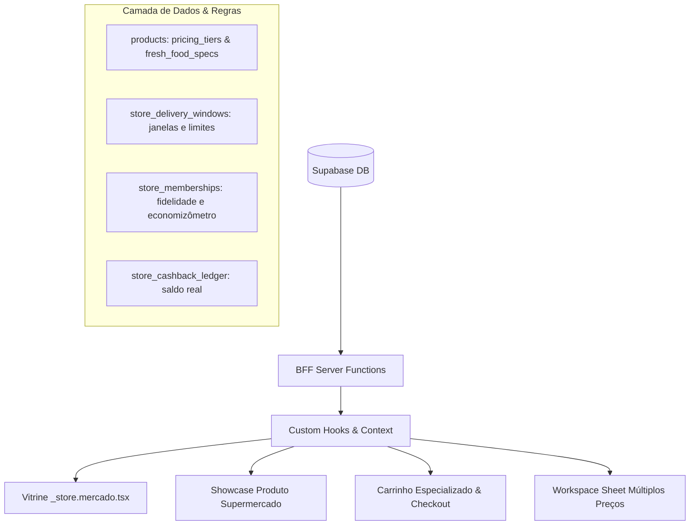

# Masterplan de Engenharia & UX: Supermercados, Açougues, Padarias e Conveniência

> **Status:** Especificação Arquitetural e Plano Executivo de Implementação  
> **Data:** 28 de Outubro de 2026  
> **Autor:** Antigravity / Waesy Design & Commerce Engineering  
> **Referência Visual:** Diretório de UI de benchmark `c:\Users\Eduardo Antônio Ramo\Downloads\uiosuper` (14 telas inspecionadas)

---

## 1. Auditoria Visual Pixel-a-Pixel das Telas de Benchmark

A inspeção detalhada das 14 imagens capturadas do ecossistema de supermercados líderes (**OSuper Digital Commerce**, **Supermercado Koch**, **Komprão Atacadista** e **Supermercado Modelo**) revela um conjunto de padrões ergonômicos indispensáveis para o varejo alimentar. Abaixo está a decomposição anatômica de cada tela:

### 1.1 `unnamed.webp` — Home de Supermercado (App OSuper)
- **Cabeçalho de Identificação de Loja:**
  - Identificador da bandeira ativa (Logo circular à esquerda).
  - Título da loja com chevron de seleção de filial: *"Seu Supermercado • Rua Rui Barbosa... ⌵"*.
- **Hero Banner:**
  - Carrossel fotográfico 16:9 com cantos arredondados (`rounded-2xl`).
  - Indicador de paginação por pontos discretos centralizados logo abaixo da imagem.
  - Mensagem comercial institucional: *"Comprar online é fácil, prático e seguro."*
- **Campo de Busca Global:**
  - Campo em formato pílula com fundo neutro (`bg-muted/50 border-border/60`).
  - Ícone de lupa à esquerda, placeholder contextual (*"Água|"*) com cursor ativo.
  - Ações auxiliares diretas no input: ícone de microfone (busca por voz) e leitor de código de barras (scanner físico de câmera).
- **Dock de Categorias Circulares:**
  - Ícones fotográficos em círculos perfeitos com fundo neutro suave: *Ofertas*, *Hortifrúti*, *Bebidas*, *Padaria*, *Carnes*.
  - Rótulos tipográficos compactos de 12px centralizados abaixo de cada círculo.
- **Seletor de Modalidade e Janela de Entrega:**
  - Bloco interativo em card soberano: `[Ícone Caminhão] Entrega ⌵ | Hoje • 9h às 10h • R$ 20,00 | >`.
  - Permite alternar entre Entrega Expressa/Agendada e Retirada no local com exibição imediata do próximo horário e valor da taxa.
- **Trilho de Benefícios e Incentivos:**
  - Chip 1: `[Presente] Ganhe frete grátis acima de R$ ***,00`.
  - Chip 2: `[Cupom] 30% off na primeira compra`.
- **Seção de Ofertas:**
  - Cabeçalho de seção: *"Ofertas"* com link de ação *"Ver mais →"*.
  - Grid de produtos de supermercado com steppers de adição rápida.
- **Barra de Carrinho Flutuante (Floating Cart):**
  - Pill verde com cantos arredondados (`bg-emerald-600 text-white rounded-2xl`):
  - Lado esquerdo: `[Sacola] 2 itens`.
  - Centro: *"Ver carrinho"*.
  - Lado direito: *"R$ 5,98"*.
- **Barra de Navegação Inferior (Bottom Nav Especial de Supermercado):**
  - 4 abas canônicas: **Início** (casa), **Ofertas** (com badge verde `99+`), **Compras** (pedidos anteriores/listas) e **Menu** (avatar do usuário com hambúrguer).

---

### 1.2 `unnamed (1).webp` — Página de Detalhe de Hortifrúti (*Tomate Caqui Kg*)
- **Cabeçalho:** Botão fechar `[✕]`, título centralizado *"Tomate Caqui Kg"*, ações de compartilhamento `[↗]` e favoritar `[♡]`.
- **Área de Mídia:** Fotografia nítida do produto sobre fundo neutro livre de ruídos, sem overlays invasivos.
- **Seletor de Modalidade de Venda (Unidade vs Peso):**
  - Segmented control canônico: botão `Unidade` e botão `Peso` (ativo com fundo verde contrastante).
- **Seletor de Maturidade (Exclusivo para Hortifrúti):**
  - Rótulo: *"Escolha a maturidade"*.
  - 3 opções horizontais com rádio e checkmark: `○ Menos maduro`, `◉ Maduro` (selecionado em amarelo/verde), `○ Mais maduro`.
- **Preço e Condição Comercial:**
  - Exibição de preço formatado: *"R$ 4,99 | Kg"*.
  - Badge contextual informativo: `[Cifrão Verde] Preço exclusivo online`.
- **Campo de Instruções do Separador:**
  - Ação tátil: `[Lápis] Adicionar instrução >` (permite ao cliente orientar o separador, ex: *"preferência por tomates mais firmes para salada"*).
- **Ação Primária:** Botão verde 100% largura com altura >= 44px: *"Adicionar ao carrinho"*.

---

### 1.3 `unnamed (2).webp` — Carrinho de Supermercado com Order Bump e Frete Grátis
- **Cabeçalho:** `[←]` Voltar, Título *"Meu carrinho"*, Ação secundária no topo *"Limpar"*.
- **Lista de Produtos:**
  - Item 1 (Embalado): Mortadela Sadia 180g — R$ 7,19 — Stepper `[-] [2] [+]`.
  - Item 2 (Pesável): Tomate Caqui Kg — R$ 4,99 — Stepper com unidade de medida `[-] [2 kg] [+]`.
  - Item 3 (Promocional): Pão Artesano 500g — R$ 12,49 — Badge azul: *"Até 50% de desconto, a un. sai por R$ 6..."* — Stepper com lixeira no valor 1: `[Lixeira] [1] [+]`.
  - Menu de opções rápidas `[...]` em cada linha de item para comentários e exclusão.
- **Card de Automação de Upsell / Cross-sell (Order Bump):**
  - Bloco em destaque sutil com ícone de raio: `⚡ Oferta relâmpago`.
  - Produto sugerido (ex: *Coca Cola Lata 350ml por R$ 3,99*) com botão direto `[Adicionar]`.
- **Barra de Progresso de Frete Grátis (Gamificação de Compra):**
  - Indicador visual verde 100%: `[Presente] Você ganhou Frete Grátis!`.
- **Footer Sticky de Fechamento:**
  - Total com transparência: *"R$ 177,27"* e link *"Saiba mais >"*.
  - Botão de ação primária: *"Finalizar compra"*.

---

### 1.4 `unnamed (3).webp` — Fluxo de Checkout: Opções de Envio
- **Barra de Progresso do Checkout:**
  - Stepper visual em linha: `Envio • Pagamento • Revisão`.
- **Título de Intenção:** *"Escolha como você deseja receber sua compra"*.
- **Opção 1 (Entrega):**
  - Card selecionável com borda: `[Caminhão] Receber em meu endereço` com rádio check.
  - Endereço cadastrado: *"Minha casa — Rua das Flores, 123 — Bairro Jardim das Acácias"*.
  - Link de alteração: *"Escolher outro endereço"*.
- **Opção 2 (Retirada):**
  - Card selecionável com borda: `[Fachada de Loja] Irei retirar na loja` com rádio check.
  - Filial: *"Loja 1 — Avenida Brasil, 456 — Centro"*.

---

### 1.5 `unnamed (4).webp` — Fluxo de Checkout: Método de Pagamento
- **Barra de Progresso:** `✔ Envio • Pagamento • Revisão`.
- **Título de Intenção:** *"Como você prefere pagar?"*.
- **Grupo 1: "Pagar agora" (Online):**
  - Cartões de crédito salvos (Mastercard 1245, Visa 4578).
  - Pix com badge visual azul `Novo`.
  - Cartão fidelidade próprio da rede (*"Pagar com Cartão da loja"*).
  - Ação para *"Novo cartão"*.
- **Grupo 2: "Pagar na entrega" (Presencial / Maquininha):**
  - Pix na entrega.
  - Dinheiro (com campo opcional de troco).
  - Cartão físico na maquininha levada pelo entregador.

---

### 1.6 `unnamed (5).webp` — Fluxo de Checkout: Revisão do Pedido e Pesagem
- **Título:** *"Revise e finalize sua compra"*.
- **Gestão de Cupons:**
  - Card de cupons disponíveis: `[Cupom] 3 cupons disponíveis >`.
  - Input para código promocional manual: `[ Digite cupom promocional ] [ Aplicar ]`.
- **Resumo Financeiro:**
  - Subtotal: R$ 177,27.
  - Valor da entrega: **Grátis** (em destaque verde).
  - Divisória sutil e Total Final: R$ 177,27.
- **Aviso Legal Obrigatório de Pesagem (Invariante do Varejo Alimentar):**
  - *"O valor total de sua compra poderá ser alterado, para mais ou para menos, caso ocorra alguma alteração no seu pedido durante o processo de separação. Saiba mais."*
- **Miniatura e Conferência dos Itens:**
  - Card *"26 itens"* com galeria horizontal de thumbnails e badge `+20`, acompanhado do botão *"Alterar"*.
- **CTA Primário Final:** Botão verde *"Comprar"*.

---

### 1.7 `unnamed (6).webp` e `unnamed (7).webp` — Supermercado Modelo (Banners Contínuos e Gestão de Carrinho)
- **Capa Hero Imersiva 100% da Largura:**
  - Capa com fundo de alimentos frescos ocupando toda a extensão superior da tela com cantos inferiores arredondados (`rounded-b-3xl`).
  - Logotipo centralizado e pill de status operacional: `[Caminhão] Próximo horário: 23/03 - De 08:00 às 12:00`.
- **Carrossel de Banners Contínuo Estilo Instagram:**
  - Mídias coladas sem espaço em branco lateral, com rolagem deslizante fluida e infinita (ex: Banner da Cerveja Heineken).
- **Cards de Produtos de Supermercado:**
  - Preço em destaque tipográfico vermelho bold (`R$ 6,99`).
  - Preço de tabela riscado (`R$ 7,99`).
  - Badge de economia líquida: `R$ 1,00 off`.
  - Botão circular de adição rápida `(+)` no canto superior do card.
- **Carrinho com Comentários Individuais:**
  - Cada item possui botão explícito `[Lápis] Comentários` para indicar substituições ou cortes ao operador de supermercado, além do botão de exclusão imediata `[Lixeira] Remover`.

---

### 1.8 `206fa5ee26c5a53a91c550c066537767c3fa6b57-CvZbjGSp.webp` — Onboarding de Seleção de Bandeira (Clube K)
- Permite ao cliente escolher entre a bandeira de varejo (*Supermercado Koch*, em azul marinho) e a bandeira de atacarejo (*Komprão Koch Atacadista*, em vermelho), com aplicação imediata do tema e regras tributárias/tabelas de atacado.

---

### 1.9 `2e4f5e9a2f91b9fe967377ee7f4d94c34c5910da-DdHTo2KZ.webp` — Ofertas do Clube com Taxonomia Rica de Badges
- **Badges em Fita Superior (Fita Angular/Ribbon):**
  - `Clube K` (fundo azul) + `Oferta` (fundo vermelho).
  - `Clube K` + `Progressivo` (desconto que aumenta conforme a quantidade).
  - `Clube K` + `Mais por menos` (ex: Leve 10, Pague 9).
  - `Clube K` + `Compre e ganhe` (compre o produto principal e ganhe brinde ou item complementar).
- **Badges de Restrição e Governança:**
  - `Máx. 10 por CPF` (badge cinza neutro prevenindo compras predatórias/revenda desautorizada).
- **Badges de Recompensa:**
  - `R$ 3 Cashback` (fita verde recortada indicando saldo real devolvido à carteira).
- **Regras Comerciais em Tags:**
  - `Até 20% desconto`.
  - `Leve 10, Pague 9`.
  - `A partir 4 un, Frete grátis`.
- **Barra de Contagem Regressiva de Urgência:**
  - `TERMINA EM: 4D:14HRS` (barra amarela na base do card com cronômetro real).
- **Disclaimer Legal de Validade:**
  - *"Válido até 00/00, sujeito a estoque."*

---

### 1.10 `36e58100f217f6187edb5caecdb38d5287c06c7e-B3QnkEUN.webp` — Página de Detalhe de Produto (*Heineken C/6*)
- **Badges Flutuantes sobre a Imagem:**
  - `Patrocinado` (indicação transparente de ad impulsionado).
  - `Destaque` (curadoria da loja).
  - `Gelado` (especificação de temperatura imediata para consumo).
- **Metadados:** Título do produto, código SKU (`SKU 4237564`).
- **Condições Especiais:** Tag rosa `Leve 3, Pague 2`, tag `🔹 Exclusivo para você`.
- **Helper Text do Carrinho:** Mensagem explicativa em tempo real: *"Adicione 3 itens ao carrinho e pague 2 unidades."*.
- **Cards de Políticas do Item:**
  - `ℹ Esta oferta tem limite de 10 un. por CPF.`
  - `[Cashback] Cashback de R$ 3,00. Válido para até 5 un. por CPF.`
  - `Sobre a oferta: Na loja física a 3ª unidade sai por 0,01 centavo.`

---

### 1.11 `536610edfe7bcc1f61e341d2c5bee3176af5957a-DnGlqKVB.webp` — Dashboard do Membro do Clube
- **Saudação ao Cliente:** *"Boa tarde, Lucas • Você é cliente Clube K"*.
- **Cards de Métricas:**
  - `Cashback` (Saldo acumulado: R$ 7,41).
  - `Cupons` (6 cupons ativos disponíveis para resgate).
  - `Carteira do cliente` (gestão de formas de pagamento e cartão da loja).
- **Card Economizômetro:**
  - Total economizado no mês pelo cliente graças aos descontos do clube (ex: *"R$ 1.877,85 economizados"*).

---

### 1.12 `97374a455e8c34547a267334b5a94ca37ddcf609-Nlm_CYpg.webp` e `a6fca87e15f1987612adc51aec0c3310a0cfb7ce-cP2bsthe.webp` — Identidade de Bandeiras (Komprão e Koch)
- **Komprão (Vermelho):** Foco em volume, atalhos para *Encarte Digital*, *Sorteios*, *Nossas lojas*, *Lista de compras*.
- **Koch (Azul):** Foco em conveniência urbana, atalho para *Solicite seu cartão Koch*, frete grátis e visualização de itens com múltiplos de caixa.
- **Bottom Navigation Canônica do Ramo:**
  - `Início` (Home da loja ou vitrine)
  - `Ofertas` (%)
  - `Clube` (Logo da marca / Dashboard de benefícios)
  - `Cartão` (Crédito próprio da loja e histórico de faturas)
  - `Menu` (Perfil civil, configurações e suporte)

---

## 2. Diagnóstico de Lacunas do Waesy Atual

Atualmente, a rota `src/routes/_store.mercado.tsx` utiliza o `CommercialShowcaseTemplate` (modelo iFood unificado para restaurantes). Embora robusto para entrega de refeições, ele não atende às particularidades de supermercados, mercearias, padarias e açougues:

| Recurso Necessário | Situação no Waesy Atual | Necessidade no Novo Motor |
| :--- | :--- | :--- |
| **Capa Hero Imersiva 100%** | Não existe em `_store.mercado` (ocupa container restrito). | Capa contínua com cantos inferiores arredondados (`rounded-b-3xl`) e carrossel estilo Instagram. |
| **Seletor de Agendamento** | Modal genérico com endereço simples. | Seletor de modalidade Entrega vs Retirada com janelas cronometradas de horário e taxa de entrega. |
| **Produtos por Peso / Fracionados** | Campo básico de quantidade numérica inteira. | Suporte a Kg, gramas, maturidade de hortifrúti (Verde, Maduro, Muito Maduro) e corte de açougue. |
| **Taxonomia de Badges de Clube** | Apenas tags estáticas de texto. | Badges em fita angular (`Clube`, `Leve X Pague Y`, `Limite por CPF`, `Cashback`, `Countdown`). |
| **Cálculo de Descontos Complexos** | Preço fixo com cupom percentual global. | Motor inteligente que calcula automaticamente "Leve 3 Pague 2", preço de atacado e cashback no checkout. |
| **Disclaimer Legal de Pesagem** | Inexistente. | Alerta legal de variação de pesagem durante a separação de carnes e hortifrúti. |
| **Gestão no Workspace/Admin** | Tabela com campo único de preço. | Sheet com múltiplas colunas de preços: Preço Online, Preço de Clube e Preço de Balcão/Físico com regras de CPF e SKU fiscal. |

---

## 3. Arquitetura das 7 Camadas: Solução Técnica Canônica



### 3.1 Camada 1: Banco de Dados & Schemas (PostgreSQL / Supabase)
1. **Campos Estruturados na Tabela `products`:**
   - `pricing_tiers` (JSONB):
     ```json
     {
       "online_cents": 1299,
       "club_cents": 1099,
       "counter_cents": 1399,
       "wholesale_min_qty": 6,
       "wholesale_cents": 999
     }
     ```
   - `promotional_rules` (JSONB):
     ```json
     {
       "rule_type": "buy_x_pay_y",
       "buy_qty": 3,
       "pay_qty": 2,
       "max_per_cpf": 10,
       "min_age_restriction": 18,
       "cashback_cents": 300,
       "ends_at": "2026-11-05T23:59:59Z"
     }
     ```
   - `fresh_food_specs` (JSONB):
     ```json
     {
       "pricing_unit": "kg",
       "allow_maturity_selection": true,
       "prep_options": ["Bife fino", "Em pedaço", "Moído 2x"],
       "estimated_weight_kg": 1.0,
       "temperature_tag": "gelado"
     }
     ```
   - `fiscal_data` (JSONB): SKU, NCM, CEST, código de barras EAN-13.
2. **Tabela de Agendamento `store_delivery_windows`:**
   - `id`, `store_id`, `day_of_week`, `start_time`, `end_time`, `max_orders_capacity`, `fee_cents`, `is_active`.
3. **Tabela de Fidelidade `store_memberships`:**
   - `id`, `user_id`, `store_id`, `cpf`, `total_saved_cents` (Economizômetro), `joined_at`.
4. **Tabela de Recompensas `store_cashback_ledger`:**
   - `id`, `user_id`, `store_id`, `amount_cents`, `transaction_type`, `expires_at`.

---

### 3.2 Camada 2: Server Functions (BFF)
1. **`supermarket.functions.ts`:**
   - `getSupermarketStorefrontData`: Retorna dados da loja/rede, carrossel de capa contínuo, janelas de entrega disponíveis, categorias circulares e ofertas em destaque.
   - `getSupermarketClubDashboard`: Consulta o saldo de cashback, total economizado (economizômetro), cupons do cliente e sorteios ativos.
   - `calculateSupermarketPromotion`: Executa o algoritmo determinístico de "Leve X Pague Y", valida limite por CPF e aplica cashback acumulado.
   - `saveProductPricingTiers`: Permite ao lojista configurar em tempo real preços Online, Clube e Balcão no Workspace.

---

### 3.3 Camada 3: Componentes Canônicos de Interface

1. **`SupermarketHeroContinuousCarousel`:**
   - Carrossel com banners fotográficos contínuos estilo Instagram, rolagem elástica e transição automática.
2. **`SupermarketHeaderCluster`:**
   - Seletor de unidade/filial (`Camboriú R. Quinze de Novembro... >`), campo de busca em formato pill com ícones de voz e leitor de código de barras.
3. **`SupermarketFulfillmentPill`:**
   - Seletor compacto `Entrega ⌵ | Hoje • 9h às 10h` com Sheet/Drawer para escolher janela de entrega ou retirada.
4. **`SupermarketCategoryCircleDock`:**
   - Trilho horizontal de ícones fotográficos circulares (*Ofertas*, *Hortifrúti*, *Padaria*, *Bebidas*, *Carnes*).
5. **`SupermarketProductCard`:**
   - Card vertical com badges em fita (`Clube`, `Leve 3 Pague 2`, `Máx por CPF`, `Cashback`), preço promocional, tag de validade e botão de adição rápida.
6. **`SupermarketProductDetailView`:**
   - Modal/Página completa do produto: seletor de Unidade vs Peso (Kg), rádio de maturidade (Menos maduro, Maduro, Mais maduro), instrução ao separador e cálculo do benefício do clube.
7. **`SupermarketCartSheet`:**
   - Carrinho de compras especializado: agrupamento por departamento, steppers fracionados de peso (`2 kg`, `500 g`), botão de comentários por item, card de Order Bump (*Oferta relâmpago*) e barra de progresso de frete grátis.
8. **`SupermarketCheckoutFlow`:**
   - Fluxo de 3 etapas com stepper (*Opções de envio* -> *Método de pagamento* -> *Revisão com aviso de pesagem*).
9. **`SupermarketBottomNav`:**
   - Barra inferior temática: *Início*, *Ofertas*, *Clube*, *Compras/Carrinho* e *Menu*.
10. **`ProductCatalogPricingSheet`:**
    - Modal/Sheet no Workspace para edição rápida das 3 tabelas de preços e regras promocionais por produto.

---

## 4. Plano de Implementação em 6 Fases

| Fase | Foco | Entregáveis | Evidência de Aceite |
| :--- | :--- | :--- | :--- |
| **Fase 1** | **BFF & Tipos DTO** | `supermarket.functions.ts`, schemas Zod para múltiplos preços, promoção "Leve X Pague Y" e janelas de entrega. | Testes unitários do cálculo promocional aprovados. |
| **Fase 2** | **Componentes de Vitrine** | `SupermarketHeroContinuousCarousel`, `SupermarketHeaderCluster`, `SupermarketFulfillmentPill`, `SupermarketCategoryCircleDock`. | Renderização canônica sem CLS e com alvos >= 44px. |
| **Fase 3** | **Card & Detalhe de Produto** | `SupermarketProductCard`, `SupermarketProductDetailView` (com seletor Kg/Unidade e maturidade). | Badges de Clube K e cálculo visual de economia em tempo real. |
| **Fase 4** | **Carrinho & Checkout** | `SupermarketCartSheet`, fluxo de envio/retirada, pagamento (online e na entrega) e revisão com disclaimer de pesagem. | Pedido gerado com persistência real em `orders`. |
| **Fase 5** | **Dashboard do Clube** | `SupermarketClubDashboardView` (Economizômetro, saldo de cashback e cupons ativos). | Métricas reais de economia e carteira populadas do Supabase. |
| **Fase 6** | **Workspace & Integração** | `ProductCatalogPricingSheet` para edição rápida de preços em coluna e integração na rota `_store.mercado.tsx`. | Zero erros TypeScript (`tsc`) e aprovação no `design-lint --ratchet`. |

---

## 5. Próximos Passos Imediatos

1. Aprovar a presente especificação técnica e registrar a decisão no log arquitetural.
2. Iniciar a **Fase 1** com a criação dos contratos de tipos DTO e Server Functions em `src/services/supermarket.functions.ts`.
3. Implementar a **Fase 2** e **Fase 3** refatorando `src/routes/_store.mercado.tsx` e acoplando os componentes canônicos reutilizáveis.
4. Validar rigorosamente contra a catraca mecânica de CI (`node scripts/design-lint.mjs --ratchet`) e compilação limpa do TypeScript.
