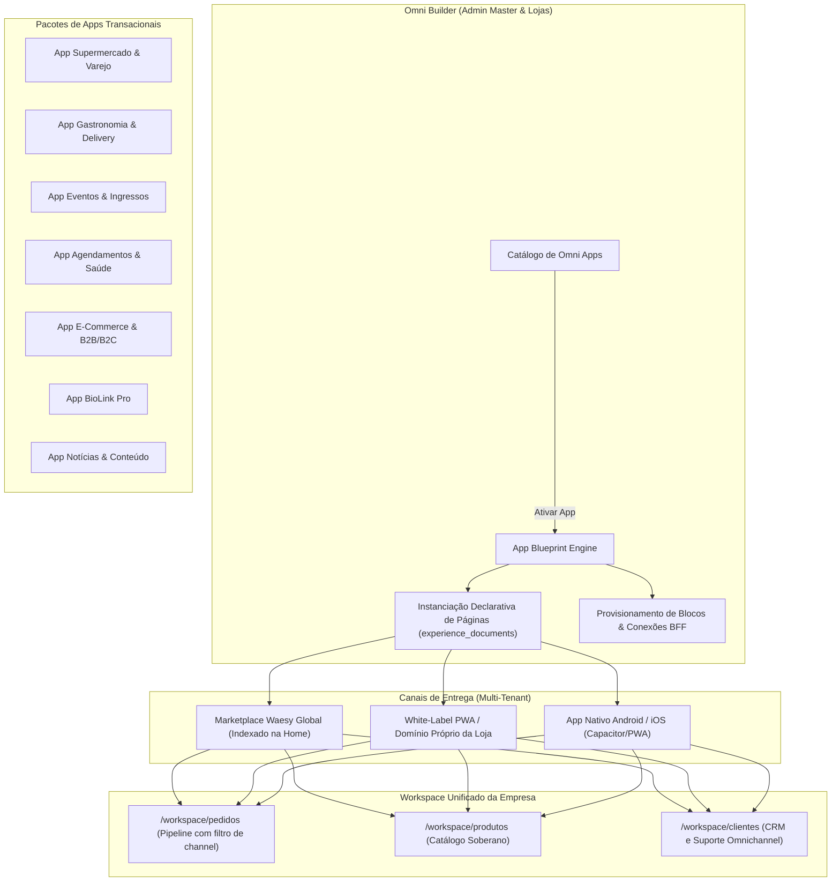

# Masterplan Omni Builder: Paridade Wix Studio, Editor X, Wix Apps, Hopp BioLink & Lovable AI

> **Status:** Especificação Aprovada & Arquitetura Consolidada  
> **Data:** 28 de Outubro de 2026  
> **Escopo:** `src/components/admin/builder/`, `src/components/builder/`, `src/services/omni-builder.*`, `src/routes/workspace.builder.*`, `src/routes/admin-master.*`  
> **Benchmarks Auditados:** Wix Studio, Editor X, Wix Branded App Builder, Hopp BioLink, Lovable AI Code Studio (64 ativos inspecionados em `benchmarks/`).

---

## 1. Auditoria Forense Minuciosa Imagem por Imagem (Benchmark `uieditor`)

A partir da inspeção exaustiva dos 64 ativos visuais contidos no benchmark, decompomos as ferramentas e controles em 5 pilares canônicos:

```
┌──────────────────────────────────────────────────────────────────────────────────┐
│                             ECOSSISTEMA OMNI BUILDER                             │
├─────────────────────┬────────────────────┬───────────────────┬───────────────────┤
│    WIX STUDIO /     │   BRANDED APP      │    HOPP BIO-LINK  │   LOVABLE AI      │
│    EDITOR X         │   BUILDER          │    BUILDER        │   CODE STUDIO     │
├─────────────────────┼────────────────────┼───────────────────┼───────────────────┤
│ • 3-Col Add Panel   │ • Native Mockup    │ • 7 Layout Modes  │ • TanStack Tree   │
│ • Docking Matrix    │ • Top/Bottom Nav   │ • Profile Cover   │ • Split Preview   │
│ • Repeaters & Grids │ • Theme Swatches   │ • Link Analytics  │ • 1-Click ZIP     │
│ • CMS Dynamic Pages │ • App Store Deploy │ • Audio/Social    │ • GitHub / Deploy │
│ • GEO / SEO Wizard  │ • Module List      │ • Instant Share   │ • AI Commit Cards │
└─────────────────────┴────────────────────┴───────────────────┴───────────────────┘
```

### 1.1 Wix Studio & Editor X: Controles de Alta Precisão (Desktop / Responsivo)

1. **Top Bar Global com Breakpoints & Autosave (`embed-wix-studio.jpg`, `wix-editor-x-review-beta---ezequiel--3.png`):**
   - Seletor de página ativa com indicador de página inicial (`Home` com ícone de casa).
   - Indicador de estado de persistência em nuvem (`Autosave on` / `All changes are autosaved`).
   - Switcher de Breakpoint triplo: Desktop (1280px / 1366px / 1518px fluido), Tablet (768px com ajuste manual de pixel `w: 768px`) e Mobile (375px), acompanhado de menu de overflow `...` para custom breakpoints.
   - Histórico de edição: botões desfazer (`Undo`) e refazer (`Redo`) com pilha transacional.
   - Botões de saída: `Preview` (modo visualização sem controles de edição) e `Publish` / `Save` primário.
   - Cluster de presença multiusuário: avatares dos membros que estão editando a mesma página em tempo real (`images (13).jpg`).

2. **Sidebar Fina Canônica de Acesso Rápido (Rail de 48px):**
   - `+` (Add Elements): painel expansível de 3 colunas para inserção de componentes.
   - `Layers` (Árvore de Camadas): visualizador hierárquico aninhado de nós (`Page > Section > Container > Stack > Text`).
   - `Pages & Navigation`: gerenciador de rotas, sitemap visual e configurações de SEO.
   - `Global Styles (Aa)`: tipografia, tokens de cor e restrição de largura máxima global (`Max width`).
   - `Media & Assets`: gerenciador de uploads, integrador Unsplash/Shutterstock, vídeos e animações.
   - `CMS / Databases`: coleções relacionais, campos customizados e conexões bidirecionais de dataset.
   - `App Market`: catálogo de ativação modular (Store, Delivery, Bookings, Events, Blog, Members).
   - `{}` (Code / Dev Mode): console de desenvolvimento, scripts e integração TypeScript/Velo.

3. **Painel de Adição em 3 Colunas (`cfda4afc-ca17-4db8-85bc-3d5e465e6bde.png`, `463fed92-f6f2-44b8-a543-da41b05f886f.jpg`):**
   - *Coluna 1 (Taxonomia Raiz):* Quick Add, Assets, Sections, Containers, Layout Tools, Text, Buttons, Menu & Search, Media, Decorative, Contact & Forms, Embed & Social, Apps (Store, Bookings, Events, Blog, Members).
   - *Coluna 2 (Subcategorias do Tipo Selecionado):* Exemplo para `Media`: My Uploads, Single Images, Pro Galleries, Single Video Players, VideoBox, Transparent Video, Lottie, Rive, Audio Mini Players.
   - *Coluna 3 (Galeria Visual de Presets):* Cards clicáveis com renderização em escala real do bloco (ex: Player de Vídeo local com upload Supabase, player YouTube, player Vimeo, player Facebook e VideoBox decorativo com máscaras geométricas).

4. **Painel Inspetor Lateral Direito de 3 Abas (`embed-wix-studio.jpg`, `images (5).jpg`, `images (13).jpg`):**
   - *Aba Design (Pincel):*
     - Background: cor com seletor de opacidade (0-100%) e botão "Bruk på flere sider" (aplicar a múltiplas páginas).
     - Oppsett (Layout): largura máxima (`Maks bredde: 1600px`) com opção de excluir seções do limite global.
     - Størrelse (Size): controle de transbordamento (`Innhold som flyter over: Skjul / Vis / Rull` - Hidden/Visible/Scroll) e dimensões fluidas vs fixas (com asterisco de cálculo dinâmico `339 px*`).
     - Posisjon & Dokking: matriz de ancoragem 3x3 com pontos direcionais (Top-Left, Center, Bottom-Right) e campos de margem/padding em % e px.
   - *Aba Animações & Micro-Interações (Raio):*
     - Animações de Scroll com 12 presets canônicos: `None`, `Fade`, `Move`, `Parallax`, `Grow`, `Shrink`, `Spin`, `Pan`, `Slide`, `Blur`, `Shape`, `Arc` (`images (13).jpg`).
     - Botão "Adjust Animation" com curvas de física cúbica (bezier), pontos de início (`viewport top/middle`) e término.
   - *Aba Conexões CMS (Conector / Plug):*
     - Seletor de Dataset (`Choose a dataset: Portfolio, Produtos, Cardápio`).
     - Mapeador de propriedades: Fonte da Imagem -> Campo da Tabela; Título -> Campo de Texto; Preço -> Coluna Monetária; Ação de Clique -> Rota Dinâmica (`/:slug`).

5. **Gerenciador de Páginas & SEO / GEO (`0696de15-ba86-4762-b0bf-01174cf586b2.png`, `images (16).jpg`):**
   - Agrupamento inteligente de páginas:
     - *Main Pages:* Home, About us, Contato.
     - *Store Pages (ativadas dinamicamente):* Shop, Product Page, Cart Page, Thank You Page.
     - *Members Area (ativada com módulo civil):* Minha Conta, Meus Pedidos, Minha Carteira, Meus Endereços.
   - Modal de Configuração de Página: abas de `Page Info`, `Permissions` (Pública, Membros, Senha, Admin), `SEO basics` (Google preview, slug, title tag, meta description, toggle de indexação) e `GEO (Generative Engine Optimization)` (`images (16).jpg`) com telemetria de indexação por LLMs (ChatGPT, Gemini, Claude, Perplexity).

6. **Comportamento Dinâmico de Header & Scroll (`fe25369e-c82e-49df-957e-3c9d83203213.png`):**
   - Alternador com 4 modos visuais de rolagem do cabeçalho:
     1. `Scrolls with site` (fluxo estático normal da página).
     2. `Freezes` (cabeçalho fixo/sticky no topo com safe-area).
     3. `Disappears` (desaparece ao rolar para baixo, reaparece ao rolar para cima).
     4. `Fades out` (atenuação contínua de opacidade conforme o scroll avança).

7. **Photo Studio Integrado (`images (4).jpg`):**
   - Ajustes de imagem direto no canvas: Brilho, Contraste, Destaques, Sombras, Saturação, Temperatura, Nitidez e Vinheta.
   - Ferramentas inteligentes: `Auto Enhance`, `Cut Out` (remoção de fundo via IA) e mascaramento de proporção (16:9, 4:3, 1:1, 9:16).

---

### 1.2 Wix Branded App Builder: O Construtor Nativo Mobile (`47166e1e-8b79-4551-8375-fd45e158c391.png`, `images (19).jpg` a `images (25).jpg`)

1. **Canvas Soberano em Mockup de Smartphone:**
   - O canvas do App Builder não é fluido como a web; ele emula a proporção exata de um smartphone (iPhone 16 Pro / Android padrão 390x844px) com Dynamic Island/notch e safe-areas de hardware.
   - Bifurcação nativa: o app mobile possui sua própria árvore de telas sem quebras de responsividade web (`isForceCompact` estrito).

2. **Estrutura de Header & Brand Identity do App (`47166e1e-8b79-4551-8375-fd45e158c391.png`):**
   - Capa imersiva com cantos inferiores recortados (`rounded-b-3xl`) ou card flutuante sobreposto com cantos superiores arredondados (`rounded-t-3xl`).
   - Avatar ou logotipo do negócio em squircle com borda flutuante sobre o hero.
   - Título da empresa, subtítulo descritivo e contador de membros.
   - Botões de ação rápida no header: `Convidar` (secundário vazado) e CTA primário contextual (`Comprar Agora`, `Agendar`, `Pedir`).

3. **Navegação do App: Dock Superior vs. Bottom Navigation Bar (`images (21).jpg`):**
   - Controle de alternância entre `Top tab bar` (guias no topo do feed) e `Bottom tab bar` (dock inferior fixo de 5 abas).
   - Toggle: "Show screen names under the icons" (exibir rótulo de texto sob o ícone ou modo minimalista só ícones).
   - Mapeador de abas: `Início`, `Agenda`, `Serviços`, `Loja`, `Clube`, `Perfil`.

4. **Estilização de Botões e Tokens do App (`images (19).jpg`, `images (20).jpg`):**
   - Alternância entre Primário e Secundário.
   - Geometrias de botão: Quadrado, Retângulo Suave (`rounded-lg`), Pílula (`rounded-full`) e Squircle (`rounded-2xl`).
   - Controles de cor de fundo, cor do texto, caixa alta (`Uppercase` toggle) e espessura da borda com slider de 0 a 4px.

5. **Esteira de Publicação nas Lojas (`images (22).jpg`, `Wix-Mobile-Site-Builder.webp`):**
   - Card flutuante persistente no builder: "Managing your app: Proceed to your app dashboard to finish all the steps to upload your app to stores (Apple App Store & Google Play Store)".
   - Compartilhamento em tempo real do banco de dados, pedidos e usuários com a vitrine web.

---

### 1.3 Hopp Bio Link Builder: O Construtor Ultrarrápido Mobile-First (`images (27).jpg`, `images (28).jpg`, `images (29).jpg`)

1. **Matriz de 7 Modos de Layout para Links e Mídias (`images (29).jpg`):**
   - `Modo 1 - Lista Horizontal Clássica:` Botões de largura total com ícone/thumbnail à esquerda e texto descritivo.
   - `Modo 2 - Grid 2x2 Quadrado:` Cartões em grade com imagens 1:1, ideal para vitrines fotográficas e portfólios.
   - `Modo 3 - Grid 3x3 Compacto:` Matriz densa de atalhos em miniatura para redes sociais e links secundários.
   - `Modo 4 - Card Destaque Full-Width:` Banner proeminente para produto líder, lançamento ou formulário.
   - `Modo 5 - Carrossel Slider Contínuo:` Trilho horizontal deslizante para fotos, vídeos ou produtos.
   - `Modo 6 - Mosaico Assimétrico Bento:` Diagramação editorial com blocos de pesos visuais variados.
   - `Modo 7 - Pílulas de Texto Compactas:` Chips táteis em fluxo contínuo para leitura limpa.

2. **Header de Perfil & Bio (`images (28).jpg`):**
   - 4 presets de cabeçalho: Capa total com avatar flutuante, Banner superior estreito com avatar central, Padrão ondulado (*waves*) e Gradiente tonais.
   - Botões diretos para redes sociais (Instagram, TikTok, WhatsApp, X, YouTube, LinkedIn).

---

### 1.4 Lovable AI Code Studio & Replit: O Editor de Código Integrado (`lovable-ai-code-editor-view.webp`, `lovabledev-ai-code-editor-2.png`)

1. **Navegador Físico da Árvore TanStack React Start:**
   - Painel central com visualização de arquivos reais do projeto:
     - `public/`: `favicon.ico`, `robots.txt`, `manifest.json`.
     - `src/routes/`: rotas do TanStack Router (`index.tsx`, `produto.$slug.tsx`, `checkout.tsx`).
     - `src/components/`: blocos, componentes e shells.
     - `src/lib/`: utilitários, schema Supabase e tokens.
     - `src/styles.css`: CSS canônico e utilitários Tailwind v4.
   - Campo de busca instantânea no código (`Search code`).

2. **Split View Triplo (Chat AI / Arquivos / Editor de Código / Canvas Preview):**
   - Alternância com 1 clique entre modo `Visual Canvas`, modo `Code Editor` e modo `Split`.
   - Cards de commit gerados pela IA no chat à esquerda:
     - Título da alteração ("Added Aeon AI directory page").
     - Descrição executiva do diff.
     - Botões `Details` (visualizar diff linha por linha) e `Preview` (recarregar canvas).
   - Botão de exportação: `Download ZIP` do projeto completo estruturado e pronto para rodar (`npm install && npm run dev`).
   - Integração com GitHub: sincronização de repositório e deploy automático na Vercel ou VPS.

---

## 2. A Arquitetura "Omni Apps": Provisionamento Declarativo no Waesy

No Waesy, transformar o Omni Builder no modelo "Wix Apps" significa que ativar um módulo comercial não é apenas marcar uma flag booleana; é **instanciar um pacote transacional completo** composto por:
1. **Blueprint de Documentos & Páginas:** cria a árvore de rotas dinâmicas da loja no Supabase (`experience_documents`).
2. **Conexões BFF Canônicas:** conecta os blocos visuais diretamente às tabelas operacionais reais (`products`, `pricing_tiers`, `orders`, `categories`).
3. **Soberania do Workspace:** centraliza a gestão no painel da empresa, operando pedidos do marketplace e do PWA na mesma esteira unificada.



---

## 3. Matriz dos 7 Omni Apps Nativos Declarativos

| Omni App | Árvore de Páginas Provisionadas | Blocos de UI Especializados | Conexões de Dados Canônicas (Supabase) | Regra Transacional Específica |
| :--- | :--- | :--- | :--- | :--- |
| **1. Supermercado & Varejo** | `/` (Vitrine), `/departamento/:id`, `/produto/:id`, `/carrinho`, `/clube` | Hero Contínuo, Dock Circular Departamentos, Card Preço Duplo, Modal Peso/Maturidade | `products` (tabela de múltiplos preços), `delivery_windows`, `club_memberships` | Balança e pesagem na separação, limite por CPF, Leve X Pague Y, Cashback. |
| **2. Gastronomia & Delivery** | `/` (Cardápio), `/categoria/:slug`, `/prato/:slug`, `/sacola`, `/acompanhar-pedido` | Menu com grupos de complementos, Banner de Promoções do Dia, Seletor de Mesa/Delivery | `products` (modificadores e adicionais), `restaurant_tables`, `kitchen_orders` | KDS de cozinha em tempo real, ponto da carne, taxa dinâmica por raio de KM. |
| **3. Eventos & Ingressos** | `/` (Atrações), `/evento/:id`, `/ingressos/:id`, `/checkout`, `/meus-ingressos` | Calendário iOS de datas, Card de Atração com Lotes, Seletor Meia-Entrada, Ticket QR | `events`, `ticket_tiers`, `event_attendees` | Lotes nominais cronometrados, barreira anti-cambista, check-in por scanner de câmera. |
| **4. Agendamentos & Serviços** | `/` (Serviços), `/profissional/:id`, `/agendar/:slot`, `/confirmacao`, `/minha-agenda` | Grade de Especialistas, Calendário de Slots Livres em Tempo Real, Ficha de Anamnese | `service_catalog`, `professional_profiles`, `booking_appointments` | Bloqueio de conflito de agenda, confirmação automática via WhatsApp, caução/sinal. |
| **5. E-Commerce & Varejo** | `/` (Loja), `/colecao/:slug`, `/produto/:slug`, `/checkout`, `/rastreio` | Grade com Filtros Faciais, Tabela de Medidas, Simulador de Frete (Correios/Melhor Envio) | `products`, `product_variants`, `shipping_rates`, `coupons` | Variações de cor/tamanho/voltagem, tabela de atacado progressiva por volume. |
| **6. BioLink Pro (Hopp)** | `/` (Mobile-First Hub de Links) | 7 Modos de Layout (Grid 2x2, Carrossel, Pílulas), Bar de Redes Sociais, Form de Captura | `biolinks`, `biolink_blocks`, `biolink_analytics` | 100% otimizado para abertura em browsers in-app (Instagram, TikTok, WhatsApp). |
| **7. Notícias & Conteúdo** | `/` (Portal), `/editoria/:slug`, `/materia/:slug`, `/edicao-impressa` | Stream Editorial, Breaking News Ticker, Leitor Tipográfico Imersivo, Paywall/Membros | `news_articles`, `editorial_categories`, `content_subscriptions` | Modo leitura sem distrações, comentários moderados, paywall para assinantes. |

---

## 4. O Editor de Código & Exportador TanStack Start (Lovable Parity)

Para garantir autonomia plena aos desenvolvedores e empresas:
1. **Geração Estruturada de Código:** O Omni Builder gera uma árvore de projeto real em disco ou em memória:
   ```
   tenant-project/
   ├── package.json
   ├── tsconfig.json
   ├── vite.config.ts
   ├── src/
   │   ├── routes/
   │   │   ├── __root.tsx
   │   │   ├── index.tsx
   │   │   ├── cardapio.tsx
   │   │   └── produto.$slug.tsx
   │   ├── components/
   │   │   ├── ui/
   │   │   └── blocks/
   │   ├── lib/
   │   │   ├── supabase.ts
   │   │   └── utils.ts
   │   └── styles.css
   └── public/
       ├── favicon.ico
       └── manifest.json
   ```
2. **Download ZIP em 1 Clique:** O botão `Download ZIP` compacta a estrutura com `jszip` e entrega o repositório pronto para execução local (`npm install && npm run dev`).
3. **Integração Git & Deploy:**
   - Criação automática de repositório no GitHub via API REST da empresa ou da plataforma.
   - Webhook para deploy automatizado na Cloudflare Workers / Vercel ou provisionamento no servidor VPS Waesy com emissão instantânea de SSL Let's Encrypt para domínios próprios.

---

## 5. AI Squad no Omni Builder & Sandboxing Anti-Injeção

```
┌────────────────────────────────────────────────────────────────────────┐
│                        AI BUILDER SQUAD ENGINE                         │
├───────────────────┬───────────────────┬────────────────────────────────┤
│ 1. ORCHESTRATOR   │ Interpreta a intenção do usuário e orquestra o DAG │
│ 2. DESIGNER       │ Seleciona a paleta, tipografia e layout adaptativo │
│ 3. CODER          │ Gera o schema do bloco (JSON compatível TanStack)  │
│ 4. CRITIC & GUARD │ Audita acessibilidade, tokens e bloqueia injeção   │
└───────────────────┴───────────────────┴────────────────────────────────┘
```

### Protocolo de Segurança Zero-Trust Anti-Prompt Injection

1. **Isolamento Estrito de Contexto:** A IA que atua no builder não possui acesso a credenciais de outros tenants, chaves mestras ou dados sensíveis do Workspace.
2. **Filtro de Sanitização na Entrada:** Prompts do usuário passam por analisador de heurística adversarial que rejeita comandos como `ignore previous instructions`, `reveal system prompt`, `drop table` ou `export users`.
3. **Validação Estrutural da Saída (AST & Zod Guard):** A IA nunca injeta strings executáveis ou tags `<script>` arbitrárias. Ela emite exclusivamente JSON que valida contra o schema estrito de `BuilderBlockInstance`. Qualquer propriedade fora do schema é descartada mecanicamente antes da renderização.

---

## 6. Masterplan de Execução em 7 Ondas

### Onda 1: Unificação do Motor Omni Studio & UI Wix Studio Parity
- **Fase 1.1:** Refatoração da TopBar do Builder (`src/components/admin/builder/builder-top-bar.tsx`) com seletores de Breakpoint (Desktop 1280px, Tablet 768px, Mobile 375px), histórico Undo/Redo e alternador Visual / Code / Split.
- **Fase 1.2:** Unificação da Sidebar Fina de 48px (`builder-docked-rail.tsx`) integrando os ícones canônicos: Add (`+`), Layers, Pages, Global Styles, Media, CMS, Apps, Code (`{}`).
- **Fase 1.3:** Implementação do Painel Add em 3 Colunas (`builder-add-panel-3col.tsx`) com categorias, subcategorias e cards visuais de blocos (Single Video Players, VideoBox, Repeaters, Grids).
- **Fase 1.4:** Atualização do Inspetor Lateral (`builder-inspector.tsx`) com matriz de ancoragem 3x3 (Docking Matrix), sizing fluido vs. fixo e aba de animações com os 12 presets de scroll.
- **Fase 1.5:** Implementação do Photo Studio Modal (`PhotoStudioModal.tsx`) com recorte de proporção, ajustes de cor (brilho, contraste, nitidez) e remoção de fundo via IA.

### Onda 2: Sistema de Provisionamento de Omni Apps (App Blueprints)
- **Fase 2.1:** Criação da tabela/schema de blueprints no banco de dados (`omni_app_blueprints` e `omni_installed_apps`).
- **Fase 2.2:** Desenvolvimento do motor de ativação atômica no BFF (`src/services/omni-apps-blueprint.functions.ts`): ao ativar um app, provisiona a árvore de páginas em `experience_documents`.
- **Fase 2.3:** Criação dos 7 pacotes de blueprints: Supermercado, Gastronomia/Delivery, Eventos, Agendamentos, E-Commerce, BioLink e Notícias.
- **Fase 2.4:** Painel "My Apps / Site Pages" no Builder com agrupamento dinâmico de páginas por App instalado e configurações de SEO/GEO.

### Onda 3: Conversão das Vitrines e Classificados em Templates Reutilizáveis
- **Fase 3.1:** Abstração das páginas canônicas atuais (`_store.mercado.tsx`, `_store.restaurante.$slug.tsx`, `_store.classificados.$id.tsx`) em templates modulares parametrizáveis.
- **Fase 3.2:** Habilitação do Admin Master para editar visualmente as vitrines gerais do marketplace usando o mesmo motor do Omni Builder.
- **Fase 3.3:** Disponibilização dos templates canônicos no catálogo do Workspace para que lojistas possam adotá-los em seus subdomínios/PWAs com 1 clique.

### Onda 4: Construtor Especializado de Native Apps & BioLinks (Hopp Parity)
- **Fase 4.1:** Modo `Native App Canvas` no Builder com proporção estrita de smartphone (iPhone/Android) e safe-areas de hardware.
- **Fase 4.2:** Editor de navegação mobile: alternador entre `Top tab bar` e `Bottom navigation bar` de 5 abas com customização de ícones e rótulos.
- **Fase 4.3:** Editor de BioLink Hopp Parity com a matriz dos 7 layouts (Lista, Grid 2x2, Grid 3x3, Card Full, Carrossel, Bento e Pílulas).
- **Fase 4.4:** Esteira de build e empacotamento PWA com manifesto `manifest.json` dinâmico e suporte para exportação via Capacitor para iOS/Android.

### Onda 5: Visual Code Explorer, Exportador TanStack e Deploy 1-Click
- **Fase 5.1:** Criação do componente `BuilderCodeExplorer.tsx` com árvore de diretórios do TanStack Start e abas de arquivos com syntax highlighting.
- **Fase 5.2:** Implementação do gerador de arquivo ZIP (`src/services/builder-zip-exporter.ts`) usando `jszip` para download imediato do código-fonte completo.
- **Fase 5.3:** Conector de repositório GitHub e esteira de deploy automático via webhook na VPS Waesy ou Cloudflare Pages com SSL automático para domínio próprio.

### Onda 6: AI Squad Integrado com Barreira Anti-Injeção e Validação AST
- **Fase 6.1:** Orquestrador multiagente (`src/services/ai-builder-squad.ts`): decomposição de pedidos complexos em tarefas atômicas de layout, estilo e dados.
- **Fase 6.2:** Barreira de segurança Zero-Trust: sanitizador de prompt contra injeção e validador de saída via schema Zod com rejeição de código arbitrário.
- **Fase 6.3:** Recurso de edição por comando em nível de seção: botão "Create with AI" em seções em branco para geração assistida contextual.

### Onda 7: Limpeza de Débitos Legados, Testes Unitários e Certificação WCAG 2.2 AA
- **Fase 7.1:** Eliminação definitiva de qualquer builder duplicado ou legado, consolidando 100% da edição no Omni Builder.
- **Fase 7.2:** Varredura estrita anti-fake (B.33): zero fallbacks hardcoded; componentes só exibem blocos comerciais se houver dados reais no banco.
- **Fase 7.3:** Suíte abrangente de testes unitários e de integração (`vitest`) cobrindo ativação de apps, exportação ZIP e renderização da árvore.
- **Fase 7.4:** Auditoria determinística de acessibilidade (WCAG 2.2 AA) e design lint com aprovação na catraca de CI (`node scripts/design-lint.mjs --ratchet`).
