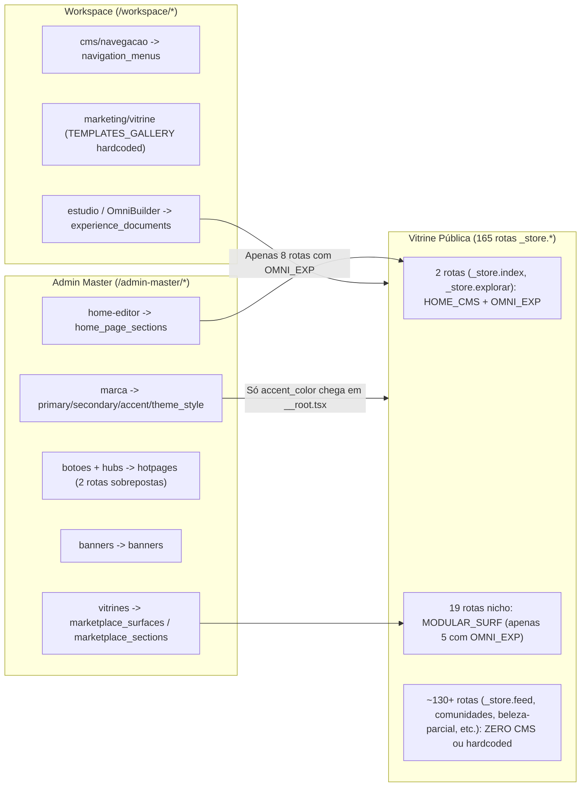

# SPEC-20261113 — Auditoria Forense E2E, Unificação de Shells & Refatoração Bidirecional Global

- **Data:** 2026-11-13
- **Branch Base:** `release/prod-20261113-fullpage-chat-copilot` (`HEAD` `44fd7076`)
- **Status:** Aprovada para Execução Global (Onda 0 -> Onda 5)
- **Escopo:** Transversal (`_store.*` 165 rotas, `workspace.*` 200 rotas, `admin-master.*` 38 rotas, `src/components/`, `src/design-system/`, `src/services/`, `src/lib/`)

---

## 1. Diagnóstico Quantitativo & Forense E2E (Linha de Base Medida)

### 1.1 Gates Automáticos Executados

| Auditoria / Gate | Comando / Script | Resultado Medido |
| :--- | :--- | :--- |
| Design Lint V2 | `node scripts/design-lint.mjs` | **746 violações** em **219 / 2728 arquivos** (`P0: 0`, `P1: 719`, `P2: 23`, `P3: 4`) — Top: `DL-01` (382), `DL-02` (130), `DL-18` (59), `DL-05` (42), `DL-03` (42), `DL-12` (21), `DL-07` (17), `DL-14` (13), `DL-11` (11), `DL-13` (9), `DL-33` (8), `DL-23` (5) |
| Botões & Intenções AST | `node scripts/audit/audit-interactive-buttons.mjs` | **1336 arquivos / 9053 controles** — `P0: 0`, `P1: 1` (`DEAD_BUTTON_NO_ACTION`), `P2: 1` (`STATIC_DISABLED_BUTTON`) em `src/components/extensions/ExtensionWebStoreModal.tsx:490` |
| Paridade de Tokens | `node scripts/token-sync.mjs --check` | **167 tokens DTCG**, `0` aliases quebrados, `0` variáveis ausentes em `src/styles.css` |
| Contraste WCAG | `node scripts/contrast-audit.mjs` | Todos os 34 pares Light/Dark aprovados (`DL-16/17`) |
| Código Morto & Ciclos | `dead-code-detector.mjs` / `check-circular-deps.mjs` | `0` órfãos declarados, `23` colisões de basename, `0` ciclos de dependência |
| Schemas, BFF & Orçamento | `check:schema`, `check:bff`, `check:route-budget` | `608` migrations, `0` tabelas sem declaração local, `100%` dos chunks abaixo do orçamento |

### 1.2 Deriva Semântica, Arquitetural & Visual (Não Coberta pelo Lint Básico)

| Categoria | Evidência Empírica Encontrada | Impacto no Produto |
| :--- | :--- | :--- |
| **Multiplicação de Shells** | **6 implementações concorrentes**: `WorkspaceShell` (`src/components/workspace/workspace-shell.tsx`), `AppShell` + `ContextSidebar` (`src/components/shell/`), `AdminMasterLayout` (`src/routes/admin-master.tsx`), e 3 camadas sem uso ativo no produto (`src/design-system/layouts/`, `src/components/admin/admin-shell.tsx`, `src/components/layout/shell.tsx`, `src/components/ui/canonical/navigation-shell.tsx`). `src/design-system/layouts/navigation-rail.tsx:32,34` aponta para rotas inexistentes (`/workspace/builder`, `/workspace/settings`). | Comportamento visual e breakpoints divergentes entre área pública, workspace e painel master; manutenção triplicada. |
| **Poluição do Sidebar & Cabeçalho** | Em `workspace-shell.tsx`: (1) Trilho de `64px` exibe ícone **e texto** `shortLabel` (`L628-631`) com tooltip HTML nativo verboso (`label — description`, `L617`); (2) Painel secundário repete `{activeMasterPillar.label}` + `{activeMasterPillar.description}` (`L707-714`); (3) `<header>` repete `{activeMasterPillar.label}` + badge de nicho (`L916-923`). Em `admin-master.tsx`, `<aside>` exibe subtítulo `"Administração Global"` + pill `"ROOT"`, grupos compostos e `<Input className="h-8">`. | Repetição tripla do mesmo título na viewport e ruído cognitivo permanente na barra lateral. |
| **Títulos Compostos & Técnicos** | **198 rótulos** em `src/lib/workspace-navigation.ts` e **69 headings JSX** usam `&`, `/`, `—`, parênteses ou jargões (`Painel & Rotina`, `Atendimento & SAC`, `Vendas & PDV`, `Catálogo & Estoque`, `Financeiro & Fiscal`, `Visão Geral & BI`, `Frente de Caixa (PDV)`, `Separação & WMS`, `Places (Lista Telefônica)`, `Ad-Network Arbitrage`, `Ledger Criptográfico (Bacen)`, `SimLabs (Laboratório)`, `Certificados MCTU`). | Interface barulhenta, quebra de leitura rápida em rail/painel e violação sistemática de `content-density` / B.8 / DL-19. |
| **Divergência de Headers de Página** | Das **237 rotas** `workspace.*` e `admin-master.*`: **`ModuleActionHeader`: 0 rotas**, `PageHeader` legado: **82 rotas** (**36** passando `subtitle`/`description` obsoletos), `<h1>` avulso: **99 rotas**, sem header: **56 rotas**. O próprio `module-action-header.tsx:80` usa `lg:flex-row` e `h-10`. | Cada tela inventa própria hierarquia de título, busca e botões; perda de padronização global. |
| **AI-Smell & Ícones Proibidos** | **`Sparkles`** presente em **107 arquivos** de `src/` (vetado por B.50 / `DESIGN.md` C.21), inclusive em `src/components/design-system/ds4-showcase.tsx`, `src/design-system/vitrine/vitrine-lateral-sheet.tsx`, `src/components/shell/utility-cluster.tsx`, `admin-master.home-editor.tsx` e `admin-master.vitrines.tsx`. **59 linhas** com copy conversacional (`"Aproveite o..."`, `"Gerencie suas..."`, `"Acompanhe seus..."`, `"Bem-vindo..."`). | Estética sintética genérica, blocos explicativos desnecessários e quebra do padrão Apple HIG / Linear. |
| **Bifurcação de Viewport (840px vs `md`/`lg`)** | **487 arquivos** alternam visibilidade/layout com `md:` (768px) / `lg:` (1024px) contra apenas **47 arquivos** usando `useWindowSizeClass()`. `AppShell` e `ContextSidebar` usam `hidden md:flex` / `md:hidden`; `WorkspaceShell:1086` usa `pb-28 lg:pb-8` com barra inferior `waesy-compact-medium-only` (<840px), deixando janela entre 840px e 1023px inconsistente; `UniversalClassifiedShowcase:27` usa `useIsDesktop(1024)`. | Quebras entre tablets/foldables (600–839px vs >=840px) e desktop estreito. |
| **Cards, Grids & Margem Mobile** | **28 arquivos** renderizam cards em `grid-cols-3` / `grid-cols-4` (`_store.marketplace.index`, `_store.diretorio.index`, `_store.turismo.index`, `HomeDesktopWebApp`, `modular-surface-feed`, etc.); **23 candidatos** a Containeritis (`DL-31`); **43 arquivos** de card usam `truncate`; **62 rotas** `_store.*` aplicam `px-4` sem `px-0 sm:px-4`; `IFoodStoreFeedCard:82,100` combina `bg-background/75` com `text-primary-foreground` e `top-2.5`; `StoreCard:40-79` usa `shadow-2xs`, gradiente e `"● Aberto"`. | Compressão horizontal, corte de títulos em squircles, baixo contraste em selo sobre imagem no modo claro e acúmulo de padding lateral no mobile. |
| **Fragmentação Bidirecional (CMS ⇄ Vitrine ⇄ Workspace)** | Ver Seção 2 detalhada abaixo. | Mudanças do Admin Master ou do Workspace não propagam de forma uniforme para todas as rotas públicas. |
| **Links Quebrados Detectados** | `_store.index.tsx:703` aponta para `/vagas` (rota real é `/empregos`); `src/design-system/layouts/navigation-rail.tsx:32,34` aponta para `/workspace/builder` e `/workspace/settings`; `ExtensionWebStoreModal.tsx:490` tem botão morto sem ação. | Navegação interrompida e falhas silenciosas em fluxos secundários. |

---

## 2. Mapa Forense Ponta a Ponta do Fluxo Bidirecional

### 2.1 Estado Atual (Desconectado / 3 Motores Concorrentes)

### 2.2 Lacunas Críticas de Propagação Encontradas

1. **Três Motores de Vitrine Desalinhados:** `/admin-master/home-editor` edita `home_page_sections` (lido só por `_store.index` e `_store.explorar`); `/admin-master/vitrines` edita `marketplace_surfaces` / `marketplace_sections` (lido só por 19 verticais); `resolveSurfacePageExperienceDocument` (`OmniPageRenderer`) é carregado em apenas **8** de 165 rotas `_store.*`. Rotas centrais do SuperApp como `_store.feed.tsx`, `_store.comunidades.index.tsx`, `_store.noticias.index.tsx`, `_store.empregos.index.tsx` e `_store.ofertas.tsx` não resolvem `OmniPageRenderer` nem `marketplace_sections`.
2. **Hardcoding Concorrendo com CMS:**
   - `_store.explorar.tsx` declara `CANONICAL_PILLARS` e `DISCOVERY_CATEGORIES` localmente.
   - `HomeMobileNativeApp.tsx` declara `CANONICAL_5X2_CATEGORIES` e `CANONICAL_FEATURE_MINI_BANNERS` localmente.
   - `MultiVitrineDock.tsx`, `_store.marketplace.index.tsx`, `_store.diretorio.index.tsx` e `context-sidebar.tsx` mantêm listas estáticas locais de categorias/explorador separadas de `navigation_menus` e `marketplace_surfaces`.
   - `workspace.marketing.vitrine.tsx` mantém `TEMPLATES_GALLERY` hardcoded na rota em vez de consumir unicamente o registro canônico (`src/lib/builder/`).
3. **Propagação Parcial de Tokens da Marca (`admin-master.marca` -> App Global):**
   - `/admin-master/marca` persiste `accent_color`, `primary_color`, `secondary_color` e `theme_style`, mas `__root.tsx:218-257` injeta apenas `brand?.accent_color`. Os demais tokens da marca não atualizam as variáveis CSS globais do `_store`, `workspace` e `admin-master`.
4. **Sobreposição entre Admin Master e Workspace:**
   - `/admin-master/botoes` e `/admin-master/hubs` editam a mesma entidade lógica (`hotpages`).
   - `/admin-master/home-editor` (`tab: menus_globais`) e `/workspace/cms/navegacao` editam a mesma tabela (`navigation_menus`), enquanto `TopBar`, `ContextSidebar` e `GlobalMenuHub` ignoram `navigation_menus` em parte dos links.
5. **Metadata de Rota Fora das Próprias Rotas:**
   - `app-shell.tsx` mantém listas manuais de ~150 pathnames (`resolveCleanMobileTitle`, `checkHasCustomPageMobileHeader`, `isFullBleedPage`, `isDetailPage`, `isCleanMobileAppPage`), e `workspace-shell.tsx:1084` hardcoda paths full-bleed no JSX em vez de ler `staticData` / registro único de rotas.

---

## 3. Arquitetura Alvo & Regras Normativas (Sintaxe EARS)

### 3.1 Núcleo de Shell Único & Navegação Primária (Icon-Only Rail)

- **REQ-NAV-01 [Ubíquo — Rail Primário Somente Ícone]:** THE SYSTEM SHALL renderizar todas as barras laterais primárias de nível superior (`WorkspaceShell`, `AdminMasterLayout`, `ContextSidebar` no modo rail/compacto e `NavigationRail`) exclusivamente com botões quadrados de `44x44px` (`size-11 min-w-11 min-h-11`) contendo apenas o ícone e indicador de estado ativo, sendo proibido exibir rótulos de texto visíveis abaixo ou ao lado do ícone no rail primário.
- **REQ-NAV-02 [Orientado a Eventos — Hover & Foco no Rail]:** WHEN o usuário passar o cursor (hover) ou focar via teclado (`:focus-visible`) sobre qualquer item do rail primário, THE SYSTEM SHALL exibir um `<Tooltip>` Radix (`delayDuration={120}`, `side="right"`) contendo exclusivamente o nome conciso do módulo (1 a 3 palavras, sem descrição longa nem traços compostos) e manter `aria-label` idêntico no botão.
- **REQ-NAV-03 [Orientado a Estado — Silenciamento do Painel Secundário & Header]:** WHEN o painel secundário do Workspace ou Admin Master estiver aberto em desktop (`>=840px`), THE SYSTEM SHALL omitir o parágrafo explicativo (`pillar.description`) do topo do painel secundário e remover a repetição do título do módulo no cabeçalho superior (`workspace-shell.tsx:916-923`), preservando uma única hierarquia de título na superfície da página.
- **REQ-NAV-04 [Ubíquo — Consolidação dos 6 Shells]:** THE SYSTEM SHALL unificar os três contextos ativos (`_store`, `workspace`, `admin-master`) sobre a arquitetura canônica de layout `src/design-system/layouts/` com um registro único de metadados por rota (título limpo, modo `fullBleed`, `hideMobileHeader`, `hideBottomNav`), arquivando ou removendo os shells redundantes (`components/admin/admin-shell.tsx`, `components/layout/shell.tsx`, `components/ui/canonical/navigation-shell.tsx`).
- **REQ-NAV-05 [Indesejado — Half-Steps e Inline Styles no Bottom Nav]:** THE SYSTEM SHALL remover utilitários fora da grade de 4px (`inset-x-2.5`) e estilos inline de posicionamento na barra inferior do Workspace, usando classes canônicas compatíveis com `840px` (`waesy-compact-medium-only`) e reserva de rolagem sincronizada (`pb-32 pb-safe`) em todos os viewports `<840px`.

### 3.2 Taxonomia de Títulos, Limpeza de Rótulos & Anti-AI-Smell

- **REQ-COPY-01 [Ubíquo — Eliminação de Títulos Compostos e Técnicos]:** THE SYSTEM SHALL padronizar todos os pilares, grupos e itens de menu (`workspace-navigation.ts`, `admin-master.tsx`, `navigation-registry.ts`, `TopBar`, `ContextSidebar`, `MobileNav`, `GlobalMenuHub`) para rótulos diretos em português natural (1 a 3 palavras), proibindo `&`, `/`, `—`, siglas técnicas entre parênteses (`(PDV)`, `(WMS)`, `(BI)`, `(Bacen)`, `(Laboratório)`) e jargões internos. Exemplos canônicos:
  - `Painel & Rotina` -> `Painel`
  - `Atendimento & SAC` -> `Atendimento`
  - `CRM & Clientes` -> `Clientes`
  - `Vendas & PDV` -> `Vendas`
  - `Eventos & Ingressos` -> `Eventos`
  - `Catálogo & Estoque` -> `Catálogo`
  - `Logística & Expedição` -> `Logística`
  - `Suporte & Qualidade` -> `Suporte`
  - `Financeiro & Fiscal` -> `Financeiro`
  - `RH & Equipe` -> `Equipe`
  - `IA & Dados` -> `Inteligência`
  - `Frente de Caixa (PDV)` -> `Caixa`
  - `Ledger Criptográfico (Bacen)` -> `Auditoria Financeira`
  - `SimLabs (Laboratório)` -> `Simulações`
  - `Places (Lista Telefônica)` -> `Lugares`
- **REQ-COPY-02 [Ubíquo — Header Canônico Único de Página]:** WHERE uma rota pertencer a `/workspace/*` ou `/admin-master/*`, THE SYSTEM SHALL utilizar o cabeçalho canônico único (`ModuleActionHeader` / `WorkspaceCanonicalToolbar` atualizado para `840px` e `h-11`), migrando todas as 82 ocorrências de `PageHeader` legado (removendo props `subtitle`/`description`) e os 99 `<h1>` manuais, garantindo título com no máximo 6 palavras e zero subtítulos explicativos.
- **REQ-COPY-03 [Indesejado — Erradicação de `Sparkles` & AI-Smell]:** THE SYSTEM SHALL substituir todas as 107 ocorrências do ícone `Sparkles` por ícones semânticos do domínio (ou remover quando meramente decorativo) e reescrever as 59 strings conversacionais (`"Aproveite o..."`, `"Gerencie seus/suas..."`, `"Acompanhe seus..."`, `"Aqui você encontrará..."`) para microcopy objetiva de produto.

### 3.3 Geometria, Bifurcação 840px & Higiene Visual (DL Gates)

- **REQ-UI-01 [Orientado a Estado — Ponto de Quebra Único 840px]:** THE SYSTEM SHALL migrar todos os switches estruturais de shell, navegação, modais adaptativos e listas/tabelas de `md:` (768px) / `lg:` (1024px) para `useWindowSizeClass()` (`compact <600px`, `medium 600–839px`, `expanded >=840px`) ou classes `.waesy-expanded-flex` / `.waesy-compact-medium-only`, incluindo `UniversalClassifiedShowcase` (`useIsDesktop(1024)` -> `>=840px`).
- **REQ-UI-02 [Ubíquo — Zero Containeritis, Grade Máxima 2 Cols & Alinhamento Mobile]:** THE SYSTEM SHALL eliminar os 23 casos de card-dentro-de-card (`DL-31`), restringir cards horizontais densos (`StoreCard`, `IFoodStoreFeedCard`, `DirectoryBusinessCard`, `ClassifiedItemCard` lista) ao máximo `grid-cols-1 waesy-expanded:grid-cols-2` (`DL-32`), remover `truncate` em títulos de mídia nos 43 arquivos de cards (`B.44`), e aplicar `px-0 sm:px-4` nas 62 rotas `_store.*` com `px-4` acumulativo.
- **REQ-UI-03 [Ubíquo — Tokens Reais, Sem Gradientes/Sombras Decorativas & Zero Fakes]:** THE SYSTEM SHALL corrigir os defeitos de contraste e classe em cards base (`IFoodStoreFeedCard`, `StoreCard`, `OfferCard`: remover `text-primary-foreground` sobre `bg-background/75`, `border-white/20`, `shadow-2xs`/`shadow-xs`, gradientes decorativos, `"● Aberto"` literal e `top-2.5`) e zerar ou reduzir sistematicamente a dívida de **746 violações** do `design-lint.mjs` (`DL-01`..`DL-33`) e o botão morto de `ExtensionWebStoreModal.tsx:490`.

### 3.4 Arquitetura Bidirecional Única (Admin Master ⇄ Vitrine Pública ⇄ Workspace)

- **REQ-BIDIR-01 [Orientado a Estado — Resoluções de Página Unificadas]:** THE SYSTEM SHALL consolidar o pipeline de leitura pública de superfícies em uma ordem determinística única em todas as páginas principais do SuperApp e Verticais: (1) Página publicada via `resolveSurfacePageExperienceDocument` (`OmniPageRenderer`) se publicada e ativa; (2) Seções configuráveis da superfície via serviço unificado de CMS (`marketplace_surfaces`/`marketplace_sections` com bridge/migração de `home_page_sections`, sem depender de dois painéis desconectados); (3) Fallback estrutural honesto consumindo exclusivamente entidades reais e ocultando seções sem dados (`B.29`/`B.33`), eliminando arrays hardcoded (`CANONICAL_5X2_CATEGORIES`, `CANONICAL_FEATURE_MINI_BANNERS`, `CANONICAL_PILLARS`, `TEMPLATES_GALLERY` na rota).
- **REQ-BIDIR-02 [Orientado a Estado — Propagação Completa de Tokens de Marca]:** WHEN o Admin Master salvar alterações em `/admin-master/marca` (`accent_color`, `primary_color`, `secondary_color`, `theme_style`, `logo_url`, `platform_name`), THE SYSTEM SHALL injetar o conjunto completo de variáveis CSS semânticas no SSR (`__root.tsx`) com verificação automática de contraste antes da persistência, propagando para `_store.*`, `workspace.*`, `admin-master.*`, `OmniPageRenderer` e templates de estúdio/propostas.
- **REQ-BIDIR-03 [Ubíquo — Fontes Únicas de Menus, Hubs & Templates]:** THE SYSTEM SHALL unificar a edição de `navigation_menus` entre `/admin-master` e `/workspace/cms/navegacao`, fundir ou delimitar claramente `/admin-master/botoes` vs `/admin-master/hubs`, fazer `TopBar`, `ContextSidebar`, `MobileNav`, `SuperAppModuleDrawer` e `MultiVitrineDock` lerem da mesma fonte canônica com zero links mortos (`_store.index.tsx:703` `/vagas` -> `/empregos`; `navigation-rail.tsx` -> `/workspace/estudio`, `/workspace/configuracoes`), e derivar `workspace.marketing.vitrine` exclusivamente do catálogo canônico de templates do Builder.

---

## 4. Plano Atômico de Execução em Ondas (E2E)

| Onda | Objetivo & Escopo Delimitado | Arquivos-Chave Principais | Critério de Saída (Evidência) |
| :--- | :--- | :--- | :--- |
| **Onda 0 — Higiene de Integridade & Links Mortos** | Corrigir links quebrados, botão morto AST e atualizar catálogo de rótulos SSOT sem quebrar imports existentes. | `src/routes/_store.index.tsx`, `src/design-system/layouts/navigation-rail.tsx`, `src/components/extensions/ExtensionWebStoreModal.tsx`, `src/lib/workspace-navigation.ts`, `src/routes/admin-master.tsx` | `audit-interactive-buttons.mjs` `P0=0, P1=0`; verificador de links `broken=0`; zero `&`/`/`/`(PDV)` em `workspace-navigation.ts` e `admin-master.tsx`. |
| **Onda 1 — Shells & Rails Primários Icon-Only + Tooltip** | Converter `WorkspaceShell`, `ContextSidebar` (modo rail/recolhido) e `AdminMasterLayout` para rail `64px` somente ícones (`size-11`) com `<Tooltip>` Radix instantâneo no hover/foco; remover descrição no sub-sidebar e repetição no `<header>`; unificar breakpoint `840px`; remover `inset-x-2.5` e inline styles; aposentar `admin-shell.tsx` e `layout/shell.tsx`. | `src/components/workspace/workspace-shell.tsx`, `src/components/shell/context-sidebar.tsx`, `src/components/shell/app-shell.tsx`, `src/components/shell/top-bar.tsx`, `src/routes/admin-master.tsx`, `src/design-system/layouts/*`, `src/components/ui/tooltip.tsx` | Rail sem texto sob ícones nos 3 shells; `<Tooltip>` funcional via mouse e teclado; ZERO ocorrência de título duplicado no header do Workspace; `typecheck` e `design-lint --ratchet` aprovados. |
| **Onda 2 — Headers de Página, Concisão & Anti-AI-Smell** | Atualizar `ModuleActionHeader` para `840px` + `h-11`, migrar os `PageHeader` com `subtitle`/`description` (36+82) e `<h1>` avulsos para contrato único, remover **107** usos de `Sparkles` e limpar **59** textos conversacionais + **69** headings compostos. | `src/components/workspace/module-action-header.tsx`, `src/components/commerce/page-header.tsx`, lotes atômicos de `src/routes/workspace.*.tsx`, `src/routes/admin-master.*.tsx`, `src/components/*` | `rg Sparkles` = `0` em UI/DS; `PageHeader` removido ou sem `subtitle/description`; headings <= 6 palavras sem `&`/`/`/`—`. |
| **Onda 3 — Design System Limpo & Saneamento de Cards/Grids** | Corrigir cards canônicos (`IFoodStoreFeedCard`, `StoreCard`, `OfferCard`, `ClassifiedItemCard`), eliminar Containeritis (`DL-31`, 23 arquivos), corrigir grids >=3 cols em cards horizontais (`DL-32`, 28 arquivos), remover `truncate` em cards (43 arquivos) e corrigir padding `px-0 sm:px-4` em 62 rotas `_store.*`; reduzir dívida `DL-01..DL-33` (746 violações). | `src/components/commerce/ifood/IFoodStoreFeedCard.tsx`, `src/components/commerce/store-card.tsx`, `src/components/commerce/offer-card.tsx`, `src/components/classifieds/catalog/classified-item-card.tsx`, `src/components/home/*`, `src/routes/_store.*.tsx` | Zero P0/P1 novos; queda mensurável na tabela `LINT_DASHBOARD.md` (especialmente `DL-01`, `DL-02`, `DL-03`, `DL-05`, `DL-07`, `DL-14`, `DL-18`); mobile <600px >=92% largura útil. |
| **Onda 4 — Motor Bidirecional Unificado (Admin Master ⇄ Vitrine ⇄ Workspace)** | Unificar pipeline CMS (`home_page_sections` <-> `marketplace_sections` <-> `resolveSurfacePageExperienceDocument`), estender suporte CMS/OmniPage às páginas públicas faltantes (`feed`, `comunidades`, `empregos`, `noticias`, `eventos`, `agenda`, `ofertas`, verticais), propagar paleta completa de `/admin-master/marca` em `__root.tsx`, remover `TEMPLATES_GALLERY`/`CANONICAL_5X2_CATEGORIES`/`CANONICAL_PILLARS` hardcoded, consolidar `admin-master.botoes` + `hubs` e `navigation_menus`. | `src/routes/__root.tsx`, `src/routes/_store.*.tsx`, `src/routes/admin-master.home-editor.tsx`, `src/routes/admin-master.vitrines.tsx`, `src/routes/admin-master.botoes.tsx`, `src/routes/admin-master.hubs.tsx`, `src/routes/workspace.marketing.vitrine.tsx`, `src/services/surface-cms.functions.ts`, `src/services/admin-home-cms.functions.ts`, `src/services/cms.functions.ts` | Teste de integração/Vitest provando ida e volta: editar seção/menu/token no Admin Master ou vitrine no Workspace reflete nas rotas públicas correspondentes após reload SSR, sem fallbacks sintéticos. |
| **Onda 5 — Verificação Integral, Rastreamento de Rota & Fechamento (Fase K)** | Rodar bateria completa: `check:canonical`, `vitest run`, `npm run build`, verificação E2E em browser headless mobile (<600px), tablet (768px) e desktop (>=1280px) nos 3 contextos (`_store`, `workspace`, `admin-master`), atualizar `docs/design/DECISIONS.md` e limpar artefatos temporários. | `scripts/*`, `docs/design/DECISIONS.md`, `docs/design/LINT_DASHBOARD.md` | 100% dos checks verdes com zero erros de compilação, zero erros de console, `route-budget` aprovado e build de worker gerado. |
