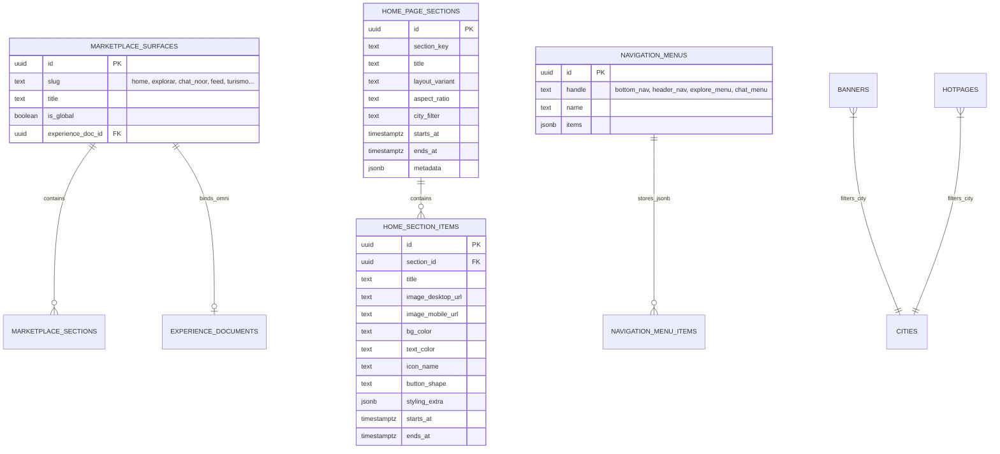

# SPEC-CMS-PAGE-BUILDER-UNIFIED-ARCHITECTURE: Arquitetura Unificada do CMS Master, Edição Página por Página, Subeditores Modulares, Omni Builder e Governança Geotemporal

- **Status:** DRAFT (Proposta para Aprovação)
- **Data:** 2026-11-02
- **Autor:** Antigravity Architect / Executive Board
- **Módulos Afetados:** `src/routes/admin-master.*`, `src/services/*cms*.functions.ts`, `src/components/shell/mobile-nav.tsx`, `src/components/chat/NoorChatBentoGrid.tsx`, `src/components/builder/OmniEditor.tsx`, `src/lib/constants/cities.ts`
- **Invariantes Vinculadas:** B.20 (Bilateralidade do CMS), B.29 (Programação Temporal e Auto-Arquivamento), B.32 (Layouts Híbridos de Vitrine), B.33 (Zero Fallbacks Sintéticos)

---

## 1. Contexto e Diagnóstico da Estrutura Atual

### 1.1 O Problema
Atualmente, a gestão de conteúdo visual, vitrines e menus no painel **Admin Master** encontra-se fragmentada em quatro telas isoladas que operam sob conceitos técnicos divergentes:
1. `/admin-master/home-editor`: Gerencia exclusivamente as tabelas `home_page_sections` e `home_section_items`. Apesar de conter seções críticas como o menu do Chat Noor (`chat_noor_bento`), sua interface assume que tudo pertence à Home.
2. `/admin-master/vitrines`: Gerencia `marketplace_surfaces` e `marketplace_sections`. Permite selecionar superfícies (como `home_mercado` ou `turismo`), mas opera apenas no nível de regras de consulta (`data_source`, `ranking_strategy`), sem permitir adicionar botões personalizados, imagens pontuais ou mídias individuais.
3. `/admin-master/banners`: Gerencia a tabela `banners` por *placement* (`home_hero`, `explore`, `top_bar`), desconectado do fluxo de montagem das páginas.
4. `/admin-master/botoes`: Gerencia a tabela `hotpages` (Cards Herói, Hubs de Categoria, Módulos Drawer). Mistura o conceito de página com o de botão de atalho.
5. **Navegação & Menus Mobile (`navigation_menus`):** Totalmente ausente do Admin Master. A barra de 5 abas inferiores (`MobileNav.tsx`) consome dinamicamente o *handle* `bottom_nav`, porém o editor só existia dentro do Workspace privado de lojistas (`workspace.cms.navegacao.tsx`).
6. **Omni Builder (`OmniEditor.tsx`):** O motor visual de 4.340 linhas estilo Wix Studio/Figma/Webflow estava restrito ao contexto de lojistas privados (`workspace.builder.$documentId.editor.tsx`), sem ponto de entrada para o Admin Master customizar visualmente páginas e vitrines da plataforma.

---

## 2. Mapa Completo de Elementos Existentes na Plataforma

### 2.1 Páginas Públicas e Suas Superfícies Vinculadas

| Página / Rota | Superfície / Chave | Componentes Visuais Principais | Fonte de Dados Atual | Onde Edita Hoje |
| :--- | :--- | :--- | :--- | :--- |
| **Início (`/`)** | `home` / `home_mercado` | `MetamorphicBannerSlider`, `NoorNativeCategoryDock`, `IFoodSquareCategoryButton`, `BentoGridTetris`, `HomePostsShowcase`, `ProceduralInfiniteFeed` | `home_page_sections`, `home_section_items`, `banners`, `hotpages` | `/admin-master/home-editor` e `/admin-master/banners` |
| **Explorar (`/explorar`)** | `explorar` | `BannerHeroCarousel`, `DiscoveryControlBar`, `CANONICAL_PILLARS`, Trilhos Horizontais de Classificados/Ofertas/Eventos/Vagas | `banners` (placement `explore`), `hotpages` (module `explorar`), pilares hardcoded | Banners em `/admin-master/banners`; pilares sem editor |
| **Chat Noor (`/chat`, Drawer)** | `chat_noor` / `chat_noor_bento` | `NoorChatBentoGrid` (Grade modular 3x2+1 com mobilidade integrada) | `home_page_sections` (`chat_noor_bento`) + `home_section_items` | Oculto em `/admin-master/home-editor` |
| **Feed Social (`/feed`)** | `feed` | Feed de publicações comunitárias, carrossel de comunidades em destaque, stories 9:16 | `mural_posts`, `community_posts`, `hotpages` (`module: feed`) | Banners em `/admin-master/banners`; cards em `/admin-master/botoes` |
| **Comunidades (`/comunidades`)** | `comunidades` | Grade de comunidades locais, diretório de tópicos e canais | `communities`, `community_members` | Parcialmente em `/admin-master/curadoria` |
| **Turismo (`/turismo`)** | `turismo` | Vitrine de pacotes, aéreos, hotéis, rodoviário, aluguel de carros (3 diárias), corporativo | `marketplace_surfaces` (`slug: turismo`) + `marketplace_sections` | `/admin-master/vitrines` |
| **Classificados (`/classificados`)** | `classificados` | Vitrine de veículos, imóveis e produtos, carrossel de destaques | `marketplace_sections`, `classified_items` | `/admin-master/vitrines` |
| **Guia / Places (`/diretorio`)** | `diretorio` | Lista telefônica comercial, busca por nicho e botão de WhatsApp direto | `places`, `directory_listings`, `banners` | `/admin-master/banners` |
| **Supermercado / Mercado (`/departamento`)** | `mercado` / `supermercado` | Leitor de código de barras, clube de cashback, encartes digitais | `marketplace_sections`, `products` | `/admin-master/vitrines` |

### 2.2 Inventário de Tipos de Seções, Layouts e Elementos

1. **Sliders & Carrosséis:**
   - `slim_slider`: Slider Fino Panorâmico Widescreen 28:9 (anti-corte de mídia, desktop e mobile).
   - `carousel`: Carrossel Deslizante Horizontal com snap scroll e traços de paginação.
   - `horizontal_scroll`: Menu deslizante contínuo tátil (padrão Noor / iFood).
   - `vitrine_vertical_carousel`: Carrossel vertical para Stories e Reels (9:16).
   - `rail_feature_card`: Trilho com Card Vertical Líder de Destaque (`HitsLeadCard`).
   - `rail_lead_banner`: Trilho com Banner Líder de Categoria.
2. **Grids e Layouts Modulares:**
   - `bento_grid`: Bento Grid Modular Tetris (spans flexíveis 1x1, 2x1, 2x2).
   - `grid_2d`: Grade Bidimensional (4 colunas desktop, 4x2 / 5x2 no mobile).
   - `grid_4col`: Grade Completa de 4 Colunas.
   - `grid_2col`: Grade Compacta de 2 Colunas.
   - `media_gallery_mosaic`: Galeria Mosaico Editorial com aspect-ratio fixado.
   - `cards_action_grid`: Grade de Cards / Botões 2x2.
3. **Botões, Chips e Atalhos de Ação:**
   - `IFoodSquareCategoryButton`: Botão quadrado 1:1, squircle, com badge promocional, imagem centralizada ou ícone vetorial.
   - `NoorBentoCard`: Card tátil do chat com micro-interações, mídia de upload ou ícone, background e badge.
   - `custom_buttons`: Grade de botões customizados com cor de fundo, cor de texto, borda e ícone.
   - `buttons_rail`: Trilho horizontal de chips e atalhos rápidos.
   - `DynamicMediaChip`: Chip tátil de alta conversão para vitrines.
4. **Banners e Faixas Promocionais:**
   - `banner_single_21_9`: Banner Único Panorâmico (21:9).
   - `banner_duo_16_9`: Banners Duplos Lado a Lado (16:9).
   - `banner_trio_bento`: Banners Triplos no formato Bento Box.
   - `promo_strip_timer`: Faixa Promocional com Contador Regressivo (Timer para Black Friday / Ofertas Relâmpago).
5. **Menus e Navegação:**
   - `bottom_nav`: Barra de Navegação Mobile Fixa de 5 Tabs (`MobileNav.tsx`).
   - `header_nav`: Barra Superior Global (`TopBar.tsx` / `UtilityCluster.tsx`).
   - `explore_menu`: Pilares e categorias da Página Explorar.
   - `chat_menu`: Grade modular de atalhos rápidos do Chat Noor.
   - `account_drawer`: Menu lateral do Drawer de Conta / Switcher de Contexto.

---

## 3. Requisitos EARS (Easy Approach to Requirements Syntax)

### 3.1 Requisitos Ubíquos (Ubiquitous Requirements)

- **UBIQ-01:** O sistema SHALL disponibilizar no Admin Master um **Hub Unificado de Páginas e Vitrines (CMS Master)** com dupla alternância de visualização:
  1. **Modo Página por Página:** O administrador seleciona a página desejada (`Início`, `Explorar`, `Chat Noor`, `Feed`, `Comunidades`, `Turismo`, `Classificados`, `Places`) e gerencia todos os seus elementos vinculados (Header, Banners, Seções, Menus, Sliders, Botões e Faixas Promocionais).
  2. **Modo por Módulo:** O administrador acessa subeditores especializados para operações transversais em lote (`Menus & Navegação`, `Banners & Sliders`, `Seções & Vitrines`, `Botões & Hotpages`).
- **UBIQ-02:** O sistema SHALL suportar em todo e qualquer elemento visual (banners, seções, botões, cards, menus e faixas) os três eixos de governança inteligente:
  1. **Geotargeting por Cidade (`city_filter` / `target_city`):** Opção "Todas as Cidades" ou vinculação a uma cidade canônica (`CANONICAL_CITIES`).
  2. **Agendamento de Publicação (`starts_at`, `ends_at`):** Data/hora de início e término automático.
  3. **Auto-Arquivamento e Validade (`auto_archive_at`):** Supressão automática da interface pública sem falhas de layout.
- **UBIQ-03:** O sistema SHALL garantir estilização visual avançada para botões, atalhos e cards, incluindo:
  - Upload de mídia bidirecional via bucket Supabase (`image_desktop_url` e `image_mobile_url`).
  - Picker de ícones vetoriais com suporte a upload de ícone/imagem personalizado.
  - Seletor de cor de fundo (`bg_color`) e cor de texto (`text_color`).
  - Seletor de gradiente (`gradient_type`: linear/radial, cores de início/fim).
  - Seletor de sombra (`shadow_mode`: `none`, `sm`, `md`, `lg`).
  - Seletor de geometria do botão (`button_shape`: `squircle`, `rounded-full`, `rounded-lg`).

### 3.2 Requisitos Orientados a Evento (Event-Driven Requirements)

- **EVENT-01:** WHEN o administrador clica em "Editar Menus Mobiles", o sistema SHALL abrir o subeditor de `navigation_menus` com suporte imediato à barra inferior (`bottom_nav`), menu do chat (`chat_menu`), menu explorar (`explore_menu`) e cabeçalho (`header_nav`), permitindo upload de ícone, badge e link de destino.
- **EVENT-02:** WHEN o administrador clica em "Abrir no Omni Builder" dentro de qualquer página do CMS Master, o sistema SHALL carregar o `OmniEditor` com o documento daquela página (`experience_documents` com escopo de plataforma), permitindo edição drag-and-drop e visualização responsiva simultânea (Desktop vs Mobile).
- **EVENT-03:** WHEN o administrador ativa o componente "Faixa Promocional com Timer" em uma página, o sistema SHALL solicitar data/hora de expiração, título, texto do CTA, link de destino e paleta cromática, renderizando na vitrine pública um cronômetro regressivo em tempo real (`days:hours:minutes:seconds`).

### 3.3 Requisitos Orientados a Estado (State-Driven Requirements)

- **STATE-01:** WHILE um banner, seção ou botão estiver fora do intervalo de agendamento (`starts_at > now` ou `ends_at < now`), as funções BFF SHALL omitir o registro das vitrines públicas e as interfaces SHALL omitir contêineres vazios, mantendo zero impacto no Cumulative Layout Shift (CLS < 0.05).
- **STATE-02:** WHILE o visitante navega sob uma cidade selecionada (ex: Chapecó), as queries de vitrine SHALL priorizar itens com `city_filter = 'Chapecó'` e mesclar itens globais (`city_filter IS NULL` ou `'all'`), ocultando itens restritos a outras localidades.

### 3.4 Requisitos de Comportamento Não Desejado (Unwanted Behavior / Guardrails)

- **UNWANT-01:** IF o upload de mídia para um botão ou banner for omitido ou falhar, THEN o sistema SHALL renderizar layout honesto baseado em cor sólida e tipografia legível, sendo expressamente proibido injetar imagens de estoque aleatórias ou renderizar tags `` quebradas.
- **UNWANT-02:** IF uma seção do tipo `bento_grid` ou `grid_2d` não possuir itens ativos cadastrados, THEN a seção inteira SHALL ser suprimida da renderização sem deixar lacunas vazias ou caixas órfãs.

---

## 4. Arquitetura de Dados Unificada

### 4.1 Mapeamento e Harmonização de Tabelas

### 4.2 Extensões de Schema Planejadas (Sem Quebra de Compatibilidade)
1. Inclusão de `styling_extra JSONB` em `home_section_items` e `marketplace_sections` para suportar:
   - `gradient`: `{ enabled: boolean, from: string, to: string, direction: string }`
   - `box_shadow`: `'none' | 'sm' | 'md' | 'lg'`
   - `timer_config`: `{ expires_at: string, urgency_label: string, badge: string }`
2. Vínculo bilateral de `marketplace_surfaces.experience_doc_id` apontando para `experience_documents.id` do Omni Builder, permitindo que qualquer página seja editada tanto pelo CMS estruturado quanto pelo Omni Builder.

---

## 5. Plano de Entrega e Fases de Execução

### Fase 1: Central de Navegação do Admin Master & Editor de Menus Mobiles
- Criação da tela `/admin-master/navegacao` para gerenciar diretamente `bottom_nav` (as 5 tabs do mobile), `header_nav`, `chat_menu` e `explore_menu`.
- Suporte a upload de mídia/ícone para cada tab ou botão, texto, badge e link de destino.

### Fase 2: Unificação do Editor Página por Página (`/admin-master/paginas`)
- Criação do seletor visual de página no topo:
  - Início (`/`)
  - Explorar (`/explorar`)
  - Chat Noor (`/chat`)
  - Feed Comunitário (`/feed`)
  - Turismo & Viagens (`/turismo`)
  - Classificados (`/classificados`)
  - Guia de Empresas & Places (`/diretorio`)
- Integração das seções existentes (`home_page_sections`, `marketplace_sections`, `banners`, `hotpages`) filtradas pela página ativa.
- Adição de botão "Editar no Omni Builder" que abre o construtor visual para aquela página.

### Fase 3: Motor de Estilização Completa & Componente de Timer (Black Friday)
- Expansão do modal de edição de botões/cards com upload de mídia bidirecional (desktop e mobile), seletor de gradiente, sombra e formato squircle.
- Criação do bloco `promo_strip_timer` com contador regressivo em tempo real e agendamento temporal.

### Fase 4: Governança Geotemporal Transversal
- Filtro de cidade (`CANONICAL_CITIES`) unificado em banners, seções, botões e menus.
- Agendamento de início (`starts_at`), término (`ends_at`) e auto-arquivamento (`auto_archive_at`).

---

## 6. Critérios de Aceite e Verificação

- [ ] A navegação do Admin Master possui links claros para "Páginas da Plataforma (CMS)" e "Menus e Navegação".
- [ ] O administrador consegue alterar os botões e ícones da barra inferior mobile (`bottom_nav`) e do menu do chat Noor (`chat_noor_bento`) com upload de imagem e persistência real no Supabase.
- [ ] A página Explorar lê seus banners e pilares a partir das tabelas gerenciáveis via CMS.
- [ ] Banners e cards com `ends_at` expirado desaparecem automaticamente das vitrines sem erros de runtime.
- [ ] Páginas suportam vinculação com documentos do Omni Builder para edição visual WYSIWYG.
- [ ] Zero erros de compilação TypeScript (`npm run typecheck` Exit Code 0).
- [ ] Build de produção aprovado (`npm run build` Exit Code 0).
- [ ] Aprovação na catraca de design lint (`node scripts/design-lint.mjs --ratchet`).
