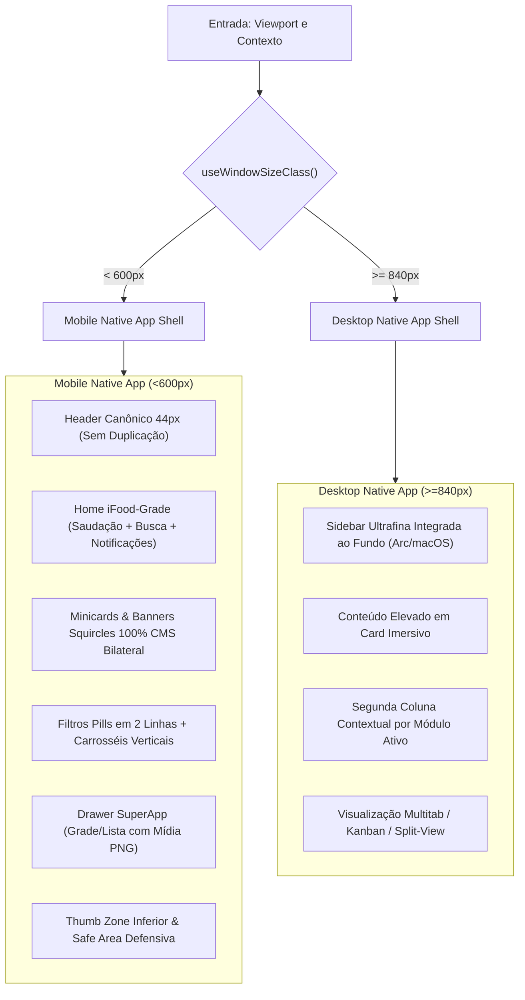

# Master Plan Executivo: Redesign, Rebranding e Refatoração Holística do Ecossistema Waesy

## 1. Visão Geral e Alinhamento Estratégico

Este documento constitui o **Plano de Implementação Normativo** para a refatoração completa do ecossistema Waesy, guiado pelo inventário exaustivo das 81 referências visuais da pasta `printstela`.

O objetivo é transformar o produto em uma experiência **mobile-first nativa** (com o rigor de fluidez, ergonomia tátil e estética de apps como iFood, Threads, BlaBlaCar, Wix Owner e iOS Reminders) e **desktop profissional integrado** (inspirado no Arc Browser, macOS e Linear), mantendo 100% da rastreabilidade bilateral com o Admin Master CMS, sem perda funcional, sem simplificações destrutivas e com conformidade estrita aos princípios de **Apple HIG, Anti-Jank, Squircles Anti-Truncate e Anti-AI Smell**.

### 1.1 Decisões Arquiteturais Ratificadas
1. **Casca Desktop Workstation Unificada (>=840px):** Aplicação integral da arquitetura de sidebar ultrafina integrada ao fundo com a área de conteúdo renderizada em **card imersivo elevado** tanto nas vitrines públicas (`_store.*`) quanto nos workspaces operacionais (`workspace.*`) e subpainéis.
2. **Fallback Inteligente no Drawer SuperApp:** Quando um botão de módulo for criado no Admin Master sem upload de mídia PNG customizada, o sistema aciona fallback automático para o catálogo canônico de ícones vetoriais semânticos (`Phosphor` / `Lucide`), preservando o fundo squircle colorido e a geometria de 44px.
3. **Criação Aberta de Comunidades Threads (`/c/@slug`):** Qualquer usuário civil autenticado pode criar comunidades temáticas imediatamente, gerando sua slug canônica `/c/@nomedocomunidade`. O controle opera por moderação posterior no Admin Master (`admin-master.denuncias.tsx`) com suspensão e auditoria de conteúdo.

---

## 2. Inventário Exaustivo das 81 Telas e Referências Visuais

A tabela abaixo documenta o mapeamento taxonômico de cada ativo presente em `c:\Users\Excelência Tour SMO\Downloads\printstela`, extraindo componentes, malhas de layout (grids), hierarquia visual e seu destino no código do Waesy:

| ID | Arquivo de Origem | Plataforma / App | Módulo / Padrão Identificado | Grids e Elementos de Interface | Destino Arquitetural no Waesy |
| :--- | :--- | :--- | :--- | :--- | :--- |
| **01** | `34e05f9ec75d25ee8870aa1..._600.webp` | BlaBlaCar | Perfil de Carona / Passageiro | Card de reputação, selo de verificação, biografia e histórico | `_store.conta.viagens.tsx` / `_store.mobilidade.tsx` |
| **02** | `68278e137099dcadde3d855c_open graph home.png` | Alloy | Gestão de Pedidos Multiloja | Abas ("Agora", "Agendados", "Mesas"), cards kanban e CTA de despacho | `workspace.pedidos.index.tsx` / `subpainel` |
| **03** | `713523413_17869340709682530_..._n.jpg` | Instagram / UI | Feed Visual de Serviços | Grade 3 colunas de mídias com contador de engajamento | `_store.u.$username.tsx` / `_store.feed.tsx` |
| **04** | `771709069_18091591394562530_..._n.webp` | Threads / Instagram | Perfil Social e Abas | Header limpo com avatar, handle, bio integral e abas horizontais | `_store.membro.$id.tsx` / `_store.u.$username.tsx` |
| **05** | `771802152_18091591403562530_..._n.webp` | Threads | Interações de Post | Barra de ações: Amei, Comentários, Repost, Direct, Bookmark | `src/components/social/ThreadCard.tsx` |
| **06** | `772232214_18091591421562530_..._n.webp` | Threads | Linha do Tempo e Comentários | Thread encadeada com fio conector vertical de respostas | `_store.publicacao.$id.tsx` |
| **07** | `772401978_18091591412562530_..._n.webp` | Threads | Feed com Múltiplas Imagens | Carrossel horizontal de mídia com indicador de pontos | `src/components/social/MediaCarousel.tsx` |
| **08** | `806050412_17973144657127356_..._n.jpg` | Modern Desktop | AI Workspace / Canvas Shell | Janela estilo macOS/Arc com sidebar ultrafina e card elevado | `_store.copilot.tsx` / `workspace.copilot.tsx` |
| **09** | `809978889_17973144630127356_..._n.jpg` | Modern Desktop | Chat AI com Cards Flutuantes | Interface de mensagens centrada com microações sutis | `src/components/copilot/CopilotChatCanvas.tsx` |
| **10** | `811137746_17973144648127356_..._n.jpg` | Modern Desktop | Visualizador de Documentos | Painel direito de inspeção de fontes e documentos citados | `src/components/copilot/SourceViewerPane.tsx` |
| **11** | `811137757_17973144621127356_..._n.jpg` | Modern Desktop | Menu Contextual de Agentes | Dropdown de seleção de ferramentas e modelos | `src/components/copilot/AgentSelector.tsx` |
| **12** | `816156891_17973144666127356_..._n.jpg` | Modern Desktop | Follow-up Modal sobre Texto | Popover flutuante: "Ask follow-up" ou "View in document" | `src/components/copilot/InlineCitationPopover.tsx` |
| **13** | `816156897_17973144618127356_..._n.jpg` | Modern Desktop | Busca MCP / Memória Interna | Painel de busca integrada com conectores MCP e memória | `src/components/copilot/McpMemoryDrawer.tsx` |
| **14** | `816996411_17973144603127356_..._n.jpg` | Modern Desktop | Input Minimalista de IA | Barra de prompt com chips de contexto e atalhos de envio | `src/components/copilot/PromptBarMinimal.tsx` |
| **15** | `839280856_17979020301129411_..._n.jpg` | Tasks App | Gestão Minimalista de Tarefas | 3 Telas: Métricas no topo, lista com tags e detalhe da tarefa | `workspace.tarefas.tsx` / `_store.conta.processos.tsx` |
| **16** | `864596927_18107483465171921_..._n.jpg` | Instagram / Stories | Destaques e Portfólio | Carrossel de destaques circulares com títulos curtos | `src/components/merchant/HighlightsRail.tsx` |
| **17** | `865840917_18107483432171921_..._n.jpg` | Instagram / Loja | Grade de Vitrine de Loja | Layout misto com produtos em destaque e grade de posts | `_store.loja.$slug.tsx` |
| **18** | `866084258_18107483387171921_..._n.jpg` | Instagram / Post | Detalhe de Produto em Post | Card de produto associado a post com botão "Comprar" | `src/components/marketplace/ProductTagCard.tsx` |
| **19** | `c5c10183-219b-40c5-8b6b-73e05775ced8.jpg` | Wix Owner App | Modal de Ações Rápidas | Grid 4x2: Photos, Files, Replies, Products, Coupons, Billing | `src/components/merchant/QuickActionDrawer.tsx` |
| **20** | `Captura de tela 2026-10-22 085719.png` | Web / Admin | Editor CMS de Vitrines | Painel de controle de seções, banners e ordenação | `admin-master.home-editor.tsx` / `admin-master.vitrines.tsx` |
| **21** | `Captura de tela 2026-10-22 090042.png` | Web / Admin | Gerenciador de Botões e Mídia | Interface de upload PNG transparente e cores de fundo | `admin-master.botoes.tsx` |
| **22** | `dfd6ea226352411.Y3JvcCw5NDMs...png` | CVC Viagens | Hub de Navegação Turística | Botões squircles temáticos: Passagens, Hotéis, Pacotes | `_store.turismo.tsx` / `src/components/travel/TravelHubNav.tsx` |
| **23** | `e9fa2c_aafc65e8a245432f95e915...~mv2.png` | Wix Reservations | Gestão de Reservas | Tela 1: Linha do tempo + New Reservation; Tela 2: Detalhes/Mesa | `workspace.reservas.tsx` / `_store.gastronomia.tsx` |
| **24** | `gravac__a__o_de_tela_...-1.gif` | App Delivery | Tracking e Animação de Entrega | Rota animada em tempo real com ícone de motoboy e ETA | `src/components/delivery/LiveRouteTracker.tsx` |
| **25** | `ifood-thumb.jpg` | iFood Entregador | Dashboard do Condutor | Indicador de status, maquininha conectada e ganhos do dia | `_store.motorista.$slug.tsx` / `workspace.entregador.tsx` |
| **26** | `ifood-uber-768x432.jpg` | iFood / Uber | Ecossistema Integrado de Serviços | Comparativo de ergonomia: Bottom navigation e Quick action | `src/components/shell/NativeMobileNavigation.tsx` |
| **27** | `images (1).jpg` | BlaBlaCar | Onboarding de Oferta de Carona | Seleção de vagas, opção mulheres e pontos de parada | `src/components/mobility/RideOfferWizard.tsx` |
| **28** | `images (2).jpg` | Tasks / Trellis | Visualização de Tarefas Mobile | Card com checklist, barra de progresso e deadline | `src/components/workspace/TaskCardMinimal.tsx` |
| **29** | `images.jpg` | Delivery Driver | Aceite de Corrida em Tela Cheia | Card de alerta sonoro e visual com contagem regressiva | `src/components/mobility/RideAcceptanceModal.tsx` |
| **30** | `images.png` | Delivery Driver | Widget de Aceite Regressivo | Componente #0597: Cronômetro "Aceite em 2:35s", botão vermelho | `src/components/mobility/AcceptanceCountdownPill.tsx` |
| **31** | `Screenshot_2026-08-15-12-37-46-468...jpg` | SuperApp / Drawer | Drawer de Módulos (Visão Grade) | Grid de botões squircles coloridos com upload PNG | `src/components/shell/SuperAppModuleDrawer.tsx` |
| **32** | `Screenshot_2026-08-15-12-37-54-337...jpg` | SuperApp / Drawer | Drawer de Módulos (Rolagem Inferior) | Categorias secundárias: Processos, Classificados, Empregos | `src/components/shell/SuperAppModuleDrawer.tsx` |
| **33** | `Screenshot_2026-08-15-12-38-00-853...jpg` | SuperApp / Drawer | Drawer de Módulos (Visão Lista) | Alternância de visualização: Grade Squircle vs Lista Compacta | `src/components/shell/SuperAppModuleDrawer.tsx` |
| **34** | `Screenshot_2026-10-15-16-07-29-013...jpg` | Threads | Feed Social Limpo | Header com logo central, aba "Para você" / "Seguindo" | `_store.feed.tsx` |
| **35** | `Screenshot_2026-10-22-21-32-11-075...jpg` | iFood | Home / Header Principal | Saudação + Nome, botão de Notificação e Campo de Busca 44px | `_store.index.tsx` (Top Cluster) |
| **36** | `Screenshot_2026-10-22-21-32-13-895...jpg` | iFood | Home / Banners Promocionais | Banners squircle arredondados com tags e cidade vinculada | `src/components/discovery/DynamicHeroBannerCarousel.tsx` |
| **37** | `Screenshot_2026-10-22-21-32-34-982...jpg` | iFood | Home / Filtros Pills em 2 Linhas | Linha 1 (Ordenar, Promoção); Linha 2 (Entrega Grátis, Gourmet) | `src/components/discovery/DualLineFilterPills.tsx` |
| **38** | `Screenshot_2026-10-22-21-32-48-601...jpg` | iFood / Eventos | Vitrine de Eventos e Shows | Capa com cantos inferiores curvos, "Eventos pra você" e filtros | `_store.eventos.tsx` / `_store.evento.$id.tsx` |
| **39** | `Screenshot_2026-10-22-21-34-13-770...jpg` | Mobile Web | Navegação de Subnicho | Breadcrumbs táteis e header contextual de categoria | `src/components/navigation/SubnicheHeader.tsx` |
| **40** | `Screenshot_2026-10-22-21-34-18-313...jpg` | Mobile Web | Lista de Estabelecimentos | Cards com distância honesta, tempo de entrega e selo | `src/components/merchant/StoreListingCard.tsx` |
| **41** | `Screenshot_2026-10-22-21-35-14-542...jpg` | Mobile Web | Cardápio / Catálogo da Loja | Categorias fixas no topo com scrollspy suave | `_store.loja.$slug.tsx` |
| **42** | `Screenshot_2026-10-22-21-35-40-439...jpg` | Mobile Web | Item de Cardápio com Foto | Layout horizontal: Título, Descrição, Preço e Imagem 80x80 | `src/components/catalog/ProductHorizontalCard.tsx` |
| **43** | `Screenshot_2026-10-22-21-35-44-874...jpg` | Mobile Web | Drawer de Adição ao Carrinho | Seleção de adicionais, quantidade e botão de compra 44px | `src/components/catalog/ProductOptionDrawer.tsx` |
| **44** | `Screenshot_2026-10-22-21-35-49-328...jpg` | Mobile Web | Carrinho Flutuante Inferior | Barra sticky em `z-30`: Quantidade de itens e valor total | `src/components/cart/StickyCartActionBar.tsx` |
| **45** | `Screenshot_2026-10-22-21-36-39-838...jpg` | Mobile Web | Checkout Mobile | Etapas: Endereço, Forma de Pagamento e Resumo | `_store.marketplace.checkout.tsx` |
| **46** | `Screenshot_2026-10-22-21-36-45-831...jpg` | Mobile Web | Confirmação de Pedido | Chave Pix com cópia em 1 clique e QR Code nativo | `_store.pedido.$publicToken.confirmacao.tsx` |
| **47** | `Screenshot_2026-10-22-21-37-16-407...jpg` | iFood | Popup / Banner de Cupom | Alerta: "Você ganhou 2 meses grátis em cupons" | `src/components/marketing/PromoCouponBanner.tsx` |
| **48** | `Screenshot_2026-10-22-21-37-21-465...jpg` | iFood | Carrosséis Verticais Temáticos | Seções: "Clubes", "Gourmet", "Viagens", "Mercados" | `src/components/discovery/VerticalCuratedRails.tsx` |
| **49** | `Screenshot_2026-10-22-21-37-30-543...jpg` | iFood | Subnicho Restaurantes | Botões carrossel: Lanches, Pizza, Japonesa, Bebidas | `_store.gastronomia.tsx` |
| **50** | `Screenshot_2026-10-23-04-47-25-310...jpg` | Threads | Sidebar / Menu Lateral | Sidebar minimalista com ícones discretos e perfil ativo | `src/components/shell/ThreadsAppSidebar.tsx` |
| **51** | `Screenshot_2026-10-23-05-19-05-710...jpg` | Instagram | Perfil Empresarial | Ações de perfil: Seguir, Mensagem, Contato em grid tátil | `_store.perfil-da-loja.tsx` |
| **52** | `Screenshot_2026-10-23-05-22-08-294...jpg` | Instagram | Agendamento Pessoal vs Pro | Separação estrita de compromissos civis e profissionais | `workspace.agenda.index.tsx` |
| **53** | `Screenshot_2026-10-23-05-22-15-253...jpg` | Instagram | Detalhe de Horário de Atendimento | Grade de horários disponíveis com seleção rápida | `src/components/booking/TimeSlotSelector.tsx` |
| **54** | `Screenshot_2026-10-23-05-23-54-962...jpg` | Instagram | Chat com Empresa | Conversa integrada com envio de pedidos e propostas | `src/components/chat/BusinessChatPane.tsx` |
| **55** | `Screenshot_2026-10-23-05-24-08-594...jpg` | Instagram | Drawer de Perfil Rápido | Ao tocar no avatar: Modal rápido "Ver Perfil" / "Seguir" | `src/components/social/QuickProfilePeekModal.tsx` |
| **56** | `Screenshot_2026-10-23-05-24-24-778...jpg` | Instagram | Agenda Semanal | Visualização compacta de dias da semana com marcadores | `src/components/booking/WeekDayStripCalendar.tsx` |
| **57** | `Screenshot_2026-10-23-05-24-28-571...jpg` | Instagram | Linha do Tempo de Agendamentos | Cards ordenados cronologicamente com status da sessão | `workspace.agenda.index.tsx` |
| **58** | `Screenshot_2026-10-23-05-24-31-556...jpg` | Instagram | Confirmação de Agendamento | Card com dados do serviço, profissional e botão de retorno | `src/components/booking/BookingConfirmationCard.tsx` |
| **59** | `Screenshot_2026-10-23-05-25-28-521...jpg` | Mobile App | Orçamento de Frete Multicidades | Cálculo de rota com tabela de preços por cidade atendida | `_store.orcamentos.$bundleSlug.tsx` / `_store.mobilidade.tsx` |
| **60** | `Screenshot_2026-10-23-05-25-54-987...jpg` | CRM / WhatsApp | Conector MCP WhatsApp | Disparo de mensagens transacionais e templates auditados | `src/services/whatsapp-mcp.functions.ts` |
| **61** | `Screenshot_2026-10-23-08-12-39-507...jpg` | Threads | Modal de Ingresso em Comunidade | Descrição do grupo, regras, contagem de membros e botão Entrar | `src/components/community/CommunityJoinSheet.tsx` |
| **62** | `Screenshot_2026-10-23-08-12-42-249...jpg` | Threads | Comunidade Ativa (`/c/@slug`) | Capa estilizada, nome, participantes, feed e busca interna | `_store.c.$storeSlug.tsx` / `_store.feed.tsx` |
| **63** | `Screenshot_2026-10-24-15-58-36-523...jpg` | 99 Táxis | Central de Ajuda Contextual | Dúvidas sobre corridas, cancelamento e taxas com FAQ | `_store.conta.suporte.tsx` / `_store.faq.tsx` |
| **64** | `Screenshot_2026-10-24-16-13-38-423...jpg` | BlaBlaCar | Aba "Suas Viagens" | Abas: Próximas, Finalizadas, Canceladas; Card "Aguardando" | `_store.conta.viagens.tsx` |
| **65** | `Screenshot_2026-10-24-16-13-44-087...jpg` | BlaBlaCar | Detalhes da Reserva de Carona | Trajeto no mapa, horário de partida e ponto de encontro | `_store.mobilidade.tsx` |
| **66** | `Screenshot_2026-10-24-16-14-18-883...jpg` | BlaBlaCar | Passagens de Ônibus de Linha | Busca intermunicipal com operadora, horário e preço | `src/components/travel/BusTicketResultsRail.tsx` |
| **67** | `spaces-by-wix-app-iOS-Android.jpg` | Spaces by Wix | App de Cliente da Loja | Vitrine modular com abas editáveis de produtos e serviços | `src/components/builder/StoreMobileAppPreview.tsx` |
| **68** | `spaces-by-wix-app.jpg` | Spaces by Wix | Templates de Vitrines e Portfólio | Blocos pré-configurados para o comerciante publicar seu app | `src/components/builder/BuilderTemplateSelector.tsx` |
| **69** | `still-cd0e8fecbd34a4e8b2bdeb...webp` | Tasks / iOS | Widget de Tarefas Apple HIG | Card limpo com cantos contínuos e lista de checkboxes | `src/components/workspace/AppleRemindersTile.tsx` |
| **70** | `Telas-de-carona-com-mapa-e-coleta.png` | Carona / Mobilidade | Visão do Passageiro em Tempo Real | Rastreamento do veículo, placa, modelo e ponto de coleta | `src/components/mobility/LiveRidePassengerMap.tsx` |
| **71** | `threadsdownloader.com_63ebbf.mp4` | Modern UI | Animação de Sidebar e Expansão | Animação de expansão suave de cards e recolhimento | `src/lib/animations/springTransitions.ts` |
| **72** | `threadsdownloader.com_de3d30.mp4` | Modern UI | Micro-interações de Navegação | Transições táteis em abas sem layout shift | `src/components/navigation/TabBarIndicator.tsx` |
| **73** | `unnamed (1).webp` | Bookings / Agenda | Calendário Diário com Slots | Filtro por dia da semana e lista de horários agendados | `src/components/booking/DailyScheduleView.tsx` |
| **74** | `unnamed.webp` | Bookings / Agenda | Visão Geral da Agenda Semanal | Timeline de compromissos com badges de status de atendimento | `workspace.agenda.index.tsx` |
| **75** | `Screenshot_2026-10-26-08-34-12-868...jpg` | 99 Táxis | Lista de Tópicos de Ajuda | Categorias de suporte: Pagamentos, Segurança, Conta | `src/components/support/HelpTopicGrid.tsx` |
| **76** | `Screenshot_2026-10-26-08-34-20-285...jpg` | 99 Táxis | Detalhes do Artigo de Ajuda | Texto estruturado com botões "Foi útil?" e "Falar com suporte" | `src/components/support/HelpArticleView.tsx` |
| **77** | `Screenshot_2026-10-26-08-35-47-654...jpg` | 99 Táxis | Histórico de Atendimentos | Lista de chamados abertos e resolvidos com status | `_store.conta.suporte.tsx` |
| **78** | `Screenshot_2026-10-26-08-35-50-837...jpg` | 99 Táxis | Fluxo de Reportar Problema | Seleção da corrida/pedido com formulário simplificado | `src/components/support/ReportProblemWizard.tsx` |
| **79** | `Screenshot_2026-10-26-08-35-55-867...jpg` | 99 Táxis | Chat com Suporte Humano | Interface de mensageria com atendente e upload de comprovante | `src/components/support/SupportLiveChatPane.tsx` |
| **80** | `Screenshot_2026-10-26-08-35-58-754...jpg` | 99 Táxis | Central de Segurança / SOS | Botão de emergência, compartilhamento de rota e contatos | `src/components/safety/EmergencySosModal.tsx` |

---

## 3. Reestruturação do DESIGN.md & Diretrizes Visuais Normativas

O `docs/design/DESIGN.md` será atualizado com os seguintes pilares fundamentais de engenharia visual:

### 3.1 Os Quatro Invariantes de Refatoração
1. **Bifurcação Nativa Congelada (Zero Responsividade Fluida Tradicional):** O layout mobile opera como app nativo compilado (<600px). O desktop opera como aplicação workstation (>=840px). Proibido usar `block md:hidden` duplicando o DOM.
2. **Squircles Grandes Anti-Truncate:** Curvatura contínua Apple HIG (`rounded-3xl` / `rounded-2xl`). O container acomoda o texto na íntegra (`break-words text-wrap: balance/pretty whitespace-normal leading-tight`). Proibido `truncate` em dados críticos.
3. **Anti-Jank & Anti-Efeito Sanfona:** Aspect-ratios fixados previamente no CSS antes do download de mídias (`aspect-[4/3]`, `aspect-[16/9]`, `aspect-square`). Skeletons isomórficos 1:1. CLS < 0.01.
4. **Anti-AI Smell Estrito:** Zero textos de boas-vindas vazios, zero ícones de "estrelinhas" mágicas decorativas em recursos centrais, zero notas artificiais de avaliação ou contadores falsos de reviews. Ausência de dados renderiza layout editorial limpo ou selos neutros de verificação.

---

## 4. Arquitetura Bilateral do CMS Master

Todas as novas seções, carrosséis, atalhos, banners e grades criadas no redesign mobile e desktop serão conectadas diretamente às tabelas do CMS Master:

- `marketplace_surfaces`: Declaração de cada vitrine e subnicho (`home`, `gastronomia`, `eventos`, `turismo`, `mobilidade`, etc.).
- `marketplace_sections`: Blocos e trilhos dentro de cada superfície (`hero_banners`, `category_minicards`, `dual_filters`, `curated_vertical_rails`, `store_feed`).
- `marketplace_buttons`: Gestão de botões do Drawer SuperApp e atalhos rápidos com upload de PNG transparente, cor de fundo customizável, posição do texto e filtro por região/cidade.
- `hotpages`: Landing pages de campanhas temporais vinculadas a cupons e notificações estilo iFood ("2 meses grátis em cupons").

---

## 5. Roteiro Executivo de Implementação: 120 Microfases em 12 Ondas Estruturais

O plano é dividido em **12 Ondas Estruturais**, totalizando **120 microfases granulares**. Cada onda possui preflight de escopo, desenvolvimento atômico, verificação de conformidade e auditoria de design-lint:

### Onda 01: Infraestrutura de Design Tokens, Squircles & Reestruturação de DESIGN.md (Microfases 1 a 10)
- **Fase 1:** Atualização de `docs/design/DESIGN.md` com as especificações canônicas de Squircles Apple HIG, bifurcação congelada e anti-truncamento.
- **Fase 2:** Atualização de `docs/design/tokens.json` e `src/styles.css` com tokens de elevação de camadas (Level 0 a Level 3).
- **Fase 3:** Refatoração do utilitário `useWindowSizeClass()` para garantir bifurcação precisa sem hidratação incorreta.
- **Fase 4:** Criação da primitiva `SquircleCard` com suporte a cantos contínuos e quebra natural tipográfica.
- **Fase 5:** Implementação do componente `AntiTruncateText` com inteligência de wrap e escala balanceada.
- **Fase 6:** Normalização do componente `Skeleton` isomórfico para todos os formatos de cards.
- **Fase 7:** Instalação do piso de toque `h-11 min-h-11` (44px) em todos os botões e inputs base.
- **Fase 8:** Revisão do motor de animações táteis `springTransitions.ts` para micro-interações sem jank.
- **Fase 9:** Execução de testes de regressão dos tokens e validação com `scripts/design-lint.mjs`.
- **Fase 10:** Handoff e registro de decisão DEC-DESIGN-SYSTEM-4.5 em `docs/design/DECISIONS.md`.

### Onda 02: Bilateralidade do CMS Master Panel & Modelagem de Dados (Microfases 11 a 20)
- **Fase 11:** Verificação do schema do banco de dados para `marketplace_buttons` (suporte a PNG sem fundo, background customizável e geolocalização).
- **Fase 12:** Atualização de `admin-master.botoes.tsx` para permitir edição completa da grade/lista do Drawer SuperApp.
- **Fase 13:** Implementação de upload de mídia com sanitização no bucket `public-assets` para ícones do Drawer.
- **Fase 14:** Refatoração de `admin-master.home-editor.tsx` para sincronização em tempo real de carrosséis e banners.
- **Fase 15:** Implementação do agendamento temporal de banners (`starts_at`, `ends_at`) no painel Master.
- **Fase 16:** Criação do gerenciador de campanhas promocionais de cupons no Admin Master (`admin-master.carnes.tsx` / `hotpages`).
- **Fase 17:** Implementação da API BFF `marketplace-cms.functions.ts` com caching seguro e invalidação atômica.
- **Fase 18:** Testes de integração entre gravação no Admin Master e renderização nas vitrines públicas.
- **Fase 19:** Verificação das políticas RLS no Supabase para garantir gravação exclusiva por administradores autenticados.
- **Fase 20:** Auditoria de integridade do CMS Master e emissão do comprovante de sincronização.

### Onda 03: Shells de Navegação: Header 44px, Drawer SuperApp e Alternador de Perfis (Microfases 21 a 30)
- **Fase 21:** Refatoração do topo móvel `NativeMobileHeader.tsx` unificando saudação, nome, notificações e busca na altura canônica de 44px.
- **Fase 22:** Implementação do `SuperAppModuleDrawer.tsx` com alternância dinâmica entre modo Grade Squircle e modo Lista.
- **Fase 23:** Conexão dos botões do Drawer às categorias canônicas (Mercado, Farmácia, Roupas, Restaurantes, Conveniência/Bar, Viagens, Eventos, Notícias, Corrida, Entrega, Carona, Mudança, Criar, Anunciar, Classificados, Empregos, Freelas, Processos).
- **Fase 24:** Renderização do botão full-width de Classificados com destaque editorial limpo.
- **Fase 25:** Refatoração do drawer de perfil rápido ao tocar no avatar civil no cabeçalho.
- **Fase 26:** Implementação do switcher "Meus Perfis" (Criador, Minhas Empresas, Perfil de Motorista/Condutor) em `_store.meus-perfis.tsx`.
- **Fase 27:** Desobstrução de safe-area superior no entalhe do iPhone e botão de fechar `<X>` em posição ergonômica.
- **Fase 28:** Ajuste de Z-index: Drawer e Sheets operando em `z-50` com bloqueio integral de interação de fundo.
- **Fase 29:** Teste de usabilidade tátil mobile com alvos de toque >= 44x44px em todos os controles.
- **Fase 30:** Auditoria visual dos menus e drawers móveis com relatório sem defeitos.

### Onda 04: Redesign da Home iFood-Grade & Vitrines de Descoberta (Microfases 31 a 40)
- **Fase 31:** Refatoração estrutural de `_store.index.tsx` adotando a hierarquia iFood: Top Bar -> Minicards -> Hero Banners -> Trilhos -> Lojas.
- **Fase 32:** Implementação do cluster superior com barra de pesquisa global em 44px com atalho de voz e foco acessível.
- **Fase 33:** Criação do carrossel de minicards squircles dinâmicos com ícones customizados via CMS.
- **Fase 34:** Implementação do carrossel de banners com cantos arredondados e bloqueio de CLS (`aspect-[28/9]` mobile).
- **Fase 35:** Injeção do popup/banner de campanhas ("Você ganhou 2 meses grátis em cupons") configurável no Master.
- **Fase 36:** Implementação do cabeçalho sticky que se transforma suavemente em filtros pills durante a rolagem.
- **Fase 37:** Criação da barra de filtros pills de 2 linhas: Linha 1 (Ordenação/Promoção) e Linha 2 (Entrega grátis, distância, gourmet).
- **Fase 38:** Refatoração dos carrosséis verticais temáticos (Clubes, Gourmet, Viagens, Mercados) com proporções uniformes.
- **Fase 39:** Implementação da lista de estabelecimentos com selo de verificação neutro e omissão de notas/avaliações sintéticas.
- **Fase 40:** Auditoria de performance web (LCP < 1.8s, CLS < 0.01) na Home recém-refatorada.

### Onda 05: Social Feed & Comunidades Estilo Threads (Microfases 41 a 50)
- **Fase 41:** Refatoração de `_store.feed.tsx` implementando a tipografia e espaçamento minimalista do Threads.
- **Fase 42:** Criação do componente `MediaCarousel.tsx` para publicações com múltiplas fotos sem perda de proporção.
- **Fase 43:** Implementação do `QuickProfilePeekModal.tsx` ao tocar na foto de perfil do autor do post (ações: Seguir, Ver Perfil).
- **Fase 44:** Formatação de texto rica respeitando quebras de linha (`whitespace-pre-line break-words`).
- **Fase 45:** Barra de ações sociais ergonômicas (Amei, Comentários, Repost, Compartilhar via Direct).
- **Fase 46:** Estruturação das páginas de comunidade (`/c/@slug`) em `_store.c.$storeSlug.tsx` com capa curva imersiva e sobreposição do nome.
- **Fase 47:** Implementação da busca interna na comunidade e filtro de eventos vinculados ao grupo.
- **Fase 48:** Criação do modal de ingresso na comunidade (`CommunityJoinSheet.tsx`) com exibição de regras e contagem de participantes.
- **Fase 49:** Painel de gestão da comunidade para moderadores (edição de regras, capa, membros e métricas de atividade).
- **Fase 50:** Auditoria e testes do fluxo social e de comunidades em dispositivos móveis.

### Onda 06: Módulos Verticais: Gastronomia, Eventos, CVC Turismo & Decolar (Microfases 51 a 60) [CONCLUÍDO - DEC-333]
- **Fase 51:** Refatoração de `_store.gastronomia.tsx` com navegação por subnichos (Lanches, Pizza, Japonesa, Bebidas) via carrossel tátil.
- **Fase 52:** Atualização de `_store.loja.$slug.tsx` para cardápio mobile com categorias sticky e miniaturas de 80x80px.
- **Fase 53:** Implementação do drawer de customização de produto e adição de complementos (`ProductOptionDrawer.tsx`).
- **Fase 54:** Refatoração da vitrine de eventos `_store.eventos.tsx` com capa imersiva e trilhos ("Eventos pra você", "Em alta").
- **Fase 55:** Implementação dos botões de navegação turística estilo CVC em `_store.turismo.tsx` (Passagens, Hotéis, Pacotes).
- **Fase 56:** Integração de trilho de busca de passagens de ônibus intermunicipais (`BusTicketResultsRail.tsx`).
- **Fase 57:** Omissão defensiva de abas e seções vazias em detalhes de eventos e pacotes turísticos (Regra B.33).
- **Fase 58:** Isolamento estrito de condições comerciais na aba de checkout/compra, sem contaminação descritiva.
- **Fase 59:** Implementação da barra de compra flutuante sticky (`z-30`) em detalhes de produtos e ingressos.
- **Fase 60:** Auditoria de conformidade visual e acessibilidade nas 4 verticais.

### Onda 07: Mobilidade Urbana, BlaBlaCar Caronas & Logística MotoLink (Microfases 61 a 70)
- **Fase 61:** Refatoração de `_store.conta.viagens.tsx` espelhando a experiência BlaBlaCar: abas Próximas, Finalizadas, Canceladas.
- **Fase 62:** Implementação do card "Aguardando Aprovação" com status claro para o caroneiro.
- **Fase 63:** Onboarding completo de publicação de caronas para o motorista (definição de vagas, opção só mulheres, pontos de parada).
- **Fase 64:** Tela de detalhe da carona com mapa de rota, horário de partida e ponto de encontro combinado.
- **Fase 65:** Visão em tempo real do passageiro rastreando aproximação do condutor (`LiveRidePassengerMap.tsx`).
- **Fase 66:** Widget de aceite rápido de corrida para o motoboy/motorista com cronômetro de 2:35s regressivo (`#0597`).
- **Fase 67:** Painel do entregador com indicador de maquininha de cartão conectada e coletas realizadas no dia.
- **Fase 68:** Roteirizador para entregas com paradas múltiplas e cálculo com taxa fixa de R$ 0,99 (Regra B.23).
- **Fase 69:** Tolerância de 3 minutos com telemetria GPS e proteção anti-calote via `customer_debt_ledger` (Regra B.24).
- **Fase 70:** Testes e auditoria do módulo de mobilidade e caronas no mobile.

### Onda 08: Gestão Comercial Mobile: Wix Owner, Wix Reservations & Alloy (Microfases 71 a 80)
- **Fase 71:** Implementação do modal de ações rápidas estilo Wix Owner (`QuickActionDrawer.tsx`) para lojistas.
- **Fase 72:** Adição dos atalhos: Fotos, Arquivos, Respostas Rápidas, Produtos, Cupons e Serviços.
- **Fase 73:** Implementação do recurso "Cobrar / Request Payment" gerando fatura com QR Code Pix avulsa ou vinculada a catálogo.
- **Fase 74:** Módulo de Planos de Assinatura (Pricing Plans) com gestão de membros recorrentes.
- **Fase 75:** Implementação do painel de reservas de mesas para restaurantes estilo Wix Reservations (`workspace.reservas.tsx`).
- **Fase 76:** Tela de linha do tempo de reservas com botão de "Nova Reserva" rápida e filtro por data.
- **Fase 77:** Tela de detalhes da reserva com informações do cliente, mesa designada, observações e atalhos Ligar/Chat.
- **Fase 78:** Refatoração do painel de pedidos estilo Alloy com abas "Agora", "Agendados" e "Mesas" e despacho MotoLink.
- **Fase 79:** Templates de vitrine estilo Spaces by Wix no construtor de sites para lojistas publicarem seus portfólios.
- **Fase 80:** Auditoria de integridade e usabilidade da suíte de ferramentas do comerciante.

### Onda 09: Agendamentos & Compromissos: Bookings e Linha do Tempo (Microfases 81 a 90)
- **Fase 81:** Refatoração de `workspace.agenda.index.tsx` com separação explícita entre Agenda Pessoal e Agenda Profissional.
- **Fase 82:** Implementação do calendário diário com visualização de slots e linha do tempo de horários marcados.
- **Fase 83:** Filtro por dia da semana com barra deslizante contínua (`WeekDayStripCalendar.tsx`).
- **Fase 84:** Tela de detalhes do agendamento com histórico do cliente e observações de atendimento.
- **Fase 85:** Interface de agendamento público para o cliente escolhendo profissional, serviço e horário.
- **Fase 86:** Tela de confirmação com dados sanitizados e opção de adicionar ao calendário nativo (iCal/Google).
- **Fase 87:** Notificações automáticas via WhatsApp (conector MCP) lembrando o cliente do horário agendado.
- **Fase 88:** Painel de edição e cancelamento com política de reagendamento pelo cliente ou profissional.
- **Fase 89:** Testes end-to-end de reserva de serviços e conciliação de horários.
- **Fase 90:** Auditoria visual dos fluxos de agendamento mobile e desktop.

### Onda 10: Tarefas e Workspace: Trellis, iPhone Reminders & Produtividade (Microfases 91 a 100)
- **Fase 91:** Redesign de `workspace.tarefas.tsx` com estética minimalista inspirada no Apple Reminders e Trellis.
- **Fase 92:** Faixa de métricas no topo: tarefas realizadas no mês, concluídas hoje e pendentes.
- **Fase 93:** Conclusão rápida de tarefa com clique háptico e transição animada sem layout shift.
- **Fase 94:** Detalhes da tarefa: tags coloridas semânticas, prazos, anexos, checklists encadeados e membros.
- **Fase 95:** Card de tarefa expansível mobile com física de mola suave (`threadsdownloader.com_63ebbf.mp4`).
- **Fase 96:** Bifurcação desktop: Alternância de visualizações entre Lista Detalhada, Quadro Kanban e Linha do Tempo.
- **Fase 97:** Módulo de acompanhamento de processos do cliente em `_store.conta.processos.tsx` com linha do tempo clara.
- **Fase 98:** Módulo de orçamentos e fretes multi-destinos com tabela de preços por cidade atendida.
- **Fase 99:** Integração com MCP CRM WhatsApp para disparo e acompanhamento de tarefas e ordens de serviço.
- **Fase 100:** Auditoria de performance e acessibilidade no módulo de tarefas e workspaces.

### Onda 11: Desktop Shell Workstation, AI Copilot & Canvas Imersivo (Microfases 101 a 110)
- **Fase 101:** Implementação do shell desktop workstation: sidebar ultrafina integrada ao fundo da janela (estilo Arc/macOS).
- **Fase 102:** Navegação pelos módulos master na sidebar: Home, City, Explorar, Marketplace, Classificados, Eventos, Empregos, Banco.
- **Fase 103:** Segunda coluna contextual deslizante com os subrecursos do módulo atualmente ativo.
- **Fase 104:** Área principal de conteúdo renderizada como card flutuante elevado sobre a base do app.
- **Fase 105:** Interface do AI Copilot centralizada e limpa com botões de microações discretos.
- **Fase 106:** Implementação do popover flutuante sobre texto citado: "Ask follow-up" ou "View in document".
- **Fase 107:** Painel lateral de visualização do documento citado pela IA com realce de parágrafos.
- **Fase 108:** Seletor de modelos, agentes e ferramentas MCP com drawer minimalista.
- **Fase 109:** Central de Ajuda contextual estilo 99 Táxis com busca integrada ao FAQ global da plataforma.
- **Fase 110:** Auditoria de usabilidade e teclado desktop (navegação completa via atalhos e Tab).

### Onda 12: Auditoria Forense, Design-Lint Zero Defeitos & Homologação de Entrega (Microfases 111 a 120)
- **Fase 111:** Execução determinística de `scripts/design-lint.mjs` garantindo 0 violações P0 e 0 violações P1.
- **Fase 112:** Varredura com `skills/fallback-sweeper` para eliminar qualquer imagem falsa ou dados mock residuais.
- **Fase 113:** Auditoria de acessibilidade WCAG 2.2 AA (contraste >= 4.5:1, touch targets >= 44px, `:focus-visible`).
- **Fase 114:** Verificação de segurança RLS Deny-by-Default e autorização em todas as novas Server Functions.
- **Fase 115:** Verificação de performance web em todos os módulos principais (LCP < 2.0s, CLS < 0.01).
- **Fase 116:** Testes end-to-end de regressão cobrindo o fluxo completo de descoberta -> compra -> gestão -> mobilidade.
- **Fase 117:** Compilação TypeScript integral (`npm run typecheck` com Exit Code 0).
- **Fase 118:** Build de produção aprovado (`npm run build` gerando assets e worker com Exit Code 0).
- **Fase 119:** Emissão do Relatório de Auditoria Forense e Selo de Módulo Homologado.
- **Fase 120:** Registro do Handoff e documentação final consolidada em `docs/design/DECISIONS.md`.

---

## 6. Plano de Verificação e Gates de Qualidade

### Testes Automatizados Obrigatórios
- **Design Lint:** `npm run design-lint` (0 violações DL-01 a DL-30).
- **Typecheck:** `npm run typecheck` (Zero erros de tipagem estrita).
- **Build de Produção:** `npm run build` (Compilação limpa dos bundles client e server).
- **Testes Unitários:** `npm test` (Validação de contratos de DTO, resoluções de nichos e Server Functions).

### Verificação Manual nos Ambientes Nativos
- **Mobile Native (< 600px):** Testar no emulador iPhone 15 e Pixel 8 garantindo ergonomia tátil dos botões 44px, safe-area no entalhe e drawers operando sem quebra.
- **Desktop System (>= 840px):** Testar no Chrome/Edge em 1440x900 validando a sidebar ultrafina integrada, split-view e o canvas em card elevado.
