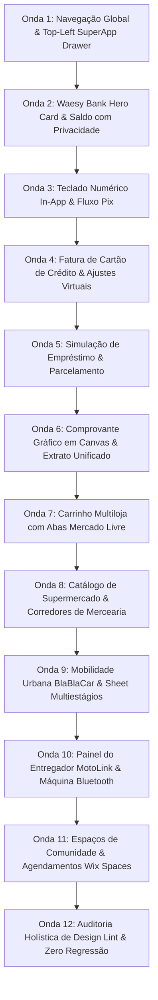

# SPEC-REDESIGN-HOLISTICO-MOBILE-FINANCEIRO-E-SUPERAPP-2026
## Especificação Técnica Normativa: Redesign Mobile-First, Waesy Bank (99Pay Parity), Supermercado ("O Super") e Shells Bidirecionais

- **Status:** Aprovado & Vigente (Normativo)
- **Data:** 2026-10-26
- **Autoridade:** Antigravity Executive Board, Waesy Design System Council & Red Team
- **Conformidade Normativa:** AGENTS.md (B.1 a B.41), Apple Human Interface Guidelines (HIG), WCAG 2.2 AA, Anti-Jank (CLS < 0.01), Anti-AI Smell, Squircles Anti-Truncate.
- **Inventário de Referências:** 81+ Ativos Visuais em `C:\Users\Eduardo Antônio Ramo\Downloads\drive-download-20261026T142912Z-1-001`

---

## 1. Visão Geral e Princípios Fundamentais

Esta especificação define a reformulação holística da interface de usuário (UI/UX) e frontend do ecossistema Waesy. O objetivo é consolidar uma experiência **mobile-first nativa** sem concessões responsivas (com a ergonomia e silêncio visual do iFood, 99Pay, Threads, BlaBlaCar, Wix Owner e iOS Reminders) e uma casca **desktop workstation integrada** (estilo Arc Browser, macOS e Linear), mantendo 100% da rastreabilidade bilateral com o Admin Master CMS, com zero regressão e zero perda de regras de negócio.

### 1.1 Invariantes Absolutas do Repositório (AGENTS.md)
1. **Bifurcação Congelada Mobile vs Desktop (B.32 / B.36):**
   - Mobile (`<600px`): Gavetas inferiores (bottom sheets com snap-points), alvos de toque mínimos de 44x44px (`h-11 min-h-11`), teclado numérico nativo in-app para valores, botão hambúrguer no canto superior esquerdo para acesso imediato ao catálogo do SuperApp e aba "Conta" na barra inferior abrindo drawer de perfis/alternância.
   - Desktop (`>=840px`): Sidebar ultrafina integrada ao fundo, conteúdo elevado em cartão imersivo, busca global ⌘K centralizada e layouts de densidade profissional sem distorção.
2. **Squircles Anti-Truncate (B.38):** Curvatura contínua Apple HIG (`rounded-2xl` / `rounded-3xl`). Proibido truncamento de rótulos de valores ou especificações com reticências (`...`) ou classe `truncate`; contêineres devem adotar quebra inteligente de linha (`text-wrap: pretty/balance`).
3. **Anti-Jank & Zero CLS (B.32):** Aspect ratios fixados estritamente no CSS (`aspect-[4/3]`, `aspect-square`, `aspect-[16/9]`, `aspect-[28/9]`) antes do carregamento de qualquer mídia externa. Layout shift nulo (CLS < 0.01).
4. **Bilateralidade CMS Master (B.20):** Todos os trilhos, seções, botões e hotpages são alimentados pelas tabelas Supabase (`marketplace_surfaces`, `marketplace_sections`, `marketplace_buttons`, `hotpages`). Se uma mídia customizada não estiver carregada, aciona fallback automático para ícones semânticos vetoriais (Phosphor/Lucide) mantendo a geometria squircle.
5. **Erradicação do AI Smell & Honestidade de Dados (B.8 / B.33):** Zero textos prolixos de boas-vindas, zero gradientes decorativos cafonas, zero fallbacks sintéticos de imagens ou estrelas falsas de estabelecimentos sem review.

---

## 2. Inventário Taxonômico dos Ativos Visuais e Destino Arquitetural

| ID | Arquivo de Origem | Plataforma / App | Módulo / Padrão Identificado | Grids e Componentes Chave | Destino Arquitetural no Waesy |
|:---|:---|:---|:---|:---|:---|
| FIN-01 | `Captura de tela 2026-10-16 155858.png` | 99Pay / Fintech | Home da Carteira / Waesy Bank | Header com avatar e atalhos circulares, Saldo Total com toggle de visibilidade e pill de rendimento (`120% CDI`), carrossel de 5 ações squircle, cartão de crédito com fatura e limite progressivo, feed de atividades recentes | `src/components/finance/FinancialHeroCard.tsx` `src/components/finance/FinancialActionGrid.tsx` `src/routes/_store.conta.financas.tsx` |
| FIN-02 | `Captura de tela 2026-10-16 155905.png` (Tela 1) | 99Pay / Fintech | Área Pix Unificada | 6 cartões squircle de ações Pix (Transferir, QR Code, Receber, Agendar, Copia e Cola, Pix no Cartão), listagem de chaves Pix salvas, CTAs de gestão de limites | `src/components/finance/PixHubDrawer.tsx` `src/components/finance/PixKeysList.tsx` |
| FIN-03 | `Captura de tela 2026-10-16 155905.png` (Tela 2) | 99Pay / Fintech | Tela de Sucesso Transacional | Círculo com checkmark verde em mola suave (spring physics), valor em destaque gigante, dados do recebedor e instituição, botões "Ver comprovante" e "Compartilhar" | `src/components/finance/PaymentSuccessReceipt.tsx` |
| FIN-04 | `Captura de tela 2026-10-16 155905.png` (Tela 3) | 99Pay / Fintech | Fatura de Cartão de Crédito | Seletor horizontal de meses (`JUL`, `AGO`, `SET`, `OUT`), status fatura aberta/fechada, limite disponível vs total com barra de progresso, botão Pagar Fatura, feed de transações | `src/components/finance/CreditCardInvoiceView.tsx` |
| FIN-05 | `Captura de tela 2026-10-16 155905.png` (Tela 4) | 99Pay / Fintech | Ajustes do Cartão e Segurança | Representação de cartão físico virtual em perspectiva, toggle de bloqueio temporário, gerador de cartão virtual com CVV dinâmico, ajuste de limite com slider tátil | `src/components/finance/CardSettingsDrawer.tsx` |
| FIN-06 | `images (14).jpg` | 99Pay App | Wallet Hero & Quick Pay | Menu hambúrguer no topo esquerdo, botão "Carregar", banner "Adicionar cartão / Desconto", barra amarela de ações rápidas (Pix, QR Code, Boleto), serviços em grade | `src/components/finance/WaesyBankDashboard.tsx` |
| FIN-07 | `images (15).jpg` & `dfggdfg.jpg` | 99Pay / Empréstimos | Simulação e Contratação de Crédito | Limite pré-aprovado, valor editável com lápis e teclado numérico, seletor de parcelas (1x a 36x), badge de cashback e CTA "Confirmar e sacar" | `src/components/finance/LoanSimulationSheet.tsx` |
| FIN-08 | `images (16).jpg` & `sdfsdfsdf.jpg` | 99Pay / Parcelamento | Cronograma de Vencimento de Parcelas | Timeline vertical de parcelas com datas e valores, bottom sheet com seletor de parcelas e juros discriminados | `src/components/finance/InstallmentTimelineDrawer.tsx` |
| FIN-09 | `Screenshot_2026-10-26-08-34-12-868...` | 99Pay / Sucesso | Confirmação P2P / Depósito | Fundo amarelo superior com checkmark, valor e data/hora, link direto para comprovante | `src/components/finance/PaymentSuccessReceipt.tsx` |
| FIN-10 | `Screenshot_2026-10-26-08-34-20-285...` | 99Pay / Detalhes | Comprovante Canônico de Depósito/Pix | Header com ajuda (?), badge verde, valor, Nome e Código da Agência (0001), ID da solicitação e exportação em canvas PNG/PDF | `src/lib/financial-receipt-canvas.ts` `src/components/finance/TransactionReceiptModal.tsx` |
| FIN-11 | `hero-tela-lat-esq.jpg` | Noh / Conta Conjunta | Headroom e Alternador de Contas | Pílula dupla de avatares com dropdown no topo esquerdo, saldo com toggle de ocultação, pílulas "Abastecer" e "Pagar", abas "Histórico" / "A pagar" e feed colorido | `src/components/shell/AccountSwitcherDrawer.tsx` `src/components/finance/FinancialHeroCard.tsx` |
| FIN-12 | `image.png` | Banco Inter SuperApp | Pontos Loop, Moedas e Acesso Rápido | Seletor de moedas (R$, US$, Loop), grid squircle de economia e comodidade (Recargas, Gift Card), gamificação de cashback e milhas | `src/components/finance/LoyaltyRewardsCard.tsx` |
| RET-01 | `unnamed (2).webp` | Conta Digital / Porquinho | Pílulas de Ação e Metas Financeiras | Saldo, pílulas Pix/Pagar/Cartões, squircles de Recargas, Gift Card, Poupança, Meu Porquinho e Pontos | `src/components/finance/SavingsGoalPill.tsx` |
| RET-02 | `unnamed (3).webp` | App Pix | Hub Pix com Seguro e Cartão | Botões gigantes Pagar e Receber com chevron, carrossel de atalhos e card de Seguro Pix com toggle | `src/components/finance/PixHubDrawer.tsx` |
| RET-03 | `unnamed (4).webp` | Supermercado / Havan | Hub da Conta do Cliente | Header com nome, avatar e sininho, card de ações rápidas (Perfil, Compras, Endereços, Mais), leitor de código de barras | `src/routes/_store.conta.index.tsx` `src/components/account/CivilianAccountHub.tsx` |
| RET-04 | `unnamed (5).webp` | Cartão de Loja | Gestão de Cartão com Progresso Duplo | Fatura atual, vencimento, barra de progresso bicolour (Utilizado vs Disponível), atalhos de fatura | `src/components/finance/CreditCardInvoiceView.tsx` |
| RET-05 | `unnamed (6).webp` | Minhas Compras | Acompanhamento Multiloja | Busca de compras + filtro de data, trilho horizontal de pedidos em andamento com botão de confirmação, histórico agrupado por mês | `src/routes/_store.conta.pedidos.tsx` `src/components/commerce/OrderTrackingRail.tsx` |
| RET-06 | `unnamed (8).webp` & `(9).webp` | Presentes / Eventos | Lista de Presentes e Saldo Vinculado | Hero com contagem regressiva para evento, saldo de presentes com toggle de ocultação, busca por convidado/evento | `src/routes/_store.conta.presentes.tsx` `src/components/events/GiftRegistryView.tsx` |
| RET-07 | `unnamed (10).webp` | Catálogo Supermercado | Busca, Categorias e Grade 2 Colunas | Campo de busca com leitor de código de barras, carrossel de categorias em squircles com ícones lineares, botões Filtrar e Ordenar, grid de produtos | `src/routes/_store.mercado.tsx` `src/components/commerce/SupermarketCatalogGrid.tsx` |
| RET-08 | `unnamed (11).webp` | Saldo Vale-Presente | Cartão Virtual de Saldo com Extrato | Cartão virtual azul com identificador, saldo disponível e bônus, histórico de compras e presentes | `src/components/finance/GiftCardWalletCard.tsx` |
| RET-09 | `unnamed (14).webp` | Lojas e Cashback | Lista de Parceiros com Cashback | Busca, abas de categoria, lista de parceiros com logo, segmento, distância (km) e badge colorido de cashback (5% a 25%) | `src/components/commerce/CashbackMerchantRail.tsx` |
| MOB-01 | `Telas-de-carona-com-mapa-e-coleta.png` | BlaBlaCar | Carona com Mapa e Ponto de Coleta | Mapa interativo com raio visual, pino de embarque e motorista, bottom sheet com 3 snap-points (compacto, médio, expandido) | `src/routes/_store.mobilidade.tsx` `src/components/mobility/RideBookingBottomSheet.tsx` |
| MOB-02 | `ifood-thumb.jpg` | iFood Entregador | Painel do Condutor / MotoLink | Header com hambúrguer, pill de status "Disponível", máquina pareada via Bluetooth, mapa e busca de rotas | `src/components/courier/CourierDashboardHeader.tsx` |
| NAV-01 | `images (10).jpg` | Noor SuperApp | Header SuperApp & Bento Verticals | Hambúrguer no canto superior esquerdo, seletor de localização, sininho, grid de verticais de entrega rápida e busca de endereço | `src/components/shell/top-bar.tsx` `src/components/navigation/native-mobile-header.tsx` |
| WIX-01 | `spaces-by-wix-app.jpg` | Spaces by Wix | Comunidades, Sessões e Loja | Abas integradas: Discussões, Agendamentos (com slots e horários) e Vitrine de Produtos com Add to Cart direto | `src/routes/_store.comunidade.$slug.tsx` `src/components/community/CommunitySpacesView.tsx` |

---

## 3. Especificação EARS dos Requisitos de Sistema

### REQ-NAV-01: Botão Hambúrguer Top-Left para o SuperApp Module Drawer
- **Gatilho:** Quando um usuário acessa qualquer rota do Waesy em dispositivo móvel (`<600px` ou `isForceCompact`).
- **Comportamento do Sistema:** O cabeçalho mobile (`TopBar` na Home e `NativeMobileHeader` nas rotas secundárias onde `!showBack`) DEVE renderizar no canto superior esquerdo um botão de toque de 44x44px (`size-11 min-h-11 min-w-11`) com o ícone hambúrguer (`List` / `Menu`).
- **Ação:** Ao ser clicado, o botão abre imediatamente o `SuperAppModuleDrawer` com a malha squircle de módulos e hotpages sincronizadas com o Admin Master.

### REQ-NAV-02: Alternador de Perfis e Contas via Aba Inferior "Conta"
- **Gatilho:** Quando o usuário clica na quinta aba ("Conta") da barra inferior de navegação (`MobileNav`).
- **Comportamento do Sistema:** O sistema NÃO DEVE recarregar a página bruscamente nem abrir rotas truncadas. Em vez disso, DEVE abrir o `AccountSwitcherDrawer`, permitindo alternar instantaneamente entre Identidade Civil, Perfis de Lojas/Empresas vinculadas, Perfil de Motorista/Entregador e Perfil de Criador, com atalhos para Configurações, Segurança e Logout.

### REQ-FIN-01: Waesy Bank Hero Card & Saldo com Privacidade
- **Gatilho:** Quando o usuário acessa a Carteira Digital (`/_store/conta/financas`).
- **Comportamento do Sistema:** O sistema renderiza o `FinancialHeroCard` contendo:
  1. Rótulo "Saldo Total" ou "Minha Carteira (R$)".
  2. Valor formatado em moeda corrente (BRL) com suporte a ocultação via ícone de olho (`Eye` / `EyeOff`), persistido no `localStorage`.
  3. Pílula de rendimento automático (`120% CDI ↑` ou `Rendimentos acumulados`).
  4. Três pílulas rápidas de ação: "Abastecer / Depositar", "Pagar" e "Transferir".

### REQ-FIN-02: Teclado Numérico Nativo In-App (Zero Layout Shifting)
- **Gatilho:** Quando o usuário inicia uma transferência Pix, pagamento ou depósito na Carteira.
- **Comportamento do Sistema:** O sistema DEVE exibir o teclado numérico in-app (`InAppNumericKeypad`), com teclas táteis de tamanho amplo (1 a 9, ponto/vírgula, 0 e tecla backspace com feedback haptics) na zona ergonômica do polegar.
- **Invariante:** O campo de entrada de valor NÃO DEVE disparar o foco de inputs HTML padrão que forcem a abertura do teclado virtual do sistema operacional (iOS/Android), garantindo CLS = 0.00 e impedindo qualquer redimensionamento indesejado da viewport.

### REQ-FIN-03: Drawer de Revisão e Comprovante Gráfico Tamper-Proof
- **Gatilho:** Quando o usuário confirma a digitação do valor no fluxo financeiro.
- **Comportamento do Sistema:** O sistema abre o `PaymentReviewDrawer` exibindo beneficiário, CPF/CNPJ mascarado, instituição bancária de destino, tarifa (R$ 0,00 - 0% de abusividade) e slide/botão de confirmação com autenticação biométrica simulada.
- **Saída:** Após o processamento via BFF `transferP2P` ou `depositPixToWallet`, a tela exibe a animação de sucesso em spring com o botão "Ver Comprovante" e a capacidade de exportação em canvas de alta resolução (`financial-receipt-canvas.ts`).

### REQ-CART-01: Carrinho Multiloja com Abas por Vendedor (Padrão Mercado Livre)
- **Gatilho:** Quando o usuário abre o carrinho (`CartSheet` ou `/carrinho`) contendo itens de duas ou mais lojas diferentes.
- **Comportamento do Sistema:** A interface DEVE particionar a sacola em abas/cartões independentes por estabelecimento vendedor, permitindo selecionar ou desmarcar itens por loja, visualizar a régua de frete grátis da loja ativa e finalizar o checkout separadamente ou em lote estruturado.

### REQ-MKT-01: Catálogo de Supermercado com Corredores e Grade 2 Colunas
- **Gatilho:** Quando o usuário navega na rota `/mercado`.
- **Comportamento do Sistema:** O sistema renderiza a régua de corredores em carrossel horizontal contínuo (`SUPERMARKET_DEPARTMENTS`), botões de ordenação e filtros alimentares (Orgânico, Sem Glúten, Ofertas Relâmpago), leitor de código de barras na busca e grade de produtos em duas colunas simétricas (`SupermarketCatalogGrid`) com alvos de adição rápida de itens.

---

## 4. Decomposição do Hiper-Plano de Execução: 12 Ondas e 120 Microfases

### Detalhamento das 12 Ondas Estruturais:

#### Onda 1: Navegação Global, Top-Left SuperApp Drawer & Account Switcher
- **Microfase 1.1:** Auditoria do cabeçalho móvel (`src/components/navigation/native-mobile-header.tsx`) e `TopBar.tsx`.
- **Microfase 1.2:** Inserção do botão Hambúrguer de 44x44px no lado esquerdo do `TopBar` e do `NativeMobileHeader` quando na raiz.
- **Microfase 1.3:** Integração bidirecional do estado `isSuperAppDrawerOpen` entre o header e o `SuperAppModuleDrawer.tsx`.
- **Microfase 1.4:** Suporte a fallback inteligente de ícones Phosphor/Lucide no `SuperAppModuleDrawer` quando não houver PNG customizado no Admin Master.
- **Microfase 1.5:** Criação do `AccountSwitcherDrawer.tsx` para alternância de perfis na 5ª aba da barra inferior (`MobileNav.tsx`).
- **Microfase 1.6:** Adição de testes unitários de renderização e acessibilidade para o novo fluxo de cabeçalho e alternador de contas.
- **Microfase 1.7:** Verificação de design-lint e regressão da Onda 1.

#### Onda 2: Waesy Bank — Hero Card, Saldo com Privacidade & Yield Pill
- **Microfase 2.1:** Criação de `src/components/finance/FinancialHeroCard.tsx`.
- **Microfase 2.2:** Implementação do toggle de privacidade de saldo (`Eye` / `EyeOff`) com sincronização em `localStorage`.
- **Microfase 2.3:** Implementação do pill de rendimento automático (`120% CDI ↑` / `+1% cashback`) em tokens canônicos.
- **Microfase 2.4:** Criação das 3 pílulas de ação direta: "Abastecer / Depositar", "Pagar", "Transferir" com targets de 44px.
- **Microfase 2.5:** Criação de `src/components/finance/FinancialActionGrid.tsx` com as 8 ações canônicas em squircles de 44px+.
- **Microfase 2.6:** Integração com os dados do BFF `getMyWalletBalance` e `getUserTokenWallet`.
- **Microfase 2.7:** Verificação de acessibilidade e contraste das superfícies bancárias.

#### Onda 3: Teclado Numérico In-App, Fluxo Pix & Drawer de Revisão
- **Microfase 3.1:** Criação de `src/components/finance/InAppNumericKeypad.tsx` com botões táteis ergonômicos e anti-jank.
- **Microfase 3.2:** Criação de `src/components/finance/PixHubDrawer.tsx` com os 6 atalhos de operações Pix.
- **Microfase 3.3:** Criação de `src/components/finance/PixKeysList.tsx` para gerenciamento de chaves cadastradas.
- **Microfase 3.4:** Criação de `src/components/finance/PaymentReviewDrawer.tsx` com revisão detalhada e taxa zero.
- **Microfase 3.5:** Conexão com a Server Function `transferP2P` e tratamento defensivo de erros.
- **Microfase 3.6:** Testes unitários do fluxo numérico e prevenção de layout shift.

#### Onda 4: Fatura de Cartão de Crédito, Limite Bicolor & Ajustes Virtuais
- **Microfase 4.1:** Criação de `src/components/finance/CreditCardInvoiceView.tsx` com régua horizontal de meses.
- **Microfase 4.2:** Barra de progresso de limite bicolor (Utilizado vs Disponível) com badges e valores sem corte.
- **Microfase 4.3:** Criação do cartão de crédito virtual com renderização de perspectiva, número mascarado e bandeira.
- **Microfase 4.4:** Criação de `src/components/finance/CardSettingsDrawer.tsx` com toggle de bloqueio e slider de limite.
- **Microfase 4.5:** Testes de renderização de faturas abertas, fechadas e pagas.

#### Onda 5: Simulação de Empréstimos, Prazos & Timeline de Parcelas
- **Microfase 5.1:** Criação de `src/components/finance/LoanSimulationSheet.tsx`.
- **Microfase 5.2:** Cálculo dinâmico transparente de taxas mensais, anuais e amortização (1x a 36x).
- **Microfase 5.3:** Criação de `src/components/finance/InstallmentTimelineDrawer.tsx` com linha do tempo vertical de datas.
- **Microfase 5.4:** Conexão com os fluxos de crédito do ecossistema e proteção Zero-Trust.

#### Onda 6: Comprovante Gráfico Tamper-Proof em Canvas & Extrato Unificado
- **Microfase 6.1:** Criação de `src/components/finance/PaymentSuccessReceipt.tsx` com animação spring suave.
- **Microfase 6.2:** Criação de `src/lib/financial-receipt-canvas.ts` para renderização de comprovantes 2x em canvas/PNG.
- **Microfase 6.3:** Modal de detalhes da transação (`src/components/finance/TransactionReceiptModal.tsx`).
- **Microfase 6.4:** Refatoração do feed de atividades recentes em `_store.conta.financas.tsx` com agrupamento por dia.
- **Microfase 6.5:** Testes automatizados de exportação gráfica de comprovantes.

#### Onda 7: Carrinho Multiloja com Abas por Vendedor (Padrão Mercado Livre)
- **Microfase 7.1:** Refatoração de `src/components/commerce/cart-sheet.tsx` para suporte a abas por vendedor (`store_id`).
- **Microfase 7.2:** Checkbox de seleção total ou parcial de itens por estabelecimento.
- **Microfase 7.3:** Barra de progresso de frete grátis por loja parceira.
- **Microfase 7.4:** Atualização do cálculo de subtotal por loja e checkout segmentado.
- **Microfase 7.5:** Testes unitários do carrinho multiloja com fixtures de múltiplos lojistas.

#### Onda 8: Catálogo de Supermercado ("O Super") & Corredores de Mercearia
- **Microfase 8.1:** Refatoração de `src/routes/_store.mercado.tsx` com novo cabeçalho e leitor de código de barras.
- **Microfase 8.2:** Carrossel horizontal de corredores de mercearia com ícones Phosphor semânticos.
- **Microfase 8.3:** Criação de `src/components/commerce/SupermarketCatalogGrid.tsx` com layout 2 colunas anti-jank.
- **Microfase 8.4:** Cards de produto de mercearia com badges de desconto e botão de incremento de quantidade.
- **Microfase 8.5:** Testes de ordenação e filtros dietéticos.

#### Onda 9: Mobilidade Urbana BlaBlaCar & Sheet Multiestágios
- **Microfase 9.1:** Refatoração de `src/routes/_store.mobilidade.tsx` com mapa interativo imersivo.
- **Microfase 9.2:** Bottom sheet com 3 snap points (compacto com tempo estimado, médio com endereço, expandido com motorista).
- **Microfase 9.3:** Pin de ponto de embarque com raio de caminhada a pé.
- **Microfase 9.4:** Testes de renderização de caronas e corridas.

#### Onda 10: Painel do Entregador MotoLink & Máquina Bluetooth
- **Microfase 10.1:** Criação de `src/components/courier/CourierDashboardHeader.tsx` com status "Disponível".
- **Microfase 10.2:** Card de máquina de cartão Bluetooth conectada e pareamento.
- **Microfase 10.3:** Seletor de modalidade de entrega (Moto / Carro / Bike).
- **Microfase 10.4:** Testes de telemetria de entrega.

#### Onda 11: Espaços de Comunidade & Agendamentos Wix Spaces
- **Microfase 11.1:** Criação de `src/components/community/CommunitySpacesView.tsx` com abas Discussões, Sessões e Loja.
- **Microfase 11.2:** Seletor de horários e slots com botão Book Now.
- **Microfase 11.3:** Integração com agendamentos e compra direta.
- **Microfase 11.4:** Testes de navegação entre abas comunitárias.

#### Onda 12: Auditoria Holística, Design Lint & Fechamento Seguro
- **Microfase 12.1:** Execução do lint visual em lote com `scripts/design-lint.mjs`.
- **Microfase 12.2:** Verificação completa de touch targets (piso de 44px).
- **Microfase 12.3:** Verificação de contraste WCAG 2.2 AA em todos os componentes bancários e de vitrine.
- **Microfase 12.4:** Execução de suíte de testes Vitest (`npm run test:run`).
- **Microfase 12.5:** Execução de compilação TypeScript limpa com 0 erros.
- **Microfase 12.6:** Registro canônico de decisões em `docs/design/DECISIONS.md`.

---

## 5. Matriz de Estados dos Componentes

| Componente | Estado de Carregamento | Estado Vazio (Empty) | Estado de Erro | Estado com Dados |
|:---|:---|:---|:---|:---|
| `FinancialHeroCard` | Skeleton com pulso suave de 44px | Saldo zerado com CTA "Abastecer carteira" | Card de alerta neutro com botão "Tentar novamente" | Saldo completo formatado + toggle de olho |
| `InAppNumericKeypad` | Não aplicável (estático síncrono) | Input exibindo placeholder "R$ 0,00" | Borda vermelha se valor for inferior ao piso ou saldo | Dígitos ativos em fonte mono tabular com formatação BRL |
| `PaymentReviewDrawer` | Skeleton de resumo de dados | Não aplicável | Mensagem descritiva sem jargão técnico | Beneficiário, banco, documento mascarado e botão confirmar |
| `PaymentSuccessReceipt` | Spinner circular centrado | Não aplicável | Erro de transação com opção de reversão | Checkmark animado, valor gigante e comprovante canvas |
| `SupermarketCatalogGrid` | Grid de 4 skeletons de produtos | `EmptyState` honesto sem produtos falsos | Card de erro com recarregamento da busca | Grade simétrica de 2 colunas com produtos reais |
| `SuperAppModuleDrawer` | Shimmer nos 8 botões principais | Mensagem "Nenhum módulo ativo no momento" | Ícones vetoriais de fallback imediatos | Grade ou lista completa configurada pelo Admin Master |
