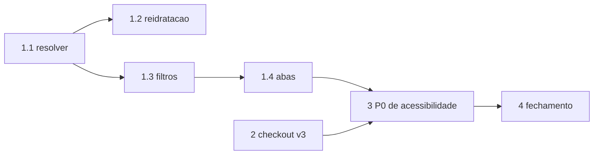

# SPEC: Refinamento Detalhado das Ondas Pendentes

- **Data:** 2026-10-23
- **Status:** Proposta. Aguarda aprovacao escrita (AGENTS.md B.5 passo 2). Nenhum codigo alterado.
- **Base:** `main` @ `60aadeef` (merge do PR #40), typecheck 0 erros.
- **Fontes:** `PLANO-MESTRE-CLASSIFICADOS-VITRINES-E-CHECKOUT-HOLISTICO.md`, `PLANO_MESTRE_CONTINUIDADE_E_REFINAMENTO_END_TO_END.md`, leitura direta do codigo.

## 1. Correcoes ao Diagnostico Anterior (evidencia no codigo)

| Item | Afirmado antes | Verificado | Consequencia |
| :--- | :--- | :--- | :--- |
| Lint P0 | 122 (relatorio versionado) | **73** apos o merge limpo (baseline congelada: 76) | Catraca passa. O relatorio versionado esta obsoleto e precisa ser regenerado e commitado |
| GAP-06 abas vazias | Abas sem gate | `classified-detail-mobile.tsx:160` e `desktop:159` ja gateiam "media" por `images.length > 1` | Gap reduzido: restam abas fixas e rotulo hardcoded "Infos do Pacote" |
| Barreira de inadimplencia | A implementar | `checkout.functions.ts:337` ja consulta `customer_debt_ledger` | Escopo reduzido a verificar UI de aviso e link de quitacao |
| GAP-01/02 filtros | Parcial | Hook `use-classified-catalog.ts` expoe agri/pharmacy/event; `classified-filter-sheet.tsx` e `_store.classificados.index.tsx:189-235` nao os declaram nem repassam | Confirmado. Falta interface, JSX e props |
| GAP-03/04 resolver | Divergencia de chaves | `canonical-specs-resolver.ts:762` le `power_hp ?? potencia`; `:763` le `attrs.cabin`; `novo.tsx:1169-1170` grava `power_cv` e `cabin_type` (string) | Confirmado. Potencia e cabine nunca aparecem na ficha |
| GAP-07 checkout | Taxa de porta via UPDATE | Confirmado e **mais amplo** (secao 3, Onda 2) | Ver Onda 2 |

## 2. Onda 1: Classificados, Nichos e Filtros

### 1.1 Alinhamento de chaves no resolver (Agro)
- **Arquivo:** `src/lib/classifieds/canonical-specs-resolver.ts` (bloco 758-790).
- **Alteracao:**
  - Potencia: `attrs.power_hp ?? attrs.power_cv ?? attrs.potencia`. Rotulo deve refletir a unidade da chave de origem ("CV" quando vier de `power_cv`, "HP" quando de `power_hp`). Nao converter valores.
  - Cabine: aceitar `cabin_type` (string: `cabin`, `platform`) e `cabin` (boolean legado). Mapa: `cabin`/`true` = "Cabinado com Ar"; `platform`/`false` = "Plataformado"; ausente ou desconhecido = omitir linha (B.33).
- **Isolamento B.37:** manter o gate de nicho agro antes de ler os atributos.
- **Testes (`canonical-specs-resolver.test.ts`):** presente `power_cv`; presente `power_hp`; ausente; `cabin_type=platform`; `cabin=true` legado; `cabin_type` invalido; vazamento: anuncio de servico com `power_cv` nao exibe potencia.
- **Aceite:** 12 testes atuais + novos verdes.

### 1.2 Reidratacao completa no modo edicao
- **Arquivo:** `src/routes/_store.conta.classificados.novo.tsx`.
- **Achado:** os `useState` de Agro e Farmacia (1165-1177) ja usam `initialData?.attributes?.*` como valor inicial. O `useEffect` de reidratacao (2767-2830) cobre imoveis, veiculos e assinaturas, mas nao Agro nem Farmacia. Quando `initialData` chega assincronamente (carga por `getPublicClassifiedById`, linha 433) o `useState` inicial ja foi consumido com vazio.
- **Alteracao:** acrescentar ao `useEffect` blocos para `category === "agri"` (hours_used/horimetro, traction/tracao, implement_type, year_fab, power_cv/power_hp, cabin_type) e `category === "pharmacy"` (subniche, retention_prescription, active_ingredient, manufacturer, anvisa_registry). Usar `!== undefined`, nunca truthiness, para nao descartar `false` e `0`.
- **Risco:** salvar com estado vazio sobrescreve atributos no banco. Teste de ida e volta obrigatorio: salvar, ler, editar, salvar sem tocar, comparar `attributes`.

### 1.3 Facetas no FilterSheet mobile
- **Arquivos:** `classified-filter-sheet.tsx` (interface 28-76 e desestruturacao 78+), `_store.classificados.index.tsx` (189-235).
- **Alteracao:** novas props `agriSubcategory`, `agriTraction`, `pharmacySubniche`, `pharmacyRetention`, `eventType` e seus setters. Os imports `AGRI_*`, `PHARMACY_SUBNICHE_OPTIONS`, `EVENT_TYPE_OPTIONS` ja existem no arquivo. Renderizar cada bloco somente quando `selectedCategory` corresponder.
- **Lacuna no hook:** `pharmacyRetention` nao existe em `use-classified-catalog.ts`. Criar estado, contar em `activeFiltersCount`, limpar em `handleClearAllFilters` e aplicar no filtro (`attributes.retention_prescription`).
- **Design:** chips `h-11 min-h-11`, `focus-visible:ring-2`, sem truncate (B.38), titulos com ate 6 palavras.
- **Aceite:** contagem de filtros ativos atualiza; limpar tudo zera; zero erro de console.

### 1.4 Abas de detalhe
- **Arquivos:** `classified-detail-mobile.tsx:154-165`, `classified-detail-desktop.tsx:153-164`.
- **Alteracao:** o rotulo "Infos do Pacote" (hardcoded) deve vir de `getNicheTabLabels`. A aba "overview" so aparece se houver especificacao, descricao ou bloco comercial; "seller" so com dados reais de anunciante. Extrair a logica duplicada para um unico hook/helper (B.2: proibido componente duplicado) consumido por mobile e desktop.
- **Aceite:** teste com anuncio sem fotos extras, sem descricao e sem especificacoes nao renderiza abas vazias.

## 3. Onda 2: Checkout Atomico

### Achados em `src/services/checkout.functions.ts`
1. A RPC `process_checkout_transaction_v2` (412-425) recebe carrinho, contato, frete, pagamento, gift card e afiliado. **Nao recebe** taxa de porta, order bump, lat/lng, notas, `custom_fields`, `receiver_info`.
2. Depois da RPC, o codigo faz `SELECT total_cents` e depois `UPDATE total_cents = leitura + taxa` (484-492, 507-517). Isso e leitura-modifica-escrita sem transacao: sob concorrencia ou falha entre RPC e UPDATE o pedido existe com total errado.
3. O order bump insere `order_items` e depois soma ao total, com `catch` que apenas faz `console.warn` (512-514): item pode ficar gravado sem total, ou o contrario.
4. `latitude` existe no schema Zod (213) mas nao e persistida em `orders` (sem `delivery_lat`/`delivery_lng` no UPDATE).
5. O abatimento `$WZ` roda depois (520+), fora da transacao principal.
6. O `catch` do bloco 462 engole erros do UPDATE: o cliente recebe sucesso com pedido inconsistente (viola B.31, sucesso ficticio).

### Alteracoes propostas
- **2.1 RPC v3** `process_checkout_transaction_v3`: aceita `p_door_delivery_fee_cents`, `p_delivery_to_door`, `p_delivery_location_type`, `p_order_bump` (jsonb), `p_delivery_lat`, `p_delivery_lng`, `p_notes`, `p_custom_fields`, `p_receiver_info`, `p_checkout_niche_metadata`, `p_use_wz_cents`. Calcula e grava tudo em uma unica transacao; o servidor recalcula valores, nunca confia no cliente (B.41). Mantem v2 ate migracao completa.
- **2.2 Frete multi-loja:** persistir `delivery_fee_cents` por pedido desmembrado e registrar a taxa fixa de R$ 0,99 (B.23) no ledger de cada pedido.
- **2.3 Erros:** remover `catch` silencioso; falha em qualquer etapa retorna erro tipado e faz rollback.
- **2.4 UI mobile:** `_store.checkout.tsx` em coluna unica abaixo de 600px, sem caixas aninhadas; barra fixa em `z-30`, folga `pb-32 pb-safe` (B.8, B.34).
- **2.5 Testes:** reaproveitar `marketplace-checkout.functions.test.ts` e `cart-lifecycle-end-to-end.test.ts`; novos casos: replay idempotente, falha no meio da transacao, taxa de porta com bump, divida pendente bloqueando.

> Esta onda exige migration SQL e mudanca de contrato financeiro. Pelo AGENTS.md B.10 (item 4) e B.31, nao aplico migration nem deploy sem confirmacao explicita.

## 4. Onda 3: Operacoes e Juridico (P0 de acessibilidade)

Distribuicao real de P0 (73): `components/app` 29, `routes/workspace` 20, `routes/store` 11, `components/tourism` 8, `routes/other` 4, `components/ui` 1.

- **Padrao de correcao (DL-15):** preferir trocar `div onClick` por `button type="button"` (semantica nativa). So usar `role="button"` + `tabIndex={0}` + Enter/Space quando o elemento nao puder ser botao (linha de tabela, card arrastavel). Sempre `focus-visible:outline-none focus-visible:ring-2 focus-visible:ring-ring` e alvo `min-h-11 min-w-11`.
- **Excecao:** container que so isola propagacao leva comentario `design-lint-ignore DL-15` com motivo e expiracao (padrao ja usado no PR #40).
- **3.1** `workspace.pedidos.gestor.tsx`: P0 de linhas e botoes de status; estilos de impressao termica (`style={{width:'80mm'}}`, DL-05) movidos para classe `@media print` em `styles.css`; avanco de status com mutacao otimista e rollback com toast em falha.
- **3.2** `workspace.advocacia.index.tsx`: cards de kanban com teclado; espacamentos na grade de 4px (DL-03).
- **Procedimento:** listar os 73 P0 por arquivo com `node scripts/design-lint.mjs` (sem `--help`, a ferramenta ignora flags desconhecidas e roda completo), corrigir em lotes de ate 8 arquivos, rodar lint e typecheck por lote.

## 5. Onda 4: Fechamento

- Regenerar `design-lint.report.json` e `LINT_DASHBOARD.md` (hoje mostram 122/FAIL por conflito de merge anterior).
- `npm run lint:design:update-baseline` somente com P0 = 0 e typecheck e build verdes.
- `npm run build` com Exit Code 0.
- Registrar DEC-324 em `docs/design/DECISIONS.md` com handoff de ate 12 linhas.

## 6. Ordem e Dependencias

Ondas 1 e 3 sao independentes da Onda 2 e podem rodar primeiro; a Onda 2 depende da decisao sobre migration.

## 7. Decisoes Pendentes do Humano

1. Autorizar a migration `process_checkout_transaction_v3` e quem a aplica no Supabase.
2. Ordem de execucao: Onda 1 antes da Onda 2 (recomendado) ou checkout primeiro.
3. Unidade da potencia agricola: exibir conforme a chave gravada (recomendado) ou padronizar tudo em CV na entrada.
4. Quantidade de P0 por lote na Onda 3 (proposto: 8 arquivos).

## 8. Definition of Done

Typecheck 0, build 0, testes verdes, lint com 0 P0 e 0 P1 nos arquivos tocados, matriz de estados (dados, loading, vazio, erro), alvos 44px, contraste AA, DECISIONS.md atualizado.
