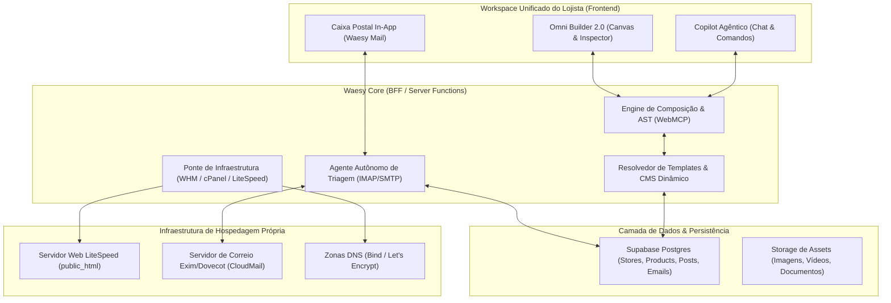
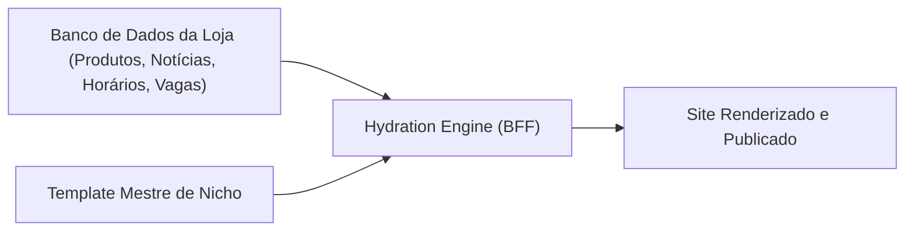
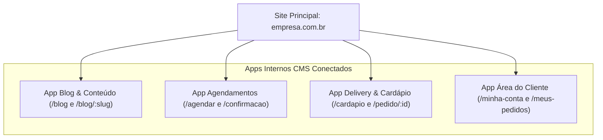
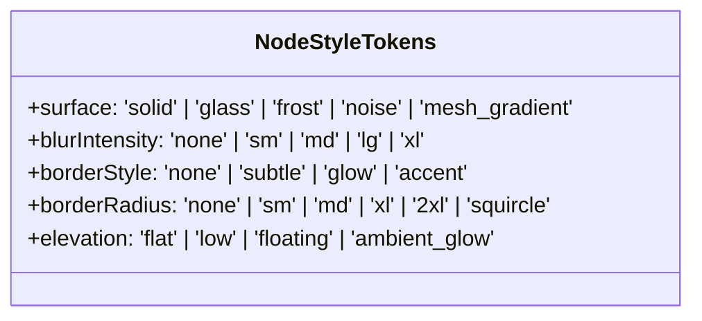
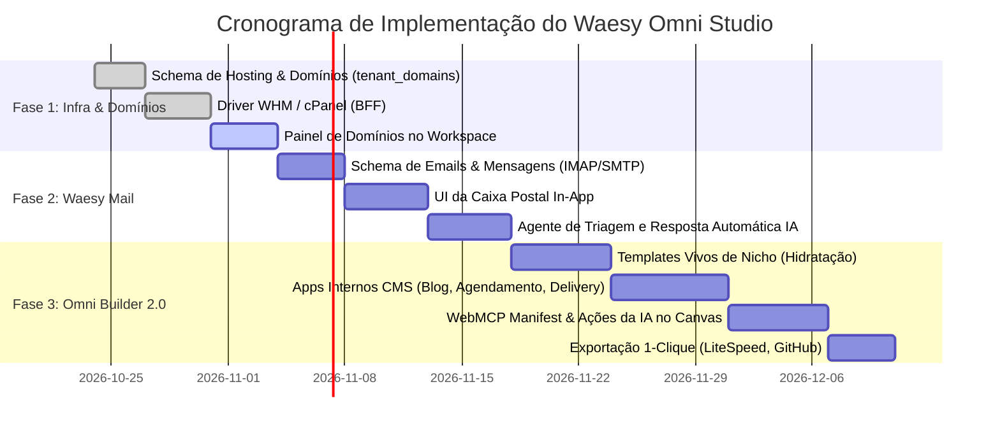

# Plano Mestre de Arquitetura: Waesy Omni Studio & Autonomous Cloud

---

## 1. Visão Executiva e Topologia do Sistema

O **Waesy Omni Studio** unifica três pilares de autonomia empresarial:
1. **Infraestrutura Autônoma de Hospedagem & DNS**: Provisionamento de contas cPanel/WHM com LiteSpeed e Let's Encrypt gratuito, descarregando o Cloudflare Pages.
2. **Caixa Postal Inteligente In-App (Waesy Mail Engine)**: Leitor e despachante de e-mail corporativo embarcado diretamente no workspace do lojista, conectado a agentes autônomos de IA para triagem, CRM e respostas automatizadas com RAG.
3. **Omni Builder 2.0 (Nicho-Oriented & CMS-Driven)**: Construtor visual de sites institucionais, e-commerces, cardápios e portais, alimentado por dados reais do banco de dados, enriquecido com Apps Internos CMS (multipáginas) e editável por IA via protocolo semântico WebMCP.



---

## 2. Caixa de E-mails In-App com IA Agêntica (Waesy Mail Engine)

### 2.1 Por Que Não Apenas um Redirecionamento Webmail?
Embora o CloudMail esteja disponível, a experiência de valor para o lojista ocorre quando os e-mails estão **integrados ao fluxo transacional**:
- Uma cotação por e-mail cria um lead automaticamente no CRM.
- Um comprovante de pagamento recebido altera o status de um pedido.
- A IA do Copilot lê a mensagem, consulta os produtos cadastrados e gera uma resposta persuasiva em 1 clique.

### 2.2 Arquitetura de Conexão IMAP / SMTP Segura
- **Leitura**: Conexão assíncrona IMAP via `imapflow` (ou pooling periódico via cron serverless).
- **Envio**: Conexão SMTP autenticada via `nodemailer` direto pela conta da hospedagem do cliente (`contato@empresa.com.br`).
- **Segurança**: Senhas de caixas de correio são criptografadas em repouso com chave simétrica AES-256-GCM antes de serem salvas em `corporate_email_accounts`.

### 2.3 Modelo de Dados do Waesy Mail
```sql
-- Mensagens e Threads de E-mail Sincronizadas
CREATE TABLE IF NOT EXISTS public.email_threads (
  id UUID PRIMARY KEY DEFAULT gen_random_uuid(),
  store_id UUID NOT NULL REFERENCES public.stores(id) ON DELETE CASCADE,
  account_id UUID NOT NULL REFERENCES public.corporate_email_accounts(id) ON DELETE CASCADE,
  subject TEXT NOT NULL,
  snippet TEXT,
  sender_address TEXT NOT NULL,
  sender_name TEXT,
  recipient_address TEXT NOT NULL,
  unread BOOLEAN DEFAULT true,
  category TEXT DEFAULT 'inbox' CHECK (category IN ('inbox', 'lead', 'order', 'support', 'finance', 'spam', 'archived')),
  ai_sentiment TEXT CHECK (ai_sentiment IN ('positive', 'neutral', 'urgent', 'angry')),
  ai_summary TEXT,
  last_message_at TIMESTAMPTZ DEFAULT now(),
  created_at TIMESTAMPTZ DEFAULT now()
);

CREATE TABLE IF NOT EXISTS public.email_messages (
  id UUID PRIMARY KEY DEFAULT gen_random_uuid(),
  thread_id UUID NOT NULL REFERENCES public.email_threads(id) ON DELETE CASCADE,
  store_id UUID NOT NULL REFERENCES public.stores(id) ON DELETE CASCADE,
  message_id TEXT NOT NULL, -- Message-ID RFC 2822
  direction TEXT NOT NULL CHECK (direction IN ('inbound', 'outbound')),
  from_address TEXT NOT NULL,
  to_addresses TEXT[] NOT NULL,
  cc_addresses TEXT[],
  subject TEXT NOT NULL,
  body_html TEXT,
  body_text TEXT,
  attachments JSONB DEFAULT '[]'::jsonb,
  is_read BOOLEAN DEFAULT false,
  created_at TIMESTAMPTZ DEFAULT now()
);
```

### 2.4 Habilidades do Agente Autônomo de Correio (Email Copilot)
1. **Triagem Automática**: Ao chegar uma mensagem, a IA classifica em: *Oportunidade Comercial*, *Dúvida de Horário/Atendimento*, *Fornecedor*, *Financeiro/Boleto*.
2. **Draft RAG Generator**: Se o remetente pergunta *"Vocês abrem no feriado e qual o valor da diária?"*, a IA consulta a tabela `stores.settings.business_hours_extended` e `travel_packages` daquela loja e redige o rascunho de resposta exato.
3. **Ações em 1 Clique**: Botões de ação contextuais: *"Criar Lead no CRM"*, *"Gerar Pedido"*, *"Criar Tarefa no Calendário"*.

---

## 3. Omni Builder 2.0: Templates Dinâmicos por Nicho

### 3.1 O Problema dos Builders Convencionais vs. Solução Waesy
Builders tradicionais entregam telas cheias de "Lorem Ipsum" que obrigam o usuário a recadastrar tudo. O **Omni Builder 2.0** opera com **Templates Vivos Hidratados (Data-Bound Templates)**.



### 3.2 Catálogo Canônico de Templates de Nicho
| Nicho / Vertical | Template Mestre | Seções Canônicas Pré-Configuradas | Fontes de Dados Dinâmicas (CMS) |
| :--- | :--- | :--- | :--- |
| **Institucional & Serviços** | `corporate_authority` | Hero com vídeo, Métricas de impacto, Grade de serviços, Equipe de especialistas, Depoimentos, Formulário de proposta. | `stores`, `specialist_team_grid`, `reviews`, `leads` |
| **Gastronomia / Restaurante** | `food_gourmet_flow` | Banner de destaque do Chef, Abas de cardápio interativo, Status de delivery/retirada em tempo real, Agendamento de mesa. | `products` (tag: cardapio), `stores.settings.business_hours`, `table_orders` |
| **Turismo & Receptivo** | `travel_wanderlust` | Buscador de pacotes, Roteiro interativo dia a dia, Destaques de hotelaria, Carrossel de experiências, Reserva com Pix. | `travel_packages`, `travel_itineraries`, `pix_payment` |
| **Imobiliária / Veículos** | `catalog_showcase` | Filtros de busca por finalidade (venda/locação), Ficha técnica detalhada, Carrossel de fotos, Botão de simulação e WhatsApp. | `classified_listings`, `canonical_specs` |
| **Landing Page de Conversão** | `high_conversion_lp` | Headline magnética, Vídeo de vendas (VSL), Grade de benefícios, Garantia, FAQ Accordion, Checkout ou captura de WhatsApp. | `marketing_campaigns`, `newsletter_leads` |
| **Portal de Carreiras (RH)** | `careers_employer` | Cultura da empresa, Depoimentos de colaboradores, Filtro de vagas em aberto, Formulário de candidatura com upload de PDF. | `careers_job_grid`, `job_applications` |

---

## 4. Apps Internos CMS: Páginas & Fluxos Multipáginas (Padrão Wix Apps)

Assim como o Wix utiliza "Apps" para injetar sistemas inteiros no site (Wix Stores, Wix Bookings, Wix Blog), no Waesy os **Apps Internos CMS** são coleções coordenadas de rotas, formulários e lógica transacional que podem ser acoplados a qualquer site:



### Detalhamento dos 4 Apps Internos Nativos:
1. **App Blog & Artigos**:
   - Cria automaticamente a listagem de posts com paginação, busca e tags.
   - Gera as rotas individuais de cada artigo com suporte a schema `Article` para SEO Google.
2. **App Agendamento & Serviços**:
   - Painel de seleção de profissional, serviço, data e horário.
   - Sincronização direta com a agenda do estabelecimento no Waesy Workspace.
3. **App Delivery & Sacola Rápida**:
   - Cardápio organizado por categorias, controle de adicionais (ex: borda recheada, molhos extras).
   - Checkout com cálculo de frete por CEP/Km e disparo direto para o WhatsApp da loja e painel de pedidos.
4. **App Central do Cliente / Portal**:
   - Acesso seguro via código OTP no WhatsApp do cliente.
   - Permite visualizar histórico de pedidos, baixar 2ª via de comprovantes e acompanhar entregas em tempo real.

---

## 5. IA Agêntica para Construção & Edição: Protocolo WebMCP de Blocos

Para que o Copilot consiga criar, alterar e reorganizar o site sem gerar código quebrado, cada bloco possui uma **Assinatura Semântica (WebMCP Manifest)**.

### 5.1 O Schema do Bloco (Tool Calling Contract)
```typescript
// Exemplo de Manifesto Semântico consumido pela IA
export interface BlockSemanticManifest {
  type: BlockType;
  category: "hero" | "commerce" | "content" | "social" | "conversion";
  description: string;
  supportedDesignTokens: Array<"glass" | "blur" | "noise" | "frost" | "gradient" | "squircle">;
  contentSchema: z.ZodObject<any>;
  dataBindingSources?: Array<"products" | "store_profile" | "news" | "jobs">;
}
```

### 5.2 Ações Atômicas que a IA Pode Executar no Site
A IA não substitui arquivos inteiros; ela despacha comandos cirúrgicos sobre a árvore de nós (AST do Builder):
1. `INSERT_BLOCK(parentId, position, blockType, initialProps)`
2. `UPDATE_BLOCK_COPY(nodeId, fieldPath, newText)` (ex: altera apenas a headline do hero)
3. `APPLY_STYLE_PRESET(nodeId, styleVariant)` (ex: aplica efeito `glass_dark` ou `frost_minimal`)
4. `BIND_DATA_SOURCE(nodeId, sourceCollection, filterRule)` (ex: vincula o carrossel aos produtos com desconto)
5. `REORDER_SECTIONS(newOrderArray)`
6. `REMOVE_BLOCK(nodeId)`

---

## 6. Motor de Estilização Avançada (Figma-Grade Design Engine)

O Omni Builder incorpora propriedades visuais modernas com garantia de performance e conformidade com o Design System do Waesy:



### Regras de Execução dos Estilos:
- **Glassmorphism / Frost**: Implementado via classes utilitárias CSS controladas: `bg-slate-900/60 backdrop-blur-xl border border-white/10`.
- **Noise Texture**: Padrão SVG leve injetado via pseudoelemento CSS em baixa opacidade (evita download de imagens pesadas).
- **Mesh Gradients**: Gerados via CSS com radial-gradients sobrepostos, eliminando CLS (Cumulative Layout Shift).
- **Squircles**: Raios contínuos de canto baseados na Apple Design Specification, mantendo o padrão tátil ergonômico.

---

## 7. Engenharia Reversa e Benchmark de Mercado

### 7.1 Análise Comparativa de Abordagens
| Plataforma | Mecanismo de Geração | Vantagens | Fragilidades | Decisão Adotada no Waesy |
| :--- | :--- | :--- | :--- | :--- |
| **Base44** | Blocos opinativos pré-prontos + IA para preenchimento de copy e estilo. | Interface limpa, alta confiabilidade, zero alucinação de layout. | Baixa flexibilidade para layouts fora da caixa. | **Adotada como baseline**: O Waesy usa blocos canônicos com props ricas. |
| **Bolt.new** | WebContainers no navegador + compilação Vite/Node local. | Flexibilidade extrema, roda qualquer pacote npm. | Pesado no browser, complexo para leigos, frágil para e-commerces. | Aproveitamos a UX de **Diff Visual e Chat Lateral**, mas com renderização server-side. |
| **Replit Agent** | Planejamento em grafo + execução via terminal/sandbox. | Constrói full-stack sob demanda. | Alto tempo de espera (2-5 min por geração). | O Waesy responde em **sub-segundos** porque monta a árvore de blocos AST. |
| **morluto/rea** | Exportação multi-destino (Vercel, Netlify, GitHub). | Liberdade para o desenvolvedor exportar o código. | Depende de serviços externos pagos. | **Incorporada**: 1-clique para Hospedagem Própria (CloudWeby), GitHub ou Netlify. |

### 7.2 O Pipeline de Exportação em 1-Clique (Multi-Destino)
O motor de exportação em [`src/services/builder-exporter.ts`](file:///c:/Users/Excelência%20Tour%20SMO/Documents/waesy/src/services/builder-exporter.ts) suporta 4 destinos:
1. **Hospedagem Própria Waesy (CloudWeby LiteSpeed)**: Gravação via SFTP/UAPI no `public_html` da conta cPanel do cliente (Destino Padrão e sem custos).
2. **GitHub Repository**: Cria repositório privado ou público com os arquivos do site via GitHub REST API v3.
3. **Netlify**: Deploy direto via Netlify ZIP Upload API ou Webhook.
4. **Vercel**: Deploy via Vercel Deploy Hook.

---

## 8. Roteiro de Implementação em Fases



---

## 9. Invariantes de Qualidade e Governança
- **Invariante de Desacoplamento de UI**: Nenhuma chamada ao cPanel/WHM ocorre diretamente no navegador. Todas as credenciais operam estritamente isoladas no BFF.
- **Invariante de Fallback Limpo**: Sites sem dados dinâmicos em determinados blocos (ex: loja sem vagas de emprego cadastradas) ocultam a seção silenciosamente sem quebras ou textos vazios.
- **Invariante de Performance (LCP < 1.2s)**: Todo site exportado para o LiteSpeed é gerado com HTML minificado, CSS crítico embutido e carregamento diferido de scripts.
