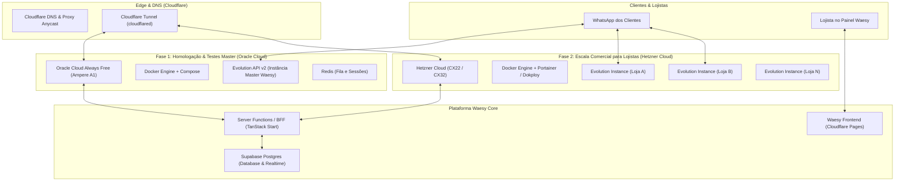

# Especificação de Infraestrutura: VPS, Docker & Orquestração Multi-Tenant de WhatsApp (Evolution API)

---

## 1. Visão Executiva e Topologia

O ecossistema **Waesy** opera com alta eficiência de custos e isolamento de tenants. Esta especificação formaliza a estratégia de infraestrutura para hospedar contêineres Docker da **Evolution API v2** (WhatsApp paralelo via `@whiskeysockets/baileys`), permitindo aos lojistas e ao master sincronizar mensagens, disparar notificações de pedidos e conectar fluxos de atendimento com IA.



---

## 2. Estratégia em Fases: Oracle Cloud (Fase 1) & Hetzner (Fase 2)

### 2.1 Fase 1: Oracle Cloud Always Free (Ambiente Master e Homologação)
- **Objetivo:** Instalação imediata do Docker e Evolution API v2 para validação interna, testes do ecossistema Waesy Go, disparo de autenticação civil e notificações transacionais do marketplace sem custo de infraestrutura.
- **Provedor:** Oracle Cloud Infrastructure (OCI).
- **Recursos Gratuitos (Always Free):**
  - Instância Compute **Ampere A1 (ARM64)** com até 4 OCPUs e 24 GB de memória RAM.
  - 200 GB de armazenamento SSD NVMe em blocos.
  - IP público estático IPv4 incluso sem cobrança.
  - 10 TB de tráfego de saída mensal gratuito.
- **Contêineres Ativos:**
  1. `evolution-api:v2` (Porta interna 8080).
  2. `redis:alpine` (Gerenciamento de cache de instâncias, webhooks e sessões do WhatsApp).
  3. `cloudflared` (Túnel seguro para publicação de rotas sem necessidade de abrir portas 80/443 no firewall da Oracle).

### 2.2 Fase 2: Hetzner Cloud (Expansão Comercial Multi-Tenant)
- **Objetivo:** Fornecer como serviço pago ou módulo adicional do plano Waesy para que os clientes e lojistas conectem seus próprios números de WhatsApp corporativo de forma isolada e profissional.
- **Provedor:** Hetzner Cloud (Falkenstein / Nuremberg / Finlândia).
- **Custo-Benefício:**
  - Instâncias **CX22 / CPX21** a partir de € 3,79 a € 5,50/mês (~R$ 24 a R$ 35/mês).
  - 2 a 3 vCPUs dedicadas/compartilhadas AMD EPYC, 4 GB a 8 GB de RAM e 40 GB a 80 GB de NVMe.
  - 20 TB de tráfego de rede por instância com porta 10 Gbps.
- **Modelo de Negócio e Concessão:**
  - Cada lojista adquire sua instância isolada de WhatsApp via Waesy Workspace.
  - O painel do Waesy dispara via API a criação da instância (`/instance/create`) na Evolution API da Hetzner.
  - O QR Code de conexão é renderizado diretamente na interface do Waesy (`_store.configuracoes.whatsapp` ou `workspace.whatsapp`).
  - Webhooks bidirecionais transmitem eventos de mensagens recebidas para a fila do Supabase / BFF.

---

## 3. Guia de Instalação e Execução Docker na Oracle Cloud (Fase 1)

### 3.1 Provisionamento da Máquina (Ubuntu 24.04 LTS ARM64)
1. Acessar o console da Oracle Cloud: **Compute > Instances > Create Instance**.
2. Escolher a imagem: **Ubuntu 24.04 LTS (Minimal ou Standard)**.
3. Shape: **VM.Standard.A1.Flex** (Definir 2 OCPUs e 12 GB de RAM ou 4 OCPUs e 24 GB de RAM).
4. Baixar a chave SSH privada (`id_rsa`).
5. Conectar via terminal:
   ```bash
   ssh -i id_rsa ubuntu@<IP_PUBLICO_ORACLE>
   ```

### 3.2 Instalação do Docker e Docker Compose
Executar no terminal da instância Ubuntu:
```bash
# 1. Atualizar repositórios do sistema
sudo apt update && sudo apt upgrade -y

# 2. Instalar Docker oficial via script automatizado
curl -fsSL https://get.docker.com -o get-docker.sh
sudo sh get-docker.sh

# 3. Adicionar o usuário ubuntu ao grupo docker
sudo usermod -aG docker ubuntu
newgrp docker

# 4. Validar instalação
docker --version
docker compose version
```

### 3.3 Configuração do `docker-compose.yml` para Evolution API v2
Criar o diretório de trabalho:
```bash
mkdir -p ~/waesy-evolution && cd ~/waesy-evolution
nano docker-compose.yml
```

Conteúdo de produção:
```yaml
version: '3.8'

services:
  redis:
    image: redis:alpine
    container_name: waesy-redis
    restart: always
    command: redis-server --appendonly yes --requirepass "SenhaForteRedisWaesy2026"
    volumes:
      - redis_data:/data
    networks:
      - waesy-net

  evolution-api:
    image: atendai/evolution-api:v2.1.1
    container_name: waesy-evolution-api
    restart: always
    ports:
      - "8080:8080"
    environment:
      - SERVER_URL=https://whatsapp-api.usewaesy.com
      - AUTHENTICATION_API_KEY=ChaveMestraWaesySuperSegura2026
      - DATABASE_ENABLED=false
      - CACHE_REDIS_ENABLED=true
      - CACHE_REDIS_URI=redis://:SenhaForteRedisWaesy2026@redis:6379/1
      - CACHE_REDIS_PREFIX_KEY=evolution
      - CACHE_REDIS_SAVE_INSTANCES=true
      - DEL_INSTANCE=false
      - WEBHOOK_GLOBAL_ENABLED=true
      - WEBHOOK_GLOBAL_URL=https://usewaesy.pages.dev/api/webhooks/whatsapp
      - WEBHOOK_GLOBAL_WEBHOOK_BY_EVENTS=true
      - WEBHOOK_EVENTS_MESSAGES_UPSERT=true
      - WEBHOOK_EVENTS_CONNECTION_UPDATE=true
      - WEBHOOK_EVENTS_QRCODE_UPDATED=true
    volumes:
      - evolution_instances:/evolution/instances
    networks:
      - waesy-net
    depends_on:
      - redis

volumes:
  redis_data:
  evolution_instances:

networks:
  waesy-net:
    driver: bridge
```

Subir os contêineres:
```bash
docker compose up -d
docker ps
```

---

## 4. Conexão Segura com Cloudflare Tunnel (Sem Abrir Portas no Firewall)

Para garantir segurança Zero-Trust e evitar ataques diretos ao IP da VPS:
1. Instalar o `cloudflared` na instância Oracle:
   ```bash
   curl -L --output cloudflared.deb https://github.com/cloudflare/cloudflared/releases/latest/download/cloudflared-linux-arm64.deb
   sudo dpkg -i cloudflared.deb
   ```
2. Autenticar com a conta Cloudflare:
   ```bash
   cloudflared tunnel login
   ```
3. Criar o túnel:
   ```bash
   cloudflared tunnel create waesy-whatsapp-tunnel
   ```
4. Apontar o subdomínio `whatsapp-api.usewaesy.com` para o serviço local `http://localhost:8080`:
   ```bash
   cloudflared tunnel route dns waesy-whatsapp-tunnel whatsapp-api.usewaesy.com
   ```
5. Iniciar o serviço contínuo do túnel:
   ```bash
   sudo cloudflared service install
   sudo systemctl start cloudflared
   ```

---

## 5. Fluxo de Integração com o Waesy BFF & Lojistas

1. **Geração do QR Code no Painel:**
   - O lojista clica em "Conectar WhatsApp" no painel.
   - O BFF chama `POST https://whatsapp-api.usewaesy.com/instance/create` com o slug da loja.
   - A Evolution API responde com o base64 do QR Code.
   - A interface renderiza o QR Code na tela para leitura pelo app do WhatsApp.
2. **Recebimento de Eventos via Webhook:**
   - Quando o status da conexão muda para `open`, o webhook avisa o BFF.
   - A tabela `stores_integrations` ou `store_whatsapp_sessions` é atualizada com `status: 'connected'`.
3. **Disparo Transacional de Mensagens:**
   - Pedido criado / Atualização de status / Ingressos de eventos:
   - A server function dispara `POST https://whatsapp-api.usewaesy.com/message/sendText/{instance}` com payload assinado.
